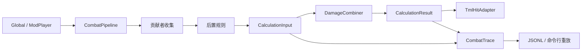

# Calculate 类型与接口设计

> 2026-10-22 按代码同步：Core、TML 调度、四条 Hook、加载生命周期、原生字段适配和 JSONL 重放已实现。本文描述当前接口；明确标注为后续的功能尚未实现。双职业桥接设计已于本日撤销，见根目录 [CHANGES.md](../CHANGES.md)。代码实现、离线验证和实机验收分别记录，见第 9 节与 [TODO.md](TODO.md)。

## 当前已实现边界

- 2026-10-23：ReactionSlotCount 已扩为 20（0..19），元素仍为 10 槽，擢升仍为 4 槽；新增空槽不自动启用。ElementTarget 已共用该容量保存目标 CD，见 [Element-Design.md](Element-Design.md)；单人游戏入口已接入并通过真实客户端测试，见 [Element-Usage.md](Element-Usage.md)。
- 扩容后逐槽结果结构变化，Trace 规则集版本升为 calculate-2（SchemaVersion 仍为 1），旧 calculate-1 记录拒绝重放，不将版本差异误报为计算差异。Core 23/23 与主项目构建通过。

- `Basic/Tag/TagEnum.cs` 保留作者当前的 15 项枚举；`Tag.cs` 提供 TagEntry 与 TagSet。同类型标签不可重复，只读，不实现覆盖、继承或修改。
- Core 已包含六类自定义目标、HitSnapshot、CalculationInput、来源与候选记录、HitProposalCollector、DamageCombiner 和 CalculationResult。
- ContributionWriter 与 GateWriter 当前放在 Core：只依赖纯数据，绑定身份与作用域，不读取 TML 实体。TML 调度器已通过该收集器调用写入器。
- 元素反应系数槽提交增幅，按 `1 + Σ增幅` 计算，无贡献时为 1；已登记当前标签注释对应的 12 条基础映射。ReactionFactor 独立输出，与 ResistanceFactor 依次写入 SourceDamage 乘法项；AfterDefenseFactor 写入 FinalDamage 乘法项。两个适配重载已通过 CombatPipeline 接入四条 Hook；自定义因子先合入 NativeModifierPlan，适配器只应用一次。实机行为待验证。
- 贡献者使用 `[CombatContributor(1001)]` 特性声明整数 ID。已接入项目构建链的分析器对冲突报告 ADVCalc001 错误；运行时由 CombatContributorAttribute.GetId(Type) 读取同一声明。CombatRegistry 已使用此方法，不再从可动态计算的实例 Id 属性取值。
- 原生数值／控制贡献、NativeModifierPlan、Global Hook、ModSystem 生命周期、JSONL 与命令行重放均已实现。Plan 包含自定义乘区合并后的 SourceDamage／FinalDamage 乘法增量，适配器只应用一次，不再次乘自定义因子。实际用法见 [Calculate-Usage.md](Calculate-Usage.md)。
- CombatContext 使用受限工厂创建的只读属性类，从物品／弹幕／NPC 的独立 Global 实例读取 AttackProfile（内含 TagSet），缺省 Unknown，不自行合并标签。TagGateRule 具备 Matches，当前已通过 DefaultTagRules 登记 12 条具体映射。双职业桥接设计已撤销，不根据元素标签补算元素职业加成。Tag 注册／更改／继承仍待设计，不包含该桥接。实时弹幕原型仍待完成。

## 1. 依赖与目录

已确认在 `Basic/Calculate` 内划分四个子目录，不新增平行基础模块：

| 位置 | 职责 | 可依赖 |
|---|---|---|
| `Core` | 候选、启停决定、固定规则输入、纯组合与写入计划 | .NET、Basic/Tag；不引用 Terraria、FNA、log4net |
| `Tml` | 实体上下文、贡献者调度、当前来源描述、TML 写入与生命周期；生成时来源捕获待实现 | Core、Diagnostics、Basic/Tag、TML |
| `Diagnostics` | JSONL、筛选、重放比较、错误记录 | Core；游戏日志连接由 Tml 提供 |
| `DamageOverTime` | 预留持续伤害适配，后续单独设计 | 暂不确定实现依赖，不套用正常命中的四个 Hook |
| `Basic/Effects` | 托管效果的激活、组合与来源明细 | 可以实现 Calculate 的贡献者接口；Calculate 不反向引用具体效果类型 |
| `Basic/Global` | 三个逐实体 Global 与已接入的 CombatPlayer 受伤入口 | Tml |

文件组织不要求一类型一文件。枚举和小记录按用途放在同一文件；对注册表、组合器、适配器不再创建同名接口。内容扩展需要两个接口：`ICombatContributor` 和 `ICombatRule`。



命令行重放直接进入 `DamageCombiner`，不创建 `Player`、`NPC` 或假装运行游戏 Hook。主 Mod 使用单一项目；Core 测试与重放工具直接编译纯计算源文件，TmlAdapter 测试使用本地真实 TML 类型。DamageOverTime 当前只预留职责，不创建空的计算接口。

## 2. 身份、标签与目标键

### 2.1 标识约定

- 贡献者使用`int`、标签采用 `Basic/Tag/TagEnum` 枚举类型记录类型。
- 规则、备用键、贡献名称使用大小写敏感的稳定字符串，建议格式为 `ModName:LocalName`，代码不强制冒号格式。规则和备用键登记时检查空值与重复，EntryId 在命中收集时检查。
- 注册序号是运行时整数，只控制顺序；JSONL 同时保存稳定 ID 和本次顺序，不把整数序号当成跨运行身份。
- 每条记录使用作者内稳定的 `EntryId`，例如 `AscensionBonus`；其命中内定位由作者 ID、记录种类（数值／控制／启停）与 EntryId 组成。同一项加成的数值与启停可使用同名 EntryId，仍是两条不同种类的记录。
- `HitId` 是当前进程内单调递增的 `long`；Trace 同时包含会话 ID 和网络执行侧。它不是联机伤害事务 ID，不用于跨端去重。
- 实体索引只在命中当时有意义；来源记录同时保存实体种类、稳定内容 ID、所属玩家、槽位／索引和可用的弹幕 identity。不能用这些记录重新寻找某个已经销毁的实体并执行副作用。

### 2.2 `ModifierTarget`：单个可启停目标

使用带私有构造函数的只读值类型，公共工厂校验合法组合，不允许调用方拼出“抗性 + 数组下标”等无效状态。

| 字段 | 类型 | 含义 |
|---|---|---|
| `Kind` | `ModifierTargetKind` | 反应、抗性、单元素、精通、擢升、备用、原生字段；默认 Invalid 不可使用 |
| `Field` | `NativeField?` | 仅原生字段有效 |
| `Index` | `int?` | 仅反应 `0..19`、单元素 `0..9`、擢升 `0..3` 有效 |
| `Key` | `string?` | 仅备用区有效，须为已登记的稳定键 |

```csharp
ModifierTarget Native(NativeField field);
ModifierTarget Reaction(int index);
ModifierTarget Resistance { get; }
ModifierTarget ElementDamage(int index);
ModifierTarget Mastery { get; }
ModifierTarget Ascension(int index);
ModifierTarget Reserve(string key);
```

以上是类型上的静态工厂／属性。不存在 `AllAscension`、数组总开关或通配键。禁用擢升需逐个提交四槽决定。数组容量和精通公式参数统一作为具名常量定义。

### 2.3 `AttackProfile` 与 `TagSet`

`AttackProfile` 保存 `string? AttackId`、`TagSet Tags`、`bool IsManagedAttack`，以及 `string? SourceItemId`。Unknown 使用空 TagSet、null 身份与非托管标志。SourceItemId 当前仅保存于 Profile，尚未自动捕获或写入 HitSnapshot。

`TagSet` 实现 `IReadOnlyList<TagEntry>`，提供 Count、索引、枚举、`Contains(TagEnum)` 和 `TryGet(TagEnum, out TagEntry)`。构造时复制输入、保留输入顺序，拒绝未定义类型及重复 type，不排序或静默去重。TagEntry 的 type／cannotBeCovered 只读；覆盖标志仅保存。没有字符串标签、ContainsAll／ContainsAny 或注册、继承、更改接口；组合匹配由 TagGateRule 实现。当前基础映射已登记，槽号见 Calculate-Usage.md；不会从元素组合推导反应，也不会将异化资格标签当作已异化反应。

## 3. 运行时上下文与可重放摘要

### 3.1 `CombatContext`（Tml）

当前实现为属性只读、构造函数私有的 sealed class，通过四个具名工厂构造。

| 属性 | 类型 | 说明 |
|---|---|---|
| `HitId` | `long` | 本次调用编号 |
| `Kind` | `HitKind` | ItemToNpc、ProjectileToNpc、NpcToPlayer、ProjectileToPlayer |
| `AttackerPlayer` | `Player?` | 可证实的玩家攻击者；敌对弹幕 owner 不自动当成攻击玩家 |
| `AttackerNpc` | `NPC?` | NPC 接触攻击的来源；弹幕的历史来源只在证实时提供 |
| `SourceItem` | `Item?` | 仅本次物品直接命中提供活引用；不从当前手持物品推断弹幕来源 |
| `SourceProjectile` | `Projectile?` | 弹幕路径的直接来源 |
| `TargetNpc` / `TargetPlayer` | `NPC?` / `Player?` | 恰有一个目标非空 |
| `Profile` | `AttackProfile` | 本次固定的攻击身份和标签 |
| `NativeDamageClass` | `DamageClass?` | 从当前命中可证实的信息取得；玩家受伤侧允许缺失 |
| `ExecutionSide` | `ExecutionSide` | 单人、客户端或服务端；仅描述实际执行侧 |

```csharp
CombatContext ForItemHit(long hitId, Player attacker, Item item, NPC target, AttackProfile profile);
CombatContext ForProjectileHit(long hitId, Projectile projectile, NPC target, AttackProfile profile);
CombatContext ForNpcHurt(long hitId, NPC attacker, Player target, AttackProfile profile);
CombatContext ForProjectileHurt(long hitId, Projectile projectile, Player target, AttackProfile profile);
HitSnapshot CreateSnapshot(); // CombatContext 实例方法
```

上下文只读不等于其中的 Terraria 实体不可变。内容契约禁止在读取期间改实体、造成伤害或保存上下文供异步使用。上下文不声称持有最终伤害／最终暴击结果，Modify Hook 尚不能提供这些结果。

### 3.2 `SourceInfo`、`ContributorActivation`、`HitSnapshot`（Core）

- `SourceInfo`：`SourceKind Kind`、`string ContentId`、`int? PlayerIndex`、`int? EntityIndex`、`int? InventorySlot`、`int? ProjectileIdentity`。SourceKind 区分 Player、Npc、Projectile、Item、Buff、World、Environment；只保存当前可证实的字段，不包含实体引用。
- `ContributorActivation`：`int ContributorId`、`int RegistrationOrder`、只读 `SourceInfo` 列表。只提交规则的贡献者也有激活记录。
- `HitSnapshot`：`HitId`、`Kind`、`ExecutionSide`、可选 `AttackId`、`IsManagedAttack`、标签列表、可选原生职业稳定 ID、攻击者／直接来源／目标的 `SourceInfo`。规则需要更多数值时增加有明确用途的摘要字段，不预先复制整个世界，也不引入任意 `object` 状态袋。

后置规则使用该摘要与激活记录，不持有 Terraria 引用。例如 Boss 在场由一个已激活的 Boss 贡献者及其来源证明，不把“目标是 Boss”误当成“世界中有 Boss”。

## 4. 对内容开放的接口与写入器

### 4.1 `ICombatContributor`（Tml）

```csharp
public interface ICombatContributor
{
    HitKinds SupportedHits { get; }
    bool IsActive(in CombatContext context);
    void Collect(in CombatContext context, ContributionWriter writer);
}
```

每个具体贡献者类用 `[CombatContributor(整数常量)]` 声明身份；可以引用内容定义的 const int。特性不向子类继承，不允许重复标注。加载时注册表从具体类型读取该特性，未声明则拒绝登记；该注册表检查已实现。编译分析器按当前项目的类型声明查重，不把运行时注册序号当成贡献者 ID。

分析器位于 `Tools/AdvancedMod.Analyzers`，通过 ProjectReference 的 Analyzer 输出接入主项目，不作为游戏运行时依赖。当前编译验收以 `.csproj` 构建链为范围；直接由游戏另行编译源码的入口留待实机验证。

`HitKinds` 是用于提前跳过无关路径的标记枚举。每次命中先按路径筛选，再按注册序号调用 `IsActive`；返回 true 后调用一次 `Collect`。实例定义不保存某个玩家的当帧状态；这些状态归对应 ModPlayer、Global 实例或 Effects 所有。

`Effects` 尚未实现；未来由它实现／注册具体贡献者，`Collect` 从组合后的效果状态读取数值与来源。Calculate 不负责同类效果如何叠层，也不靠扫描所有 Buff 来重做 Effects 的工作。

### 4.2 `ContributionWriter`（Core，由 Tml 调度）

调度器创建并绑定当前贡献者 ID 和顺序，内容不能在数值提交方法中指定另一个贡献者 ID。写入器只在当前 Collect 调用期间有效，离开后封闭，不可缓存。

```csharp
void AddSource(SourceInfo source);
void AddValue(string entryId, ModifierTarget target, float value);
void AddNative(string entryId, NativeField field, NumericOperation operation, float value);
void SetEnabled(string entryId, ModifierTarget target, bool enabled, string reason);
void SetCriticalStrike(string entryId, CriticalStrikePolicy policy);
void SetIgnoreDefense(string entryId, bool enabled);
void SetMaximumDamage(string entryId, int limit);
void SetInstantKill(string entryId, bool enabled);
void SetCancelHurt(string entryId, bool enabled);
void SetKnockbackDisabled(string entryId, bool enabled);
void SetHitDirection(string entryId, int direction);
```

`AddValue` 只用于六类自定义数值：反应系数、抗性、单元素、精通、擢升、备用。精通提交原始精通点，先求和再代入非线性公式，不能逐条求倍率后相乘。提交候选不自动启用目标。

`NumericOperation` 为 `AddBase`、`AddPercent`、`Multiply`、`AddFlat`、`Add`；不是每个原生字段都支持全部操作，见原生字段表。`AddPercent` 的 `0.1` 表示加十个百分点，`Multiply` 的 `1.1` 表示乘 1.1。对已有原生 StatModifier 的加法贡献继续使用原生加法语义，独立自定义槽的最终乘积通过乘法通道写入。

`CriticalStrikePolicy` 为 `Inherit`、`Force`、`Disable`。同一命中重复提交同一作者、同一记录种类的 EntryId 视为内容错误；需要多条同目标候选时使用不同 EntryId。同目标跨贡献者求和不属于重复提交。

### 4.3 `ICombatRule` 与 `GateWriter`（Core）

```csharp
public interface ICombatRule
{
    string Id { get; }
    HitKinds SupportedHits { get; }
    void Evaluate(in RuleContext context, GateWriter writer);
}

void GateWriter.SetEnabled(
    string entryId, ModifierTarget target, bool enabled, string reason);
```

`RuleContext` 包含 `HitSnapshot Hit`、只读激活记录、只读数值候选和此前启停决定，并提供 `HasContributor(int id)`、`GetSources(int contributorId)`。规则按注册序号执行；后执行规则可看见此前决定。GateWriter 绑定当前规则身份，只能追加启停决定，不能追加数值候选或改写历史记录。

普通标签规则使用只读属性类 `TagGateRule`，属性为 `Id`、`SupportedHits`、`Target`、`RequiredAll`、`RequiredAny`、`Excluded`、`Enabled`。空 All/Excluded 表示没有该限制，空 Any 表示没有任一要求；未匹配时不提交决定。它们统一由 Calculate 在普通内容之前解释，无须为每条“火标签启用槽 0”生成一个接口实现类。

## 5. 注册表、收集器与调度

### 5.1 `CombatRegistry`（Tml）

```csharp
void RegisterReserveKey(string id);
void Register(TagGateRule rule);
void Register(ICombatContributor contributor);
void Register(ICombatRule rule);
void Freeze();
internal void Clear();
```

内部保存三个有序列表：标签规则、普通贡献者、后置规则，以及用于查重的贡献者 ID、规则 ID、备用键集合。冻结后禁止新增；卸载时清理。原生字段能力表和六类自定义公式是固定定义，不建可任意替换公式的插件系统。

生命周期由 `CalculateSystem : ModSystem` 管理：在 `PostSetupContent()` 中调用一个显式登记入口 `RegisterDefinitions(CombatRegistry registry)`，依次登记备用键、标签规则、贡献者和后置规则，最后 Freeze 并创建管线。该登记入口已显式注册 DefaultTagRules.All；后续数值贡献者的登记函数由它调用，顺序由代码确定，不依赖反射枚举或不同 ModSystem 的 Hook 执行顺序。在 `Unload()` 中释放调试流、清空注册表和管线引用；即使加载未完成也可安全清理。登记函数不读取当前世界或玩家状态；这些条件留在命中时判断。

选择该阶段依据本地 TML 文档：PostSetupContent 在内容设置完成后执行，适合建立内容查询表。首版登记范围是本 Mod；以后若开放第三方登记，再单独约定跨 Mod 生命周期。

### 5.2 `HitProposalCollector`（Core，内部）

保存激活来源表、数值候选、控制候选和启停决定；维护本次命中单调递增的序号。调度入口为 `Collect(int contributorId, int registrationOrder, Action<ContributionWriter>)`、`RunTagRule`、`RunPostRule`、`CreateRuleView(HitSnapshot)` 和 `Seal(HitSnapshot)`；内部方法记录自定义数值、原生数值、控制及启停。来源通过 ContributionWriter.AddSource 收集。

它只校验和记录，不立即求和、不根据当前开关提前丢候选。Seal 之后不允许继续写入。对内容只暴露前述绑定身份的写入器，避免内容获取内部列表并自行篡改贡献者或顺序。

### 5.3 `CombatPipeline`（Tml）

```csharp
CalculationInput Collect(in CombatContext context);
CalculationResult Calculate(in CombatContext context, bool includeDiagnostics = false);
void ModifyNpcHit(in CombatContext context, ref NPC.HitModifiers modifiers);
void ModifyPlayerHurt(in CombatContext context, ref Player.HurtModifiers modifiers);
```

每次调用独立持有收集器；禁止用全局静态“当前命中”保存状态。步骤为标签基础决定、普通贡献者、后置规则、Seal、纯组合、按需 Trace、TML 应用。Trace 保存计划，写入发生在适配器应用前，不代表最终游戏伤害。普通贡献者或规则抛异常时记录当前身份与摘要后使用 `throw;` 保留原始堆栈。不要捕获后假装本次没有贡献。

四个已确认的 Hook 只构造对应上下文并调用该入口。首版不注册带事务语义的 OnHit 回调；保留 HitId 和来源等扩展数据，未来结合真实命中回调再设计关联，不能预先假设 Modify 与 OnHit 一定一一对应。

## 6. 候选、裁决与纯计算

Core 小记录统一使用不可变值／只读列表：

| 类型 | 字段 |
|---|---|
| `NumericContribution` | `ContributorId`、`EntryId`、`Target`、`float Value`、`long Sequence`；原生数值单独使用 NativeNumericContribution，包含 Field 和 Operation |
| `ControlContribution` | `ContributorId`、`EntryId`、`NativeField Field`、`int Value`、`long Sequence`；布尔／枚举编码为整数 |
| `GateDecision` | `Stage`、`int? ContributorId`、`string? RuleId`、`EntryId`、`Target`、`Enabled`、`Reason`、`Sequence` |
| `CalculationInput` | `HitSnapshot`、激活与来源表、全部数值／控制候选、完整启停决定列表 |
| `GateResolution` | `Target`、`Enabled`、`long? WinningSequence`；没有单独的默认值来源字段 |
| `TargetResult` | `Target`、`Gate`、`float Sum`、`float Factor`；禁用自定义目标倍率为 1，原生分量在 Plan 中 |
| `ContributionDecision` | `Sequence`、`Disposition`、`GateSequence`、`RelatedSequence`；关联启停或覆盖记录 |

```csharp
CalculationResult DamageCombiner.Evaluate(
    CalculationInput input, bool includeDiagnostics = false);
```

`CalculationResult` 保存 `NativeModifierPlan Plan` 和最终目标结果；只有 includeDiagnostics 为 true（显式请求或命中 Trace 筛选）时生成逐条采纳／排除和覆盖链明细。候选本身在收集至折叠完成期间始终存在，不因关闭 Trace 而改变算法。正常命中未开启 Trace 时不创建 JSON 字符串或复制完整追踪对象；异常日志仍会序列化命中摘要。

计算顺序：按每目标最后决定解析开关 → 排除禁用候选 → 同目标按提交顺序求和／合并 → 精通等公式 → 按固定目标顺序相乘 → 形成原生写入计划。备用键使用 `StringComparer.Ordinal` 排序；数组按索引升序。零倍率继续参与计算，不能使用“0 表示未设置”。禁用是独立状态。

仅使用有限 `float` 值；NaN、Infinity、越界槽、未知备用键、重复 ID、非法原生操作作为错误报告。允许负抗性和有限的负倍率，不增加用户未要求的零下限。原生伤害上限要求正整数，击退方向只允许 `-1/0/1`。

## 7. 原生字段计划与能力边界

`NativeModifierPlan` 描述 Calculate 自己的增量，不包含一个猜测的最终伤害。为 NPC 与玩家分别保存可用字段；不把任意字段名反射写入 TML。

| 原生目标 | 操作／载荷 | NPC | 玩家 |
|---|---|---|---|
| SourceDamage、FinalDamage、Knockback | Base／AddPercent／Multiply／Flat | 是 | 是 |
| Defense、CritDamage、NonCritDamage | Base／AddPercent／Multiply／Flat | 是 | 否 |
| ArmorPenetration、ScalingArmorPenetration | Add | 是 | 是 |
| FlatBonusDamage、ScalingBonusDamage | Add | 是 | 否 |
| DefenseEffectiveness、DamageVariationScale | Multiply | 是 | 否 |
| IncomingDamageMultiplier、KnockbackImmunityEffectiveness | Multiply | 否 | 是 |
| 暴击策略、即时击杀、禁止击退 | 控制值 | 是 | 否 |
| 取消受伤 | 控制值 | 否 | 是 |
| 最大伤害、击退方向 | 正整数上限／方向 | 是 | 是 |
| 无视防御 | 启用时映射比例穿透 | 是 | 是 |

计划中的 StatModifier 增量用 `StatModifierDelta` 表达：`Base = 0`、`AdditiveBonus = 0`、`Multiplicative = 1`、`Flat = 0`。适配器在现有原生修饰器上合并这些分量，不新建原生修饰器覆盖原对象。Core 的该记录只为脱离 TML 运行与序列化服务；实际原生应用仍使用 TML 的 StatModifier。

实际计划使用 `NativeModifierPlan(HitKind Kind, 只读 NativeFieldResult 列表)`，每条记录包含 Field、Gate、StatModifierDelta?、float? NumericValue、int? ControlValue；能力表校验字段对应的载荷与命中方向。不使用 `Dictionary<string, object>`，也不再额外复制 Common／Npc／Player 三套数据类。

StatModifierDelta 的单位值为 Base=0、AdditiveBonus=0、Multiplicative=1、Flat=0；加法字段默认 0，乘法字段默认 1，未提交控制时为 null。布尔控制保存 0／1，暴击策略保存已校验的枚举值。关闭原生目标排除该目标的候选，自定义目标独立裁决；适配器应用折叠后的结果，不再次根据原生 Gate 连带屏蔽自定义倍率。

```csharp
void TmlHitAdapter.Apply(CalculationResult result, ref NPC.HitModifiers modifiers);
void TmlHitAdapter.Apply(CalculationResult result, ref Player.HurtModifiers modifiers);
```

- 最后覆盖者生效适用于内部控制候选；只把胜出的决定写入原生对象。`Inherit`／false 表示本模块不再提出对应要求。
- 最大伤害从有效上限候选中取最小值，再调用 TML SetMaxDamage。
- TML 已有 DisableCrit 或 Cancel 等状态不能通过本模块的 Inherit／false 撤销。跨 Mod 的最终结果依赖 TML 本身的调用与合并语义。
- 不支持某路径的候选在写入器阶段报错，不能静默忽略成“可对玩家产生暴击”。
- 不开放 TargetDamageMultiplier、ModifyHitInfo／ModifyHurtInfo 回调和只读属性的写入。
- 关闭原版字段仅排除 Calculate 管理的增量，保留进入 Hook 前的 TML／其他 Mod 修正。
- 反应系数与抗性在防御前，映射到 SourceDamage 乘法项；单元素、精通、擢升、备用四类在防御后，映射到 FinalDamage 乘法项。阶段由目标的固定定义决定，同槽贡献者不能各自选择阶段。
- 职业加成由攻击自身的 DamageClass 与 TML 职业统计机制处理；Calculate 不因元素标签额外读取或补算 ElementalDamageClass 的职业加成，不建立双职业桥接贡献或资格规则。
- “元素伤害”专指元素职业的伤害，带元素标签的其他职业伤害不因此改变职业身份。元素相关自定义增伤与反应资格由标签、已登记规则及反应系统裁定，不以 DamageClass 作为资格判据；元素职业身份本身也不自动启用乘区或触发反应。
- 写入原生乘法项遵循 TML 的 Base／Additive／Multiplicative／Flat 次序。SourceDamage.Base 受该乘法项影响，SourceDamage.Flat、FlatBonusDamage 等保持原生位置；FinalDamage 的 Flat 同样保留在其乘法之后。不宣称自定义因子能覆盖其他 Mod 在任意后续 Hook 追加的全部伤害。
- 正式导电需要传递不含前一目标抗性的源伤害，因此 NativeModifierPlan 额外保留 SourceDamageBeforeResistance；它与正常计划来自同一次候选折叠，不重复收集贡献者，不从最终伤害倒除抗性（抗性倍率为0时也有定义）。派生节点使用固定的继承源阶段并重新应用自身抗性、防御和防御后乘区，不再次叠乘源前段增伤。Calculate不承担扣血或派生伤害副作用。

原生字段名枚举同时包含可启停的控制目标，如 CriticalStrike、MaximumDamage、InstantKill、CancelHurt、KnockbackDisabled、HitDirection、IgnoreDefense；这些目标只允许对应的具名控制方法，不能通过 AddNative 提交数值。

“无视防御”是与普通穿甲同一原生写入目标上的策略，避免减少已经存在的穿甲效果；当前在普通穿甲合并后补足比例穿甲至至少 1，不降低已有更高值；已通过真实类型离线验证，实机仍待验收。不开启时只移除本模块该策略的贡献，不撤销其他来源穿甲。

## 8. Trace、日志与重放接口

`CombatTrace` 当前字段为 SchemaVersion、RulesetVersion、SessionId、HitId、`TraceInput Input`、`TraceExpected Expected`。TraceInput 保存命中摘要及全部候选、来源、启停和备用键；TraceExpected 保存 Targets、Decisions、NativeFields 及三个总倍率。当前只记录完成纯计算的成功记录，不含故障字段；异常由 Mod.Logger 记录阶段、作者和上下文。独立故障 JSONL 尚未实现。

`CombatTraceOptions`：`Enabled`、可选来源稳定 ID 集合、玩家索引集合、目标稳定 ID 集合。每个集合内为“任一命中”，不同非空集合之间为“全部满足”；空集合表示该维度不限制。以 HitSnapshot 实现 `Matches`，不让 JSONL 输出再次读取实体。

```csharp
bool CombatTraceOptions.Matches(HitSnapshot hit);
void CombatTraceWriter.Write(CombatTrace trace);
void CombatTraceWriter.Flush();
ReplayComparison CombatTraceReplay.Replay(CombatTrace trace);
```

Writer 由宿主传入文件流／TextWriter，负责 JSONL 编码与格式；命令行可传文件或标准输出，游戏端负责选定目录、创建和关闭流。游戏摘要及异常调用现有 Mod.Logger，不自造一套 ILogger 层级。每次命中的普通文件写入不改变 CalculationResult。CalculateSystem 在首次匹配时创建 JSONL 流；一次输出故障后停止本次加载周期的详细追踪，管线记录错误并继续使用已完成的计算结果。

Replay 使用记录的候选与决定调用同一个 DamageCombiner，比较开关、采纳结果、各槽结果和 Plan。它不重新执行 IsActive、Collect 或后置规则；因此能发现组合算法错误，不能证明贡献者读取了正确游戏状态。现有 Core 测试覆盖标签匹配与后置规则数据视图；完整 TML 调度和贡献者实体读取仍待补充验证。

相同版本、相同浮点输入、相同顺序以精确结果比较；规则集／Trace 版本不兼容应报告“不支持重放”，不伪装成伤害差异。跨运行时差异的容差策略若需要，后续显式增加，不悄悄吞掉差异。

## 9. 实现状态与验收边界

### 已实现与离线验证

- Core 六类自定义乘区、原生增量计划、收集器和启停裁决已实现；2026-10-22 Core 测试 22/22 通过，包含 JSONL 往返、篡改检测、规则数据视图、输入校验及 Boss 后置禁用样例。
- 注册表、管线、四条 Hook、逐实体 Profile、加载卸载与 Mod.Logger 连接已实现；RegisterDefinitions 已登记 12 条正式基础标签规则，尚无数值贡献者。
- 两个 TML 适配重载已接入；2026-10-22 NPC／玩家真实类型离线测试通过，覆盖已有分量保留、倍率位置、穿甲与上限。
- 2026-10-22 主项目构建（BuildMod=false）成功，0 警告、0 错误；不代表游戏内打包或运行通过。
- 贡献者 ID 验证脚本和独立命令行重放样例此前已有验收记录，本次文档同步未重跑。

### 待实现与待补充验证

- 待实现：正式复杂反应效果与联机入口、弹幕实时属性、通用 Tag 更改／继承、Effects 组合及 DoT。Element 的单人原生事务已接入，武器配置与 NewProjectile 封装提供显式标签和元素量。
- 已验证：离线检查正式槽位映射、异化资格及覆盖；Element 框架检查最终标签进入 Calculate 及乘区只应用一次。单人真实客户端检查四路径与临时反应系数，联机反应资格仍待验证。
- 待补充离线验证：完整 CombatRegistry／CombatPipeline 调度、贡献者实体读取与异常路径。现有 Core 测试不加载 Terraria，适配测试也不运行完整管线。
- 待端到端验证：Boss／饰品样例在正式贡献者、游戏上下文及 JSONL 中的完整表现；纯计算样例通过不等于已实现正式 Boss 或饰品。

### 待实机验证

- 四条 Hook 的时序与每个执行侧的写入次数，逐实体 Profile，以及加载、重载、卸载行为。
- Trace 配置、筛选、实际日志文件和输出故障处理。
- 在相应功能实现后验证自有弹幕的 originalDamage、实时职业属性、父子来源及原版／第三方兼容边界。
- 单人、主机、专用服务器的执行侧与结果；HitId 不用于跨端去重。
- 游戏内开发构建入口是否运行贡献者 ID 分析器。

具体标签到槽的映射、各 Boss 规则和效果叠层属于内容定义，不在基础模块中推测。
