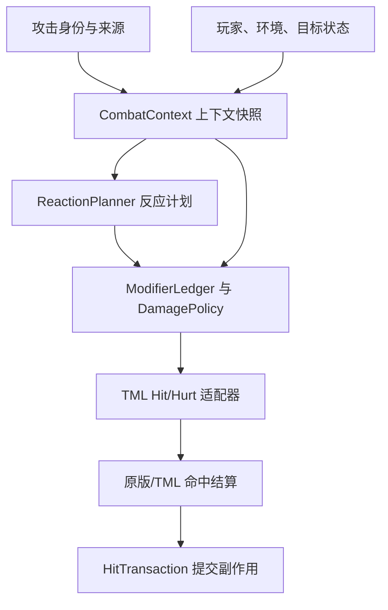

# Terraria Mod 战斗伤害与反应管线需求文档

> 状态：架构草案  
> 编写日期：2026-09-17  
> 文档目标：记录设计目的、当前模块边界、可复用的 tModLoader API 与建议参考实现；不提前固化尚未确定的战斗数值和内容规则。  
> API 基线：文中 API 名称按 2026-09-17 的 tModLoader stable 文档核对；正式开发时仍应在项目内锁定具体 tModLoader 版本并复核签名。

## 1. 文档定位

本系统用于承载 Mod 中所有需要“根据命中当下上下文重新解释一次伤害”的战斗逻辑，包括但不限于：

- 一次攻击同时拥有职业、元素、具体元素、反应、来源形态等多层标签；
- 玩家、武器、弹幕、目标、环境、饰品、Buff、结界和特殊 SP 状态共同影响同一次命中；
- 元素反应可能被月反应、星反应等规则替换、修饰或追加产物；
- 真伤、无视防御、无视抗性等效果需要跳过某些计算阶段，而不是事后反向抵消；
- 弹幕不能一律锁定生成时面板，需要在命中时读取允许实时变化的状态；
- 多人游戏中，反应状态、结界/SP 消耗和派生伤害必须能够确定性复现并正确同步。

本文是架构级需求文档，不是最终数值设计表，也不规定所有类名和方法签名。文中的模块名均为工作名，可以在实现阶段调整。

## 2. 问题陈述

目标伤害不是“多个分量伤害相加”，而是**一个伤害事件拥有多组彼此正交的语义标签**。例如：

> 魔法职业使用元素武器造成火元素命中，触发感电，并被月曜规则异化。

该事件可能同时满足：

- `Magic`：吃魔法职业增伤；
- `Elemental`：吃通用元素增伤；
- `Fire`：吃火元素增伤；
- `Reaction`：应用反应系数；
- `Lunar`：应用月反应规则；
- `Projectile`：应用弹幕相关规则。

这些标签描述的是同一个命中，不应为了让各类加成生效而拆成多个伤害分量。系统需要按标签收集修正，再按明确的乘区和阶段合并。

同时，“真实伤害”之类的效果不能通过先计算防御和抗性、再除回去实现。浮点舍入、截断、上下限和其他 Mod 的修改都会使这种“撤回”不可靠。正确做法是先解析本次命中的绕过策略，再决定哪些阶段根本不参与计算。

## 3. 设计目标

### 3.1 核心目标

1. **多标签命中**：一次伤害可同时命中任意数量的正交标签条件。
2. **统一上下文**：玩家、攻击来源、弹幕、目标、环境、光环/附着、结界和 SP 均通过同一上下文参与计算。
3. **分阶段计算**：修正按命名阶段和乘区记录，能够解释每一项数值来自哪里。
4. **显式绕过**：无视防御、无视抗性等效果以策略决定“跳过什么”，不做数值回滚。
5. **实时计算**：由本 Mod 控制的攻击可在命中时读取实时状态；必须快照的身份信息仍在生成时固定。
6. **反应可扩展**：基础反应、月/星异化和未来规则通过注册与候选规划组合，不依赖一条不断增长的硬编码 `if/switch` 链。
7. **计算与副作用分离**：伤害预览/修改阶段只生成计划；附着消耗、SP 变化、生成派生弹幕等在确认命中后提交。
8. **兼容 TML**：自定义语义层作为事实来源，最终尽可能映射到 tModLoader 的 `HitModifiers` / `HurtModifiers`，复用原版防御、暴击和命中结算。
9. **可调试与可测试**：能够输出一次命中的标签、候选反应、最终反应、各乘区贡献、绕过策略和 TML 映射结果。

### 3.2 非功能目标

- 同一输入在相同状态下得到确定性结果；
- 常规命中不产生不必要的堆分配和全量状态复制；
- 内容侧新增饰品、环境或反应时，尽量只注册规则，不改动核心调度器；
- 多人模式不依赖“某个 Hook 肯定只执行一次”的隐含假设；
- 允许逐步迁移，第一阶段不要求所有旧武器和第三方弹幕都获得完全实时的面板重算。

## 4. 当前不作为目标的事项

以下内容应保留为独立设计决策，本阶段不写死：

- 最终元素列表、标签命名和标签继承关系；
- 所有乘区的确切数量、名称及数值公式；
- 元素附着量、衰减、共存和消耗的最终模型；
- 每一种基础反应、月反应和星反应的具体优先级；
- 当月、星规则同时满足时，究竟互斥、复合还是追加；
- 结界、护盾、特殊 SP 与最终生命伤害之间的确切结算顺序；
- “真伤”是否还可暴击、是否穿透结界、是否无视通用减伤；
- 哪些反应只改写当前命中，哪些必须产生独立伤害事件；
- 完整 UI、特效、音效和战斗文本规格；
- 对第三方 Mod 的兼容承诺和公共扩展 API 版本策略。

架构只要求这些决定以后能够通过数据或策略补上，而不需要重写整条管线。

## 5. 设计原则

### 5.1 标签描述“是什么”，策略描述“怎么算”

`Fire`、`Magic`、`Reaction` 是语义标签；`IgnoreDefense`、`ReplaceReaction`、`ConsumeBarrierFirst` 是计算或结算策略。二者不得混在同一个布尔字段集合中。

标签可以多选且大多无顺序；替换、消费、互斥等策略必须有显式阶段和冲突规则。

### 5.2 自定义层只保留一个事实来源

内容代码不得一部分直接修改 `HitModifiers`，另一部分又在自定义公式里重复计算同一加成。所有本 Mod 管理的修正先进入统一账本，再由唯一的 TML 适配器写入 `HitModifiers` / `HurtModifiers`。

### 5.3 先决策，后折叠，不做“撤回乘区”

管线先得到最终标签、反应计划和绕过策略，再筛选有效修正并折叠数值。任何需要跳过既有阶段的规则都必须在折叠前表达。

### 5.4 修改阶段无副作用，命中后一次提交

`ModifyHit...` 阶段只读取状态、生成候选和计算修正，不消耗附着、不扣 SP、不生成弹幕。确认命中后，`OnHit...` 根据已缓存的命中事务一次性提交副作用。

### 5.5 快照身份，实时读取状态

弹幕生成时固定“这是什么攻击”和不可变来源信息；命中时读取玩家、环境、目标、反应和允许变化的面板状态。二者不能笼统地全部快照或全部实时读取。

## 6. 总体架构

### 6.1 模块划分

| 模块（工作名） | 主要职责 | 明确不负责 |
|---|---|---|
| `AttackProfile` | 描述攻击的不可变身份、基础标签、归属和可选基础伤害种子 | 不持有实时玩家 Buff/环境状态 |
| `CombatTagSet` | 高效保存和查询职业、元素、来源形态、反应等正交标签 | 不直接包含倍率或优先级 |
| `PlayerCombatState` | 维护每个玩家当前激活的效果提供者、结界/SP 等战斗状态 | 不让每件饰品各自实现整套公式 |
| `TargetCombatState` | 保存目标的元素附着、易伤/抗性状态和反应所需持久数据 | 不在读取阶段直接消费附着 |
| `ProjectileCombatState` | 保存弹幕的攻击身份、来源追踪及本 Mod 控制的基础伤害种子 | 不快照所有会变化的面板属性 |
| `EnvironmentCombatState` | 汇总世界、区域、天气、事件或场地提供的战斗规则 | 不将所有环境效果伪装成 Buff |
| `CombatContextBuilder` | 在命中当下构建只读上下文快照 | 不执行副作用 |
| `ReactionRegistry` | 注册基础反应、异化规则、冲突组和消费要求 | 不依赖硬编码的固定反应枚举调度链 |
| `ReactionPlanner` | 生成候选、应用月/星等变体、解决冲突并产生不可变计划 | 不立即修改目标附着或玩家资源 |
| `ModifierProviderRegistry` | 汇集玩家、装备、环境、攻击和目标提供的修正 | 不直接写 TML 数值 |
| `DamageModifierLedger` | 按阶段、乘区、来源记录修正并生成可解释结果 | 不承担内容层条件判断 |
| `DamagePolicy` | 表达防御、抗性、减伤、结界等阶段是否参与 | 不用反向除法撤销结果 |
| `TmlHitAdapter` | 将最终账本和策略一次性映射到 TML 修饰器 | 不重复维护另一套完整伤害公式 |
| `PendingHitTransaction` | 保存本次已确定但尚未提交的附着、SP、派生攻击等动作 | 不改变已完成的数值计划 |
| `CombatTrace` | 提供命中追踪、诊断和自动化测试所需记录 | 正式模式下不得造成显著开销 |

模块可以合并到较少的实际文件中；上表表达的是职责边界，而非强制一模块一类。

## 7. 伤害上下文与标签模型

### 7.1 `CombatContext` 至少应能观察的维度

- 攻击者与归属玩家；
- 直接命中、物品命中、弹幕命中或派生反应命中；
- `AttackProfile` 与当前标签集合；
- 目标 NPC 及其 `TargetCombatState`；
- 当前玩家战斗状态和已激活效果提供者；
- 当前世界、区域、天气、事件和场地状态；
- 当前附着快照与反应候选所需数据；
- 是否为暴击候选、是否允许触发 OnHit、是否允许再次触发反应；
- 网络侧身份、命中序号或等价的事务关联信息；
- 调试模式下的贡献来源标识。

上下文应在一次命中规划期间保持只读。需要变化的内容写入 `PendingHitTransaction`。

### 7.2 标签要求

- 标签是可组合的，不建立“只能属于一种伤害类型”的互斥枚举；
- `Magic` 与 `Fire`、`Elemental` 可以同时存在；
- 复合或派生标签应由规则显式添加，不依赖字符串前缀推断；
- 高频核心标签宜有紧凑表示；低频或跨 Mod 扩展标签可使用稳定注册 ID；
- 标签注册顺序不得成为游戏规则优先级；
- 调试输出应能还原为人类可读名称。

## 8. 命中管线

### 8.1 建议顺序

1. **取得攻击身份**：从物品、弹幕或派生事件取得 `AttackProfile`。
2. **构建只读上下文**：读取命中当下的玩家、目标和环境状态。
3. **补全语义标签**：合并攻击固有标签与上下文派生标签。
4. **生成基础反应候选**：根据来袭元素、目标附着和触发条件生成候选，不修改状态。
5. **应用异化规则**：月、星或未来规则以 `Replace`、`Decorate`、`AugmentOutput` 等明确语义处理候选。
6. **解决冲突与消费预算**：按冲突组、显式优先级、所需附着量和稳定决胜规则得到一个 `ReactionPlan`。
7. **收集伤害修正**：所有有效提供者向账本提交带来源、阶段、乘区和条件的贡献。
8. **解析伤害策略**：确定本次命中跳过哪些防御、抗性、减伤或资源吸收阶段。
9. **折叠并映射 TML**：生成最终数值修正，由唯一适配器写入 `HitModifiers` 或 `HurtModifiers`。
10. **TML 完成命中结算**：继续复用原版/TML 的防御、暴击、击退及生命结算。
11. **确认后提交事务**：在 `OnHit...` 中一次性消费附着/SP、更新结界、生成派生攻击并同步必要状态。

### 8.2 反应候选不得边试边改

反应调度不应采用“按代码顺序依次 `TryReaction`，第一个成功者立即消耗附着”的模式。该模式会使代码顺序成为隐藏优先级，也很难正确处理月、星规则同时满足的情况。

`ReactionPlanner` 应先在同一份附着快照上构建完整候选集，再进行选择。至少需要表达：

- 候选所属冲突组；
- 候选需要消费的附着和资源；
- 是替换基础反应、修饰基础反应，还是追加产物；
- 显式优先级或其他可比较规则；
- 选中后要提交的状态变化；
- 是否生成独立伤害事件。

月反应和星反应同时满足时，二者都应先成为候选或候选修饰器；最终选择依据以后确定的数据规则完成。当前文档不预设“月必定高于星”或相反。

### 8.3 派生反应伤害

多数只改变本次命中系数或防御策略的反应应继续作用于当前单一命中。只有具备独立时序、范围、目标选择或持续实体的反应，才生成新的伤害事件。

派生伤害必须重新进入同一条管线，并带有防递归所需标签或触发预算；不得通过直接修改 `npc.life` 绕过命中系统。对于本 Mod 完全控制的派生事件，优先使用专用弹幕或等价的受控伤害载体。

## 9. 伤害账本与乘区

### 9.1 概念模型

账本记录的不是一个不断被覆盖的 `damage` 浮点数，而是一组具名贡献。每项贡献至少具备：

- 来源 ID；
- 生效条件或已经通过条件检查的结果；
- 所属阶段；
- 所属乘区；
- 操作类型（加法、倍率、固定值、覆盖或钳制等）；
- 数值；
- 可选标签或调试说明。

同一乘区内可采用加法汇总、不同乘区之间相乘。概念上可写为：

$$
M_{\mathrm{pre}}=
\prod_{g\in G_{\mathrm{enabled}}}
\left(1+\sum_{m\in g}m\right)
$$

$$
D_{\mathrm{predef}}=
\left(D_{\mathrm{base}}+D_{\mathrm{flat}}\right)M_{\mathrm{pre}}
$$

防御由 TML/原版规则处理后，可再应用目标侧与最终阶段：

$$
D_{\mathrm{final}}=
D_{\mathrm{postdef}}\,M_{\mathrm{target}}\,M_{\mathrm{final}}
$$

这些公式只说明分层方式，并非承诺最终乘区表，也不试图复制 Terraria 内部的完整整数取整顺序。实际数值以后以锁定版本的 TML 行为和自动化测试为准。

### 9.2 可能的乘区类别

当前架构应至少容纳以下类别，但名称和合并关系待数值设计确认：

- 基础/来源伤害；
- 职业伤害；
- 通用元素伤害；
- 具体元素伤害；
- 反应倍率；
- 目标承伤或易伤；
- 防御与护甲穿透；
- 自定义元素抗性；
- 最终伤害；
- 结界、护盾或 SP 吸收阶段。

提供者只能向已注册乘区提交贡献。新增乘区应有明确理由，避免每个饰品都创造独立乘区。

### 9.3 绕过策略

“真伤”不应只是一个最终阶段倍率，也不应只有一个含义模糊的布尔值。管线应能表达若干正交策略，例如：

- 忽略 NPC 防御；
- 忽略自定义元素抗性；
- 忽略特定通用减伤层；
- 是否经过结界/护盾/SP 吸收；
- 是否允许暴击；
- 是否触发常规命中效果。

最终游戏设计可以把其中某个固定组合命名为“真伤”。架构层只保证这些阶段在折叠前可被启用或跳过。

典型映射原则：

| 需求 | 首选实现 |
|---|---|
| 完全无视 NPC 防御 | `NPC.HitModifiers.ScalingArmorPenetration = 1f`，或由适配器合并到同等结果 |
| 固定护甲穿透 | `NPC.HitModifiers.ArmorPenetration` |
| 改变目标防御值/防御效率 | `Defense` / `DefenseEffectiveness`，仅在语义确实匹配时使用 |
| 忽略自定义元素抗性 | 在自定义账本折叠前排除该阶段 |
| 最终倍率 | `FinalDamage` |
| 必须越过 TML 无法表达的最终层 | 最后手段使用 `ModifyHitInfo`，并接受兼容性风险 |

不应为了实现真伤而先读取预计防御减伤，再用倍率补偿。`ModifyHitInfo` 也不应成为常规内容 API，因为官方文档明确提示多个 Mod 的末端修改可能互相覆盖或冲突。

## 10. 状态归属与效果提供者

### 10.1 玩家效果总线

饰品、Buff 和环境内容不应各自持有完整伤害公式。它们只负责在每帧声明某个效果提供者已激活，或更新该提供者所需的小型状态；统一的 `PlayerCombatState` 在命中时调度这些提供者。

建议要求：

- 每个效果类型有稳定注册 ID；
- 每个玩家保存当帧激活位集、来源物品和必要实例状态；
- `ResetEffects` 清空短期激活状态；
- 饰品、Buff 或环境 Hook 重新激活对应效果；
- 只为实际覆写某类战斗阶段的效果建立调度列表，避免遍历全部已注册效果；
- 需要跨帧的计时、充能、SP 和结界数据保存在 `ModPlayer` 实例中，不保存在全局静态效果定义中；
- 内容提供者返回修正贡献或策略请求，不直接调用核心结算。

该模式直接适合“很多饰品与环境效果不适合全塞在 Buff/饰品类里”的问题：内容对象负责声明存在，玩家状态负责保存实例，中央管线负责解释。

### 10.2 目标状态

元素附着、目标侧抗性、反应冷却及其他逐 NPC 状态应放在 `GlobalNPC` 的逐实体实例中。状态变更通过命中事务提交，必要时使用 `SendExtraAI` / `ReceiveExtraAI` 或 `ModPacket` 同步。

### 10.3 弹幕状态

攻击的不可变语义身份和来源追踪放在 `GlobalProjectile` 的逐实体实例中。生成时通过 `IEntitySource` 识别来源；命中时由上下文构建器读取。

### 10.4 环境状态

世界级、区域级、天气级或事件级状态由 `ModSystem` 或专门世界状态模块维护。环境只需注册或暴露效果提供者，不应为每种环境修正向玩家强行添加一个可见 Buff。

## 11. 快照与实时计算边界

| 数据 | 建议时机 | 原因 |
|---|---|---|
| 攻击固有标签、技能/武器身份 | 生成或挥击开始时快照 | 避免攻击飞行中被重新解释为另一种攻击 |
| 归属玩家、来源物品类型、来源链 | 生成时记录 | 用于追踪、兼容和调试 |
| 本 Mod 受控弹幕的原始基础伤害种子 | 生成时记录 | 允许命中时重新应用实时乘区，避免重复吃面板倍率 |
| 玩家当下效果、面板和特殊 SP 状态 | 命中时读取 | 满足“不锁面板”需求 |
| 环境、区域与事件状态 | 命中时读取 | 反映实际命中地点和时刻 |
| 目标防御、抗性、附着和易伤 | 命中时读取 | 反映目标最新状态 |
| 随机结果 | 按确定性策略产生并关联事务 | 避免客户端与服务端分歧 |

必须接受一项兼容性边界：原版或第三方弹幕的 `projectile.damage` 往往已经包含生成时的面板结果，无法可靠地“反快照”。因此：

- 本 Mod 完全控制的弹幕可以保存未经完整面板折叠的 `BaseDamageSeed`，在命中时应用实时修正；
- 原版和第三方弹幕默认以其现有伤害作为输入，只叠加能安全表达的命中时修正；
- 如果未来需要深度兼容，应按来源建立明确适配器，而不是猜测并除回未知倍率。

## 12. 与 tModLoader API 的融合

### 12.1 总体原则

TML 负责最终数值后端和原版命中流程；自定义系统负责语义、反应、乘区、绕过策略与状态事务。正常路径中，自定义结果只由一个适配器写入 TML 一次。

### 12.2 API 对照

| TML API | 在本系统中的用途 | 注意事项 |
|---|---|---|
| `NPC.HitModifiers.SourceDamage` | 调整防御前的来源伤害 | 适合基础/来源阶段；会影响依赖来源伤害的 OnHit 计算 |
| `FlatBonusDamage` / `ScalingBonusDamage` | 明确属于 TML 语义的额外伤害 | 不把所有自定义乘区都硬塞进 bonus 字段 |
| `ArmorPenetration` / `ScalingArmorPenetration` | 固定或比例无视防御 | 完全无视防御优先使用比例穿透表达 |
| `Defense` / `DefenseEffectiveness` | 修改本次命中的防御或其换算效率 | 仅用于目标防御语义，不代替元素抗性系统 |
| `CritDamage` / `NonCritDamage` | 区分暴击与非暴击的防御后修正 | 暴击规则仍需与自定义反应规则协调 |
| `FinalDamage` | 防御后的最终倍率 | 常规最终乘区首选；避免使用不推荐给 Mod 的目标倍率替代 |
| `TargetDamageMultiplier` | 原版在目标承伤倍率层使用 | 官方文档不建议 Mod 常规使用；通常改用 `FinalDamage` |
| `Crit` / `DisableCrit`、`Knockback` 等命中字段 | 控制暴击判定、击退及其他原生命中表现 | 属于 TML 原生表现层，不替代自定义语义标签 |
| `ModifyHitInfo` | TML 常规字段无法表达时做末端修改 | 最后手段；多个 Mod 同时使用时兼容性较差 |
| `Player.HurtModifiers` | 玩家受伤方向的来源、穿甲、最终伤害、取消或上限控制 | 与对 NPC 伤害共享概念层，但使用独立适配器 |
| `ModPlayer.ResetEffects` | 清理当帧玩家效果激活状态 | 持久 SP/结界值不能在此丢失 |
| `ModPlayer.PostUpdateEquips` | 汇总装备及派生玩家效果 | 具体注册时机可按内容需要调整 |
| `ModPlayer.ModifyHitNPC*` | 玩家输出伤害的统一入口之一 | 修改阶段保持无副作用 |
| `ModPlayer.OnHitNPC*` | 提交玩家命中的反应、资源与派生事件 | 需要与之前生成的事务可靠关联 |
| `ModPlayer.ModifyHurt` / `ModifyHitBy*` | 玩家受伤方向的上下文和策略入口 | 结界/SP 若影响受伤，应走同一阶段化思路 |
| `GlobalNPC.InstancePerEntity` | 为每个 NPC 保存附着和目标战斗状态 | 需要明确存档、清理及联网同步策略 |
| `GlobalNPC.ModifyIncomingHit` / `ModifyHitBy*` | 目标侧通用或来源特定修正 | 避免与 `ModPlayer` 重复应用同一贡献 |
| `GlobalNPC.OnHitBy*` | 目标侧命中后提交 | 与攻击方事务保持幂等 |
| `GlobalProjectile.InstancePerEntity` | 为每个弹幕保存语义身份与来源数据 | 不要给所有弹幕复制完整玩家状态 |
| `GlobalProjectile.OnSpawn` + `IEntitySource` | 建立弹幕来源链和攻击身份 | 第三方来源可能信息不完整，需要安全降级 |
| `GlobalProjectile.ModifyHitNPC` / `OnHitNPC` | 弹幕侧读取与命中后行为 | 中央调度只能有一个最终写入点 |
| `SendExtraAI` / `ReceiveExtraAI` | 同步逐 NPC/弹幕的小型自定义状态 | 不同步整个 `CombatContext` |
| `ModSystem` | 管理世界和环境战斗状态 | 玩家局部状态仍归 `ModPlayer` |
| `ModPacket` | 同步无法由实体 ExtraAI 覆盖的事务或世界状态 | 消息需带稳定实体和事务标识，防重放 |

官方 API 参考：[`NPC.HitModifiers`](https://docs.tmodloader.net/docs/stable/struct_n_p_c_1_1_hit_modifiers.html)、[`Player.HurtModifiers`](https://docs.tmodloader.net/docs/stable/struct_player_1_1_hurt_modifiers.html)、[`ModPlayer`](https://docs.tmodloader.net/docs/stable/class_mod_player.html)、[`GlobalNPC`](https://docs.tmodloader.net/docs/stable/class_global_n_p_c.html)、[`GlobalProjectile`](https://docs.tmodloader.net/docs/stable/class_global_projectile.html)、[`ModSystem`](https://docs.tmodloader.net/docs/stable/class_mod_system.html)。

### 12.3 Hook 归属要求

TML 会从多个 Hook 汇总修改，且其他 Mod 也可能参与。内部实现必须指定一个**规范写入入口**：其余 Hook 只补充上下文或注册贡献，不再次折叠同一套账本。具体入口可在原型验证 TML 实际调用顺序后确定。

官方文档对多处 `Modify...` Hook 的建议是只修改修饰器、将副作用放到 `OnHit...`；本系统应遵循这一边界。

### 12.4 TML 能力边界

`HitModifiers` / `HurtModifiers` 已能覆盖来源伤害、额外伤害、防御与穿甲、暴击/非暴击、最终倍率、击退、伤害上限或取消受伤，以及最后阶段的命中信息修改。因此，本系统没有必要重新实现 Terraria 的整套基础命中公式。

它们不原生表达的部分包括：多层语义标签、任意自定义乘区、元素附着与反应候选、月/星异化优先级、结界/SP 的持久事务，以及“跳过某个自定义层但保留另一个层”的策略。以上内容应保留在自定义层，只把可等价表达的最终结果交给 TML。

## 13. 反应与异化规则

### 13.1 规则结构要求

反应规则至少应分为三层：

1. **基础反应层**：根据来袭标签与目标附着产生基础候选；
2. **异化/修饰层**：月、星或其他系统替换候选、附加标签、改变输出或追加后续事件；
3. **冲突解析层**：处理互斥组、资源预算和显式优先级，生成唯一可提交计划。

这三层必须允许独立单元测试。新增异化规则不应要求修改基础反应调度器的 `switch`。

### 13.2 `ReactionPlan` 应包含的概念数据

- 选中的基础反应和异化规则 ID；
- 对当前命中的标签、乘区和伤害策略修改；
- 要消费、保留或新增的附着；
- 对玩家 SP、目标状态或结界的预期变化；
- 需要生成的派生事件；
- 防递归/触发预算；
- VFX、音效和战斗文本所需语义事件；
- 联机同步与调试所需的稳定标识。

计划本身不应持有可变实体的裸引用作为长期状态；提交时应重新验证实体仍然有效。

### 13.3 gcsim 调研结论对本设计的影响

截至核对版本，gcsim 已包含 `lunarcharged`、`lunarcrystallize`、`stellarconduct` 和 `stellarswirl` 等特殊反应实现，并实现了附着贡献者追踪、部分多角色贡献聚合及特殊反应独立攻击。它证明“反应拥有独立所有者、派生事件和特殊无视防御配置”是可落地的。

但其核心反应入口仍以入射元素为 `switch`，再按固定代码顺序调用多个 `Try...`；源码仍留有核对反应顺序的 TODO。月/星分支也存在由全局标志选择替代路径的做法。这类实现适合模拟器逐步扩展，不适合作为本 Mod 的通用优先级架构。

因此本系统应借鉴其**附着状态、贡献者归属、派生实体和多贡献者聚合**，但不照搬顺序式反应调度。

## 14. 结界、护盾与特殊 SP

这些系统既可能作为状态提供者影响伤害，也可能在命中后消耗资源。为避免顺序不清，应遵循：

- 结界/SP 的当前值保存在相应实体状态中；
- 对伤害的影响以独立、具名阶段进入账本或 `DamagePolicy`；
- 修改阶段只计算“若命中确认，应消耗多少、剩余伤害多少”的计划；
- `OnHit` 或对应受伤确认点提交资源变化；
- 同一事务重复到达时不得重复扣除；
- 真伤是否穿透该阶段由显式策略决定，而不是由 `TrueDamage` 标签隐式猜测。

结界位于防御前还是防御后、SP 是减伤资源还是技能资源，仍属于待定玩法规则。模块必须支持选择，但本文件不替设计者作出数值决定。

## 15. 多人同步与确定性

### 15.1 必要约束

- 附着、结界、SP 和反应冷却等持久状态必须有明确权威方；
- 命中事务应有足以防止重复提交的关联键；
- 候选排序不能依赖哈希表遍历顺序、对象地址或本地注册偶然顺序；
- 随机反应结果必须使用可同步或可复现的随机来源；
- 只同步持久状态变化、选中反应和必要派生事件，不同步完整修正账本；
- 客户端可为表现生成预测，但不得无条件重复消费权威资源。

TML 不同命中 Hook 在客户端、服务端和所有者侧的实际执行方式需要在最小多人原型中验证。实现不得仅凭单人测试假定某个 `Modify...`/`OnHit...` 全局只执行一次。

### 15.2 同步手段

- NPC/弹幕少量逐实体字段：`SendExtraAI` / `ReceiveExtraAI`；
- 玩家持久战斗状态：玩家同步包或项目既有同步框架；
- 世界与环境状态：`ModSystem` 的世界数据和网络同步；
- 复杂反应事务：精简 `ModPacket`，包含实体 ID、反应 ID、事务 ID 和必要结果。

## 16. 可观察性与测试要求

### 16.1 战斗追踪

开发模式应能为一次命中输出：

- 原始攻击身份与最终标签；
- 玩家、环境、弹幕和目标提供者列表；
- 所有反应候选、淘汰原因和最终计划；
- 每项账本贡献的来源、乘区、阶段和值；
- 生效的绕过策略；
- 写入 TML 的字段；
- TML 返回的最终命中信息；
- 命中后提交的附着、SP、结界和派生事件。

### 16.2 最低测试集

1. 魔法 + 元素 + 火 + 反应 + 月规则同时命中各自乘区；
2. 同乘区多项相加、跨乘区相乘，结果与定义一致；
3. 无视防御只跳过防御，不意外跳过元素抗性；
4. 配置的真伤组合不会通过数值回滚实现；
5. 月、星同时满足时，候选与冲突结果可预测且不依赖注册偶然顺序；
6. 未选中的候选不消费附着或 SP；
7. 修改阶段被重复调用不会产生副作用；
8. 命中事务重复提交不会重复扣除资源；
9. 受控弹幕命中时能读取实时玩家/环境状态；
10. 第三方弹幕安全降级，不因无法反推基础伤害而重复乘算；
11. 派生反应伤害重新进入管线且不会无限触发自身；
12. 单人、主机和专用服务器上的持久状态结果一致。

## 17. 建议参考实现

| 项目 | 建议重点参考 | 不建议照搬 |
|---|---|---|
| [Fargo's Souls](https://github.com/Fargo-Team/FargosSoulsMod) | `AccessoryEffectLoader` 的稳定效果注册、`AccessoryEffectPlayer` 的逐玩家激活数组和按 Hook 预分组调度；静态效果定义与玩家实例状态分离 | 大型玩家类中不断累积的特例和内容耦合 |
| [Calamity Mod Public](https://github.com/CalamityTeam/CalamityModPublic) | 将大量命中/受伤逻辑拆到 `ModPlayer` partial 文件；`GlobalProjectile`/`GlobalNPC` 的逐实体来源与目标状态 | 把最终架构退化成巨大的布尔字段包和长条件链 |
| [gcsim](https://github.com/genshinsim/gcsim) | 附着状态、反应所有者、延迟/范围反应实体、多贡献者聚合和特殊反应公式 | 按固定代码顺序逐个 `Try...` 并即时修改状态的调度方式；用全局标志硬切月/星分支 |
| [tModLoader ExampleMod](https://github.com/tModLoader/tModLoader/tree/stable/ExampleMod) | 官方 Hook 用法、实体来源、网络同步和跨实体数据存放惯例 | Example 代码是 API 示范，不是完整战斗架构 |
| [Terraria Overhaul](https://github.com/Mirsario/TerrariaOverhaul) | 作为单项战斗行为如何接入 TML Hook 的次要参考 | 不作为本管线核心分层的主要范本 |

### 17.1 核对过的关键源码入口

- Fargo's Souls：[`AccessoryEffectLoader.cs`](https://github.com/Fargo-Team/FargosSoulsMod/blob/226fadeadbe3422785a7708ba2cdf53bd8548c00/Core/AccessoryEffectSystem/AccessoryEffectLoader.cs)、[`AccessoryEffect.cs`](https://github.com/Fargo-Team/FargosSoulsMod/blob/226fadeadbe3422785a7708ba2cdf53bd8548c00/Core/AccessoryEffectSystem/AccessoryEffect.cs)、[`AccessoryEffectPlayer.cs`](https://github.com/Fargo-Team/FargosSoulsMod/blob/226fadeadbe3422785a7708ba2cdf53bd8548c00/Core/AccessoryEffectSystem/AccessoryEffectPlayer.cs)、[`HitEffectsPlayer.cs`](https://github.com/Fargo-Team/FargosSoulsMod/blob/226fadeadbe3422785a7708ba2cdf53bd8548c00/Core/ModPlayers/HitEffectsPlayer.cs)。
- Calamity：[`CalamityPlayerHitHurt.cs`](https://github.com/CalamityTeam/CalamityModPublic/blob/1a8cebd27ec5615316b78f71973446b5528d2b78/CalPlayer/CalamityPlayerHitHurt.cs)、[`CalamityGlobalProjectile.cs`](https://github.com/CalamityTeam/CalamityModPublic/blob/1a8cebd27ec5615316b78f71973446b5528d2b78/Projectiles/CalamityGlobalProjectile.cs)、[`CalamityGlobalNPC.cs`](https://github.com/CalamityTeam/CalamityModPublic/blob/1a8cebd27ec5615316b78f71973446b5528d2b78/NPCs/CalamityGlobalNPC.cs)。
- gcsim：[`reactable.go`](https://github.com/genshinsim/gcsim/blob/912a02b4c923a21ee421e05c729d046b9356acfa/pkg/reactable/reactable.go)、[`lunarcharged.go`](https://github.com/genshinsim/gcsim/blob/912a02b4c923a21ee421e05c729d046b9356acfa/pkg/reactable/lunarcharged.go)、[`lunarcrystallize.go`](https://github.com/genshinsim/gcsim/blob/912a02b4c923a21ee421e05c729d046b9356acfa/pkg/reactable/lunarcrystallize.go)、[`stellarconduct.go`](https://github.com/genshinsim/gcsim/blob/912a02b4c923a21ee421e05c729d046b9356acfa/pkg/reactable/stellarconduct.go)、[`stellarswirl.go`](https://github.com/genshinsim/gcsim/blob/912a02b4c923a21ee421e05c729d046b9356acfa/pkg/reactable/stellarswirl.go)、[`reaction.go`](https://github.com/genshinsim/gcsim/blob/912a02b4c923a21ee421e05c729d046b9356acfa/pkg/core/combat/reaction.go)。

上述链接固定到调研时的提交，便于以后确认上游变化；项目首页链接则用于查看最新版本。

## 18. 建议实施顺序

### 阶段一：最小语义与账本

- 建立 `AttackProfile`、标签注册与只读 `CombatContext`；
- 实现具名乘区、来源追踪和战斗追踪输出；
- 暂不实现复杂反应，只验证多标签同时吃加成。

### 阶段二：TML 适配

- 确立唯一规范写入入口；
- 映射来源伤害、穿甲、暴击后修正和最终伤害；
- 用最小原型验证 Hook 顺序、取整和多人执行位置。

### 阶段三：效果状态总线

- 实现逐玩家效果注册与激活；
- 迁移少量饰品、Buff 和环境规则；
- 验证内容侧不直接重复写入伤害修饰器。

### 阶段四：目标附着与基础反应

- 建立逐 NPC 状态和只读候选规划；
- 实现一个简单基础反应及事务提交；
- 完成必要网络同步。

### 阶段五：月/星异化与派生事件

- 加入替换、修饰、追加产物和冲突组；
- 实现月、星同时满足的测试矩阵；
- 让独立反应伤害重新进入统一管线。

### 阶段六：结界/SP 与兼容层

- 固化资源吸收阶段和真伤策略组合；
- 为原版/第三方弹幕定义安全降级；
- 评估是否发布稳定的跨 Mod 注册 API。

## 19. 架构验收标准

当以下条件成立时，可认为第一版架构满足需求：

- 一个命中能同时拥有职业、通用元素、具体元素、反应和异化标签；
- 各标签对应的有效修正只计算一次，并可从追踪结果解释；
- 玩家、弹幕、目标和环境均能通过统一提供者机制贡献修正；
- 月/星等异化规则不要求修改基础调度器的硬编码分支；
- 防御/抗性绕过在账本折叠前决定，不存在“计算后除回去”；
- 修改 Hook 无持久副作用，命中后事务可幂等提交；
- 受控弹幕能按命中时上下文计算，第三方弹幕有明确降级行为；
- 核心数值最终通过 TML 修饰器落地，末端重写只用于确实无法表达的例外；
- 多人测试中附着、SP、结界和派生反应不重复、不丢失；
- 新增普通效果提供者或反应规则不需要修改核心管线主流程。

## 20. 待后续决策清单

后续玩法设计与技术原型需要共同确认：

1. 正式标签表以及标签是否允许父子查询；
2. 正式乘区表和每个 TML 字段的唯一映射；
3. 防御、元素抗性、目标减伤、结界/SP 的最终顺序；
4. “真伤”的正式策略组合；
5. 元素附着的数据模型及衰减/共存规则；
6. 月与星同时满足时的规则类型和优先级数据；
7. 反应暴击、继承面板、所有者归属和多人随机策略；
8. 哪些反应是当前命中改写，哪些生成独立事件；
9. 规范 Hook 入口及 `PendingHitTransaction` 的可靠关联方式；
10. 第三方 Mod 的扩展边界和兼容失败时的降级原则。

在这些问题被决定前，代码应优先完成能验证边界的薄原型，不应先建立庞大的内容枚举和数值表。
