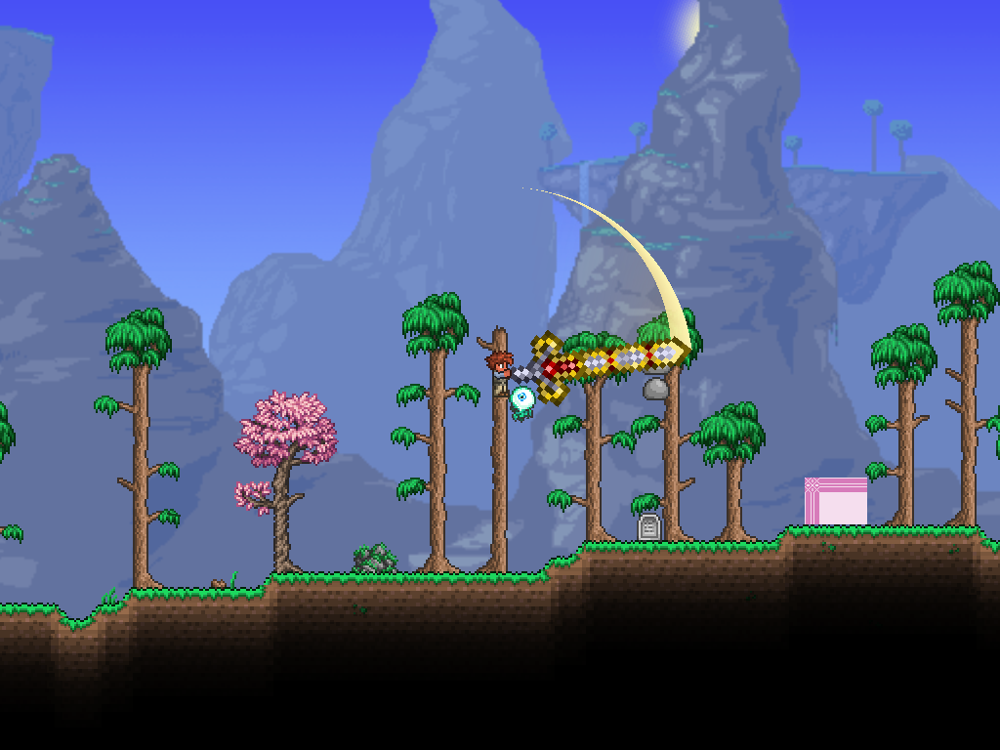
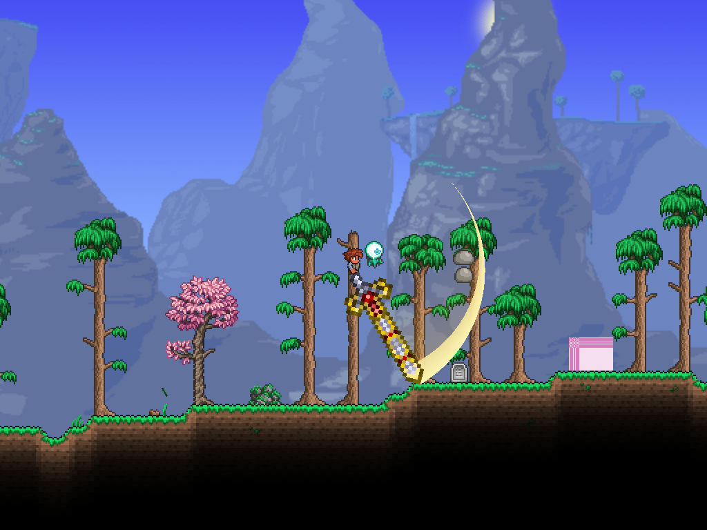
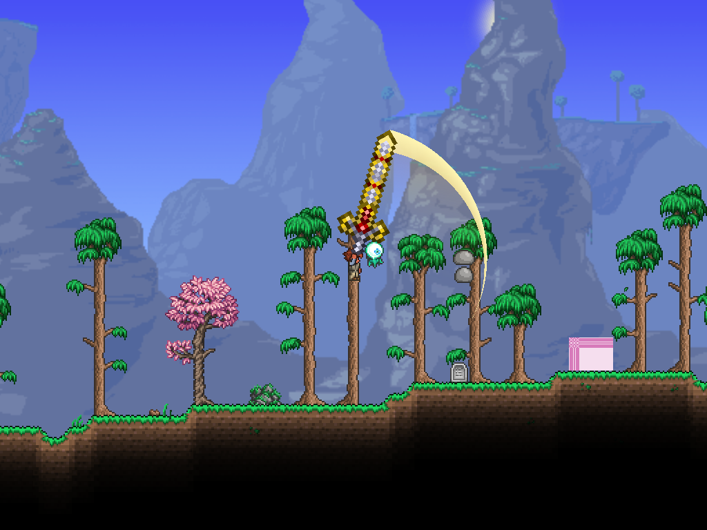

# 天裁第二轮验证：范围、加减速与相切剑气

日期：2026-10-24。环境与[首轮](2026-10-24-hallow.md)一致，使用隔离存档和原生ItemCheck输入。首轮报告保留为历史记录，不覆盖。

## 已实现

- 保留作者调整的100伤害、30刻基础时长、192像素剑长；剑身显示、刀刃碰撞与剑气外半径一致。碰撞厚度仍为16，范围翻倍指半径翻倍。
- 对平滑速度曲线积分：前22%加速，中间56%快速挥动，最后22%减速，首尾速度为0。第三段两圈共享一次曲线，不在中间停顿；圈数判定使用角度进度。
- 相切圆弧的偏心距为0.12R，内圆半径0.88R，在尾端与外圆内切。亮带向内只轻微渐变，交界处骤降为暗金色，再向R/3透明边界插值。最大可见弧长1.9弧度；不是按寿命把全扇面均匀抹淡。结束后保留姿态，0.12秒淡出。
- 通用几何在Basic/Graphics/Rendering/VfxMesh；天裁参数与生命周期在Contents/Hallow/Weapons/HallowSlashEffect。未修改旧/vfx剑气示例。

## 验证结果

| 项目 | 结果 |
| --- | --- |
| 主项目构建 | PASS，0警告0错误 |
| 离线 | PASS，20/20，含曲线单调／端点／中点速度及月牙亮暗／空洞 |
| 单人实机 | PASS，15/15 |
| 1倍／2倍攻速 | 每段30／15刻 |
| 每轮命中次数 | 1、1、2、1 |
| 实际伤害 | 100、100、75+75、275 |
| 角度衔接、基础暴击 | PASS，8% |
| 扩大范围 | 测试靶从64移到160像素，仍满足上述命中；高速扫描补判已参与 |

[离线报告](2026-10-24-hallow-v2-offline.json)，[实机报告](hallow-v2-2026-10-24/report.json)。测试工程NuGet漏洞审计连接仍有NU1900提示，不将审计视为通过。

八张图片在 `hallow-v2-2026-10-24`，覆盖两种攻速的四段中程姿态。检查了尖尾、明亮外带、暗层分界和剑尖衔接；图片不能证明完整运动时序的主观手感。

## 复现及待验收

构建重载后输入 `/hallowblade`。需要作者重点试挥：起手是否仍拖沓、收尾与下一段的停顿是否合适、第三段回旋节奏、亮带厚度与暗层强度。可调参数分别集中在HallowBladeRules和HallowSlashEffect。

自动脚本为 `Tests/Run-HallowLive.ps1`，准备隔离存档的方法沿用首轮；离线运行 `dotnet run --project Tests/Vfx/Vfx.Tests.csproj -- docs/testing/2026-10-24-hallow-v2-offline.json`。

本轮没有验证联机、PvP、反重力、坐骑、手动超时续段与世界切换。没有添加格挡、闪避、元素吸收。剑身继续使用放大的断钢剑占位贴图，像素颗粒随尺寸放大。
