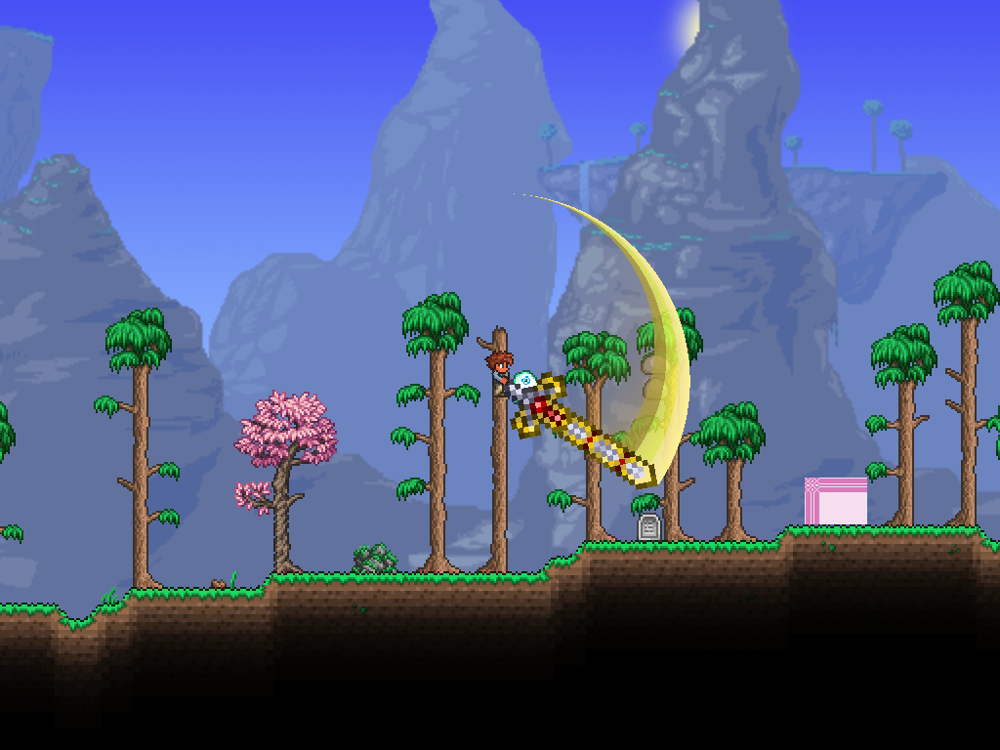
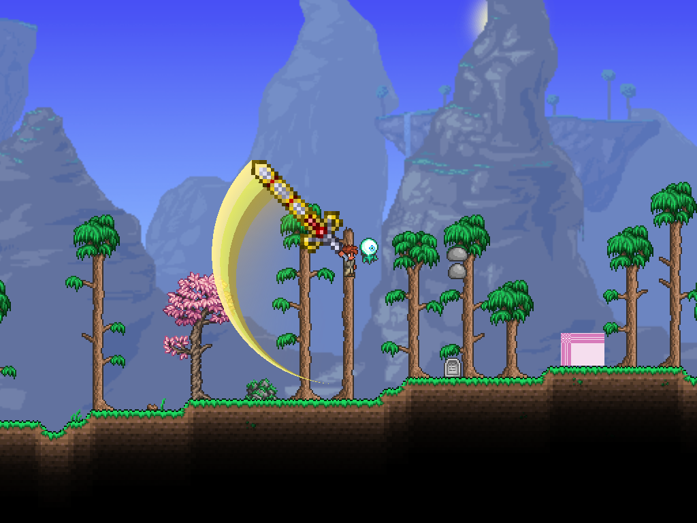
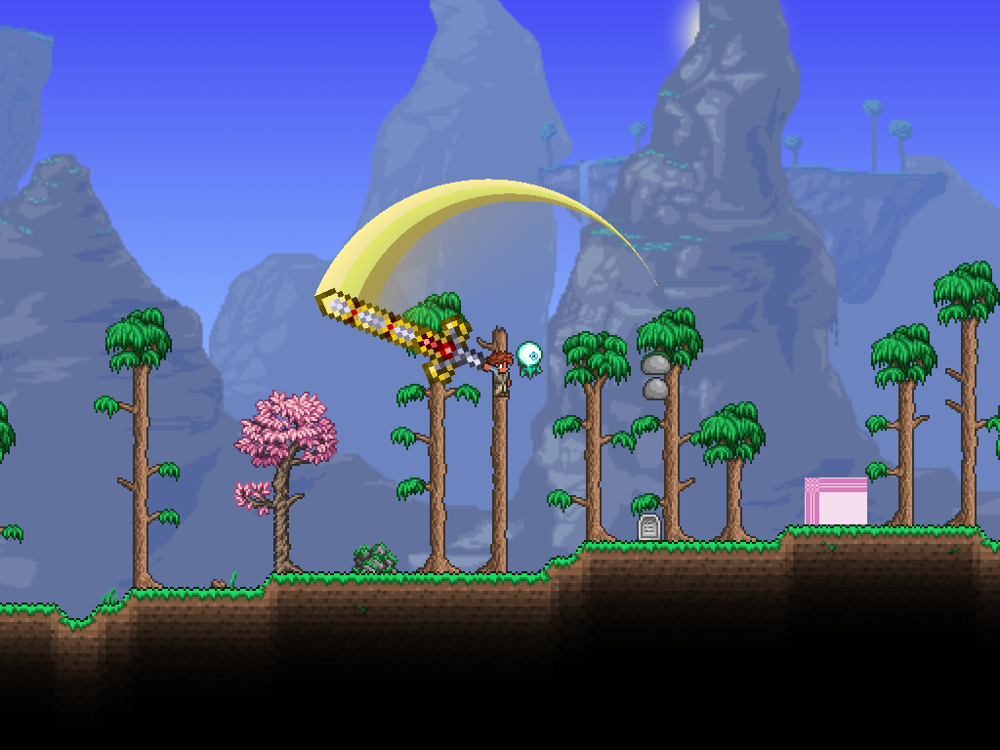

# 天裁第三轮：三层相切条带与动作随动

## 当前实现

保留作者当前135伤害、40刻基础动画、192像素剑长。三层亮带最大总宽64像素，完整弧角135°；每层在最宽处约21.33像素。两条中间边界和最内侧边界均为偏心圆，与外圆共用尾端内切点；根据宽度反解圆心偏移，而不是简单缩放同心圆。短于135°时自然收窄，不通过压缩角度强行维持64宽。

颜色参照断钢剑绘制源码的金白(255,240,150)、亮黄(255,255,80)、暗金(180,160,60)，分别施加递减强度；层内只轻渐变，层间保留阶跃。内层金色为(245,185,55)乘0.42，增强后仍向R/3处透明。

通用几何：`Basic/Graphics/Rendering/VfxMesh.LayeredTangentCrescent`；内容参数：`Contents/Hallow/Weapons/HallowSlashEffect`。单层旧网格API及旧示例保留，不影响其他内容。

## 元素方舟的参考依据

阅读灾厄公开1.4.4分支：

- [物品](https://github.com/CalamityTeam/CalamityModPublic/blob/1.4.4/Items/Weapons/Melee/ArkoftheElements.cs)，本次blob为 `c3c661f5ecec844e57eac2d600ffd1c6f5467d5f`：useTime/useAnimation为20，MeleeNoSpeed，持握弹幕存在时禁止再次使用。
- [持握弹幕](https://github.com/CalamityTeam/CalamityModPublic/blob/1.4.4/Projectiles/Melee/ArkOfTheElements_SwungBlade.cs)，本次blob为 `5a8bc31f62d01a6096234f0daf79c81d3601d358`：MaxSwingTime35、extraUpdates1，不能把35次更新直接当35游戏刻。普通斩击使用ExpOut起手、PolyInOut三次缓动挥砍、Linear随动；最后阶段的角进度继续增加到1.2。剑身缩放随挥动变化，残影与smear覆盖动作后段。

这些代码说明：攻速面板不等于肉眼看到的主要斩击速度；短时间集中完成挥砍，剩余时间维持姿态运动与视觉余韵。它们对流畅度的贡献属于源码分析，未运行灾厄作实机对照。

天裁不复制其额外转角或动态缩放，避免破坏已确认的半圈／一圈／两圈以及固定范围。第二轮对称22%加减速改为速度曲线积分：0—10%加速，10—45%快挥，45—62%降低至峰值22%，62—94%缓慢随动，94—100%短收尾至0。角度归一化，首尾位置不变；第三段过一圈的时刻提前，免疫重置按角度而非时间中点。原生段间约1刻调度间隔仍保留。

## 验证

- 主项目：0警告、0错误。
- 离线21/21：[报告](2026-10-24-hallow-v3-offline.json)。新增验证三条内切边界、64总宽、135°弧角；更新缓动与实际转圈判定测试。测试工程NU1900漏洞审计网络提示仍未解决，不代表审计通过。
- 单人原生ItemCheck专项15/15：1／2倍攻速40／20刻，160像素处目标命中数1、1、2、1；实际伤害135、135、101+101、371；角度连续，基础暴击面板8%。小数倍率最终按原生伤害整数量化。
- 八张截图覆盖两种攻速四段中程姿态：[实机报告](hallow-v3-2026-10-24/report.json)。

复现：重载模组后 `/hallowblade`。自动脚本仍为 `Tests/Run-HallowLive.ps1`，使用项目obj内隔离存档、不保存；准备方法见首轮记录。

待作者实测起手与随动节奏、亮带配色和内层金色强度；截图只验证形状，不等于主观动态手感通过。联机、反重力、坐骑等尚未验证。前两轮记录保留为历史证据。
