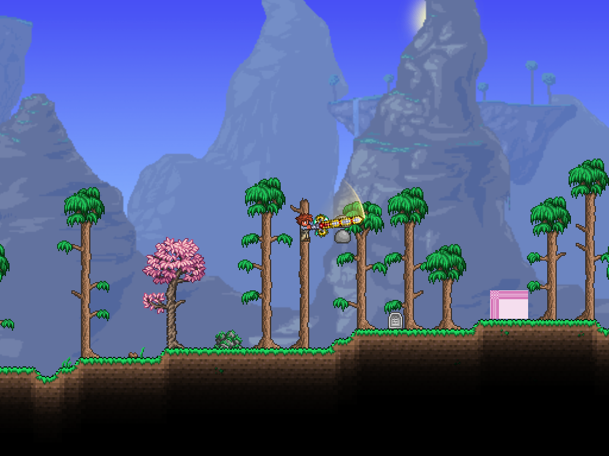
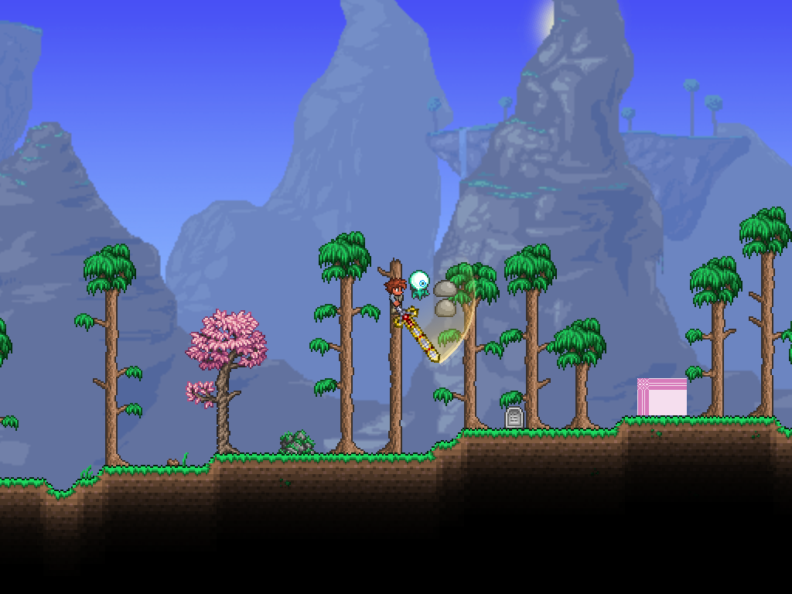
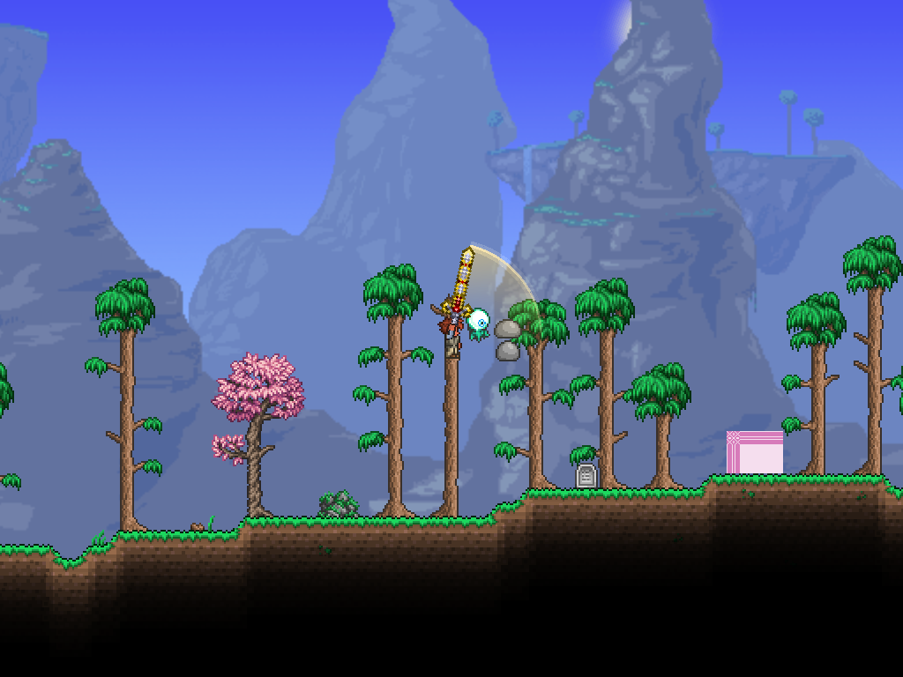

# 天裁之刃第一阶段验证

## 实现与参考

实现位于 `Contents/Hallow/Weapons`，复用 `Contents/Vfx/SlashTrailEffect` 与 `Basic/Graphics`。物品发起攻击，持握弹幕执行每段动作，视觉残迹自行淡出。没有增加通用武器框架。

已阅读以下1.4.4分支的一手源码：

- [ExampleCustomSwingSword](https://github.com/tModLoader/tModLoader/blob/1.4.4/ExampleMod/Content/Items/Weapons/ExampleCustomSwingSword.cs) 与 [ExampleCustomSwingProjectile](https://github.com/tModLoader/tModLoader/blob/1.4.4/ExampleMod/Content/Projectiles/ExampleCustomSwingProjectile.cs)：物品禁用默认近战、持握弹幕、多段动作、本地免疫及刀刃线段碰撞。
- [ExampleSwingingEnergySword](https://github.com/tModLoader/tModLoader/blob/1.4.4/ExampleMod/Content/Items/Weapons/ExampleSwingingEnergySword.cs) 与 [ExampleSwingingEnergySwordProjectile](https://github.com/tModLoader/tModLoader/blob/1.4.4/ExampleMod/Content/Projectiles/ExampleSwingingEnergySwordProjectile.cs)：原版断钢剑式表现及直接传入原生动画时长。本实现保留单外缘向内渐隐，不叠加原例内侧光圈。
- [灾厄Ark物品](https://github.com/CalamityTeam/CalamityModPublic/blob/1.4.4/Items/Weapons/Melee/ArkoftheCosmos.cs) 与 [持握弹幕](https://github.com/CalamityTeam/CalamityModPublic/blob/1.4.4/Projectiles/Melee/ArkOfTheCosmos_SwungBlade.cs)：参考段号管理、持握姿态、线段碰撞与表现分离；未移植其美术或格挡、远程攻击机制。

## 离线结果：PASS

主工程 `dotnet build AdvancedMod.csproj -p:BuildMod=false --no-restore`：0警告、0错误。

`Tests/Vfx`：18/18通过，包含原14项与新增四项：四段方向／角度衔接、149／150刻续段边界／中断重置、第三段两圈／倍率、单外缘渐隐网格。证据：[离线JSON](2026-10-24-hallow-offline.json)。测试工程存在NuGet漏洞审计网络提示NU1900，不视为审计通过。

## 单人实机结果：PASS

2026-10-24，本机tModLoader 1.4.4.9+2026.08.3.0、FNA D3D11、Luminance 1.0.14，1024×768。脚本在 `obj/hallow-live` 的复制角色／世界中执行，不保存；通过 `PreItemCheck` 设置输入，让原生物品使用流程发起攻击，未直接调用武器Shoot或伪造伤害。测试靶关闭暴击及伤害浮动，防御为0。

| 验证 | 结果 |
| --- | --- |
| 1倍攻速四段 | 每段60刻；1、1、2、1次命中 |
| 2倍攻速四段 | 每段30刻；1、1、2、1次命中 |
| 实际伤害 | 200、200、150+150、550 |
| 两轮各三次衔接 | 后段起始角等于前段结束角 |
| 无额外装备暴击面板 | 8% |

共15/15通过。原生自动使用相邻段之间有1游戏刻调度间隔；60／30刻为每段机制弹幕的实际存续时长。完整时间戳、命中与角度见[报告](hallow-2026-10-24/report.json)。

首轮界面遮挡截图已弃用，最终仅验收模式隐藏UI重跑。每段进度45%—65%采集一帧，共8张，逐张检查剑身和单条亮外缘连接、向内渐隐，未见轨迹翻折或断裂。静态图不能证明运动手感或所有中间帧。





其余图片在同目录，文件名 `speed-{1或2}-stage-{1至4}.png`。

## 复现与待验收

重载模组，输入 `/hallowblade` 获取天裁之刃，长按左键执行四段连招。剑身为断钢剑占位资源，尚无配方。

自动验证命令：

```powershell
dotnet run --project Tests/Vfx/Vfx.Tests.csproj -- docs/testing/2026-10-24-hallow-offline.json
pwsh -File Tests/Run-HallowLive.ps1
```

实机脚本需预先准备 `obj/hallow-live/Players/testPlayer.plr`、`Worlds/testWorld.wld` 及 `Mods/enabled.json` 和依赖；只接受项目obj内目录。保持游戏窗口焦点。仅环境变量 `ADVANCEDMOD_HALLOW_LIVE_TEST=1` 启用自动输入、隐藏界面及后缓冲截图，普通游玩不启用。脚本要求本轮新报告，不能用旧报告代替运行。

待手工实机：松开后续段、等待150刻重置、左右与上下瞄准、移动手感、切换物品／死亡／世界切换、反重力和坐骑。待联机：远端姿态、伤害归属、第三段两圈、晚加入和丢包；代码中的ExtraAI同步尚不等同联机验收。PvP未验收。右键格挡／闪避／吸收元素不属于本轮范围。
