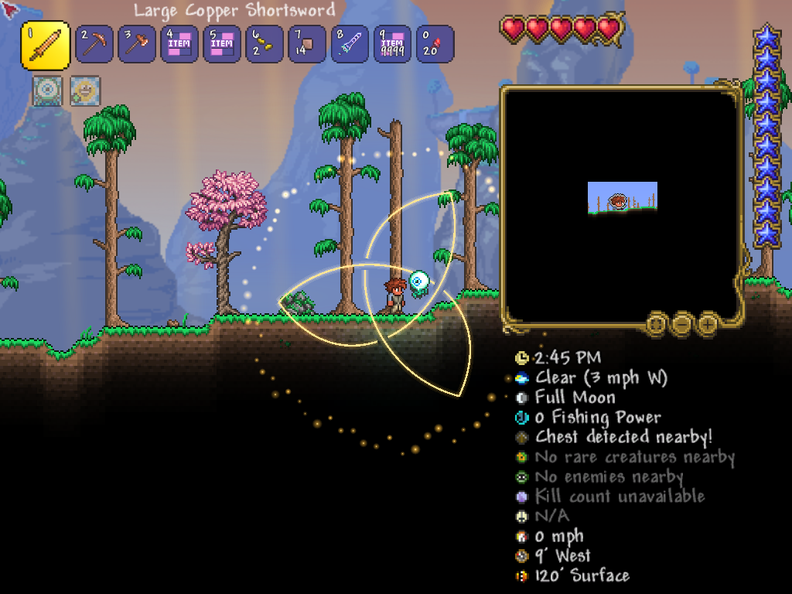

# VFX 验证记录

日期：2026-10-24。

## 环境与范围

- Windows、.NET 8、tML 1.4.4.9+2026.08.3.0、Luminance 1.0.14、FNA D3D11。
- 单人测试使用项目 `obj/vfx-live` 中的独立角色、世界和模组列表；自动保存关闭，未向正常游戏存档写入测试内容。
- 生产代码与截图测试都未创建视觉用 Projectile；演示是客户端本地表现，没有接入实际武器伤害、领域机制或网络同步。

## PASS

1. 主项目 `dotnet build AdvancedMod.csproj --no-restore -p:BuildMod=false -v:minimal`：0 警告、0 错误。
2. 离线测试 14/14：[JSON 报告](2026-10-24-vfx-offline.json)。覆盖同轮创建关闭、延迟取消、停止幂等、提交边界、世界清理、旧句柄、预算、半途收束、绘制不推进时间、环境聚合／仲裁／快速切换、轨迹断开／时间／非法数据、退化网格和三弧接头／缺口。测试 restore 曾提示 NU1900（无法取得 NuGet 漏洞数据），不影响构建与执行，不将漏洞审计记为通过。
3. 真实客户端已成功加载、运行 900 刻综合演示并正常退出；最终代码的 1024×768 演示取得全部 8 张后缓冲截图。
4. 已查看开场剑气、完整领域、交叉缺口、旧领域收束与新领域展开、领域收束、天空重启及最终清空画面。未见 UI 状态污染、跨地图光带或残留实例。
5. 245 刻撤销两个天空来源中的一个后：剩余请求 1、天空强度 0.85；365 刻实例数 3，包含旧领域、新领域与剑气；850 刻实例数 0、请求数 0、天空强度 0。

最终证据：[截图及状态报告](vfx-2026-10-24/1024x768-final/capture-report.json)、[运行日志节选](vfx-2026-10-24/client-excerpt.txt)。

## 已发现并修正

- 首次窗口截图工具未能取得游戏画面，第一次客户端失焦后停在少量更新，已中止，不能视为视觉验收。核对本机引擎代码确认单人模式失焦时提前设置 `gamePaused` 并返回。
- 改为只在自动验收环境变量开启时，在完整 Draw 后读取后缓冲并保存 PNG；正常游戏不注册截图钩子。
- 800×720 初版截图发现天空按 32 段绘制出现横向分带；改为逐像素行渐变与共享软遮罩云雾／光柱，1024×768 最终截图已确认条纹消失。初版截图保留于 `vfx-2026-10-24/800x720-initial`，不能作为最终天空效果的验收图。
- 加入按缩放调整世界裁剪范围、天空快速切换最多保留两个可见样式、Reset 清理样式请求与扫掠翻折保护；最终构建与离线测试在这些修改后执行。

## 待验收与未接入

- 待手工验收：不同缩放比例、游戏运行中调整分辨率、暂停恢复、退出并进入另一世界、模组重载资源释放。两次不同启动分辨率不等同运行中切换分辨率已验证。
- 待正式机制接入：真实刀刃姿态采样、源身份校验与异常失效处理、来源断线清理、晚加入重建及专服／联机视觉一致性。当前 `/vfx` 命令不提供网络同步。
- 美术仍为基础示例：曲线为按参考图拟合的三段贝塞尔中心线，最终控制点、色彩、辉光强度与动画节奏可继续调整；未实现多遍模糊、噪声消散或流光 shader。

手工入口与集成接口见 [Vfx-Usage.md](../Vfx-Usage.md)。
