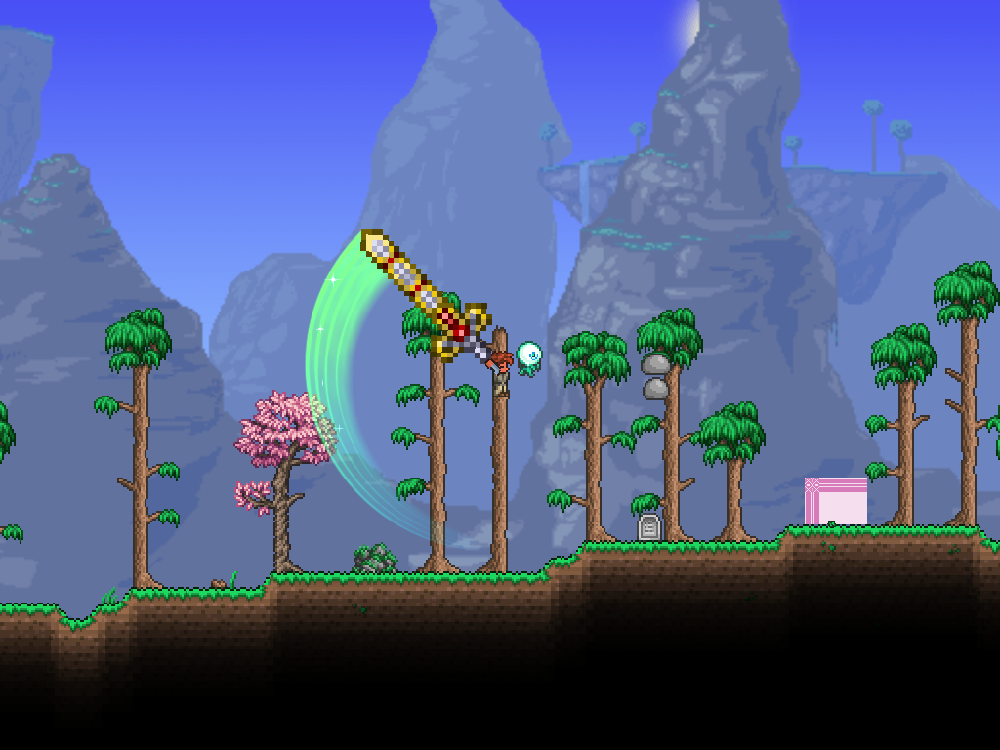

# 天裁动态剑气首版验证（2026-10-25）

基线提交：e90cb12，分支feature/hallow。本轮实现保留在工作区，未自动提交或推送。

## 结果

- PASS：主项目BuildMod=false构建，0警告0错误。
- PASS：VFX离线25/25；新增纹理边缘／有限值、动态面积、攻速比例、停止生命周期、高速圆弧采样检查。原三层相切几何测试仅验证保留的通用方法，不表示天裁仍使用旧样式。
- PASS：最终隔离客户端原生物品使用15/15；1倍／2倍攻速为40／20刻，伤害135／135／101+101／371，衔接与基础暴击8%通过。
- 视觉检查：第二轮查看全部8张截图，发现双倍攻速两圈段折角；最终轮重点复查双倍攻速第三段与普通第二段，亮纹平滑，头部亮绿、尾部青蓝、星光可见，未见上述折角。
- 待验收：作者动态手感、原视频逐帧相似度、联机、镜头缩放、运行中切换分辨率及模组重载专门验证。

## 方案和参数

- 历史条带取代固定三层相切月牙，不再固定135°；径向头宽为剑长1/3，当前192对应64。
- 记忆时间为每段实际时长22%，多圈段再除以圈数；40刻普通段约0.147秒、两圈段约0.073秒，2倍攻速对应减半。
- 256×64程序化灰度条纹，绿青顶点渐变，Alpha主体加One/One发光层，独立十字星芒。仅绘制线程按需创建纹理，卸载释放。
- 原有三次子更新之间按0.025弧度补圆弧，避免高攻速下用直线弦连接而出现折角。

## 证据与命令

- 离线：[报告](2026-10-25-hallow-dynamic-offline.json)。命令：dotnet run --project Tests/Vfx/Vfx.Tests.csproj --no-restore -- docs/testing/2026-10-25-hallow-dynamic-offline.json。
- 实机：Tests/Run-HallowLive.ps1，使用obj/hallow-live隔离存档，不保存真实角色／世界。
- [最终报告](hallow-dynamic-2026-10-25/final/report.json)、[构建哈希](hallow-dynamic-2026-10-25/final/build-hashes.json)。最终报告UTC时间2026-10-25T07:22:56，对应北京时间15:22:56。
- initial保存亮度不足版，brightness保存发光版（仍有高攻速折角），final为角度补样修正版。
- 测试项目存在NU1900漏洞源网络警告，测试仍完整执行；打包阶段报告Image loading failed: unknown image type，未阻止打包、加载或本次剑气渲染，不将其记为已修复。
- tModLoader运行时删去了源码中未注册的神圣火花本地化条目；已按基线恢复这些自动删除，避免混入本轮视觉修改。

