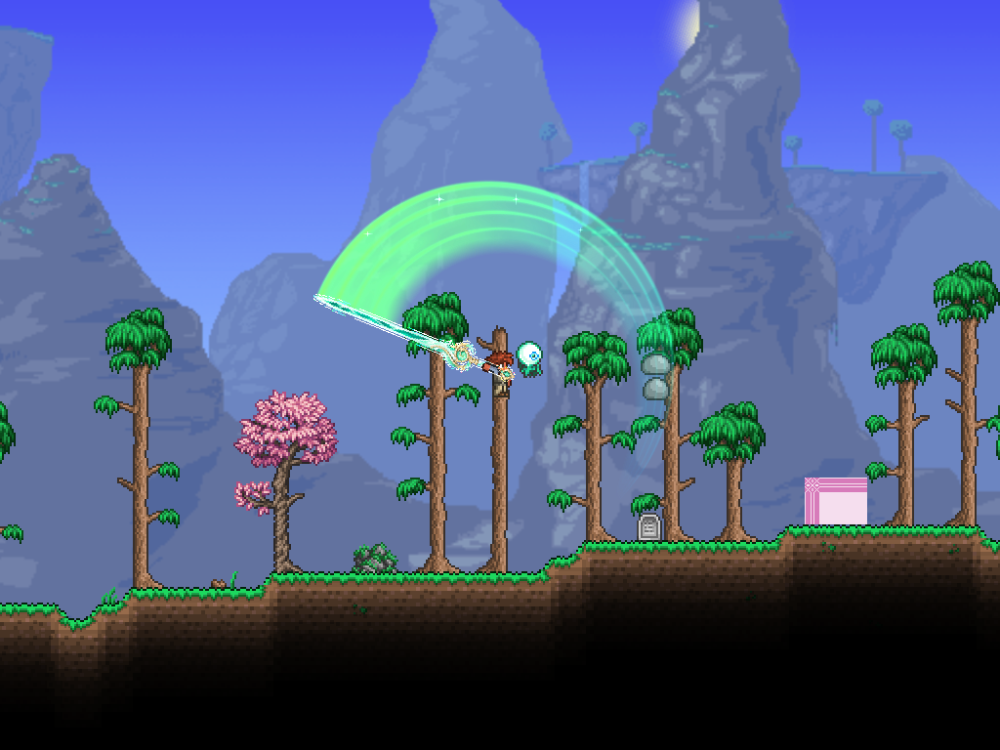

# 青绿剑身与96宽剑气验证（2026-10-25）

实现基于91a8635；本轮未提交或推送。

- PASS：主项目BuildMod=false构建，0警告0错误。最初沙箱构建无诊断失败，沙箱外重试与实机脚本内构建均成功。
- PASS：VFX离线26/26，包含实际输出网格头部宽度测量：192半径对应96宽，288半径对应144宽。
- PASS：隔离客户端原生物品回归15/15；1／2倍攻速40／20刻，伤害135／135／101+101／371、角度衔接、暴击面板均通过。
- 已查看实机截图：1倍攻速第一、二、四段及2倍攻速第三段；剑身无矩形背景，握点位置正常，尖端贴合剑气外缘，宽条带与较长拖尾正常显示。
- 未验收：联机、其他缩放／光照环境、用户动态手感与最终美术定稿。

## 资源

内置image_gen生成；[完整提示词](../assets/hallow-sword/prompt.txt)、[生成与处理记录](../assets/hallow-sword/README.md)。源图有真实Alpha，脚本清理低透明度残色后输出48×240剑身和48×48图标。源图不打包进游戏，运行时读取Assets/Textures/Hallow内的成品。

握点(24,196)到尖端(24,4)为192；实际绘制按攻击半径缩放并以握点旋转。剑气宽度=半径×0.5，记忆=实际段时长×0.33÷max(1,圈数)。40刻下普通段0.22秒、两圈段0.11秒；2倍攻速相应减半。

## 证据

- [离线报告](2026-10-25-hallow-sword-offline.json)
- [实机报告](hallow-sword-2026-10-25/report.json)：UTC 10:05:26（北京时间18:05:26）。
- [构建与资源哈希](hallow-sword-2026-10-25/build-hashes.json)
- 实机命令：Tests/Run-HallowLive.ps1，obj/hallow-live隔离存档；未修改真实存档。
- 测试项目仍有NU1900漏洞源网络警告；打包器仍提示Image loading failed: unknown image type，实际新资源已成功加载渲染。未声称解决这些既有提示。
- tML自动删除的无关神圣火花本地化条目已恢复，避免混入本轮修改。

