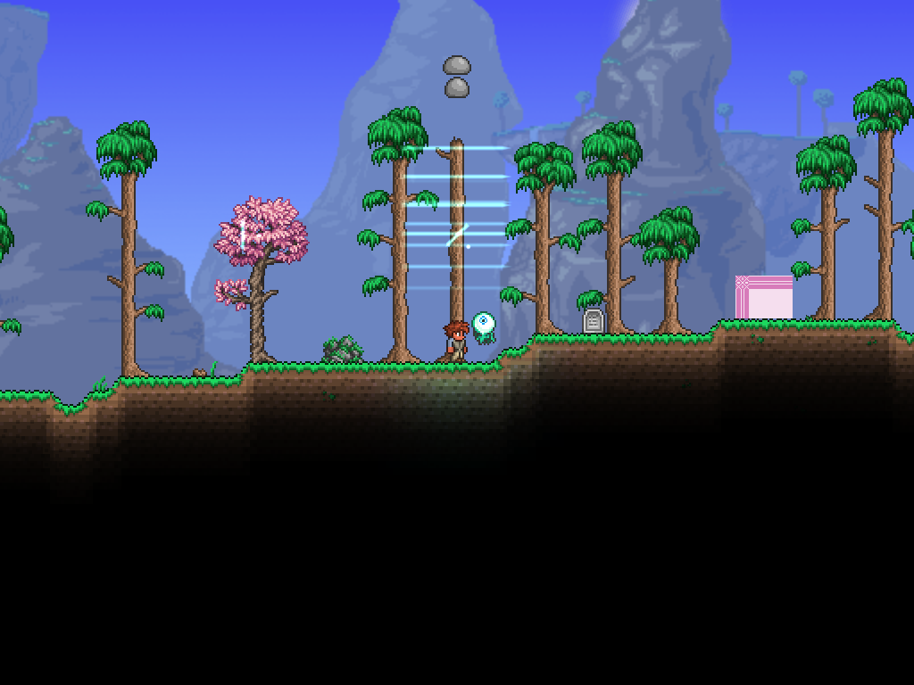
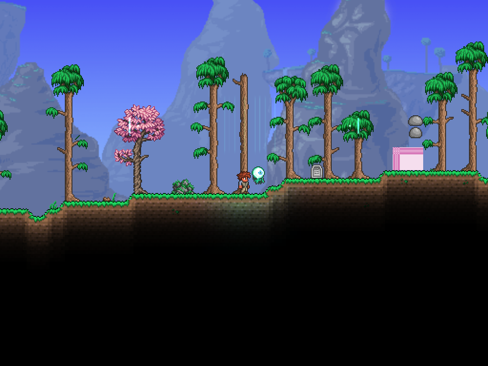
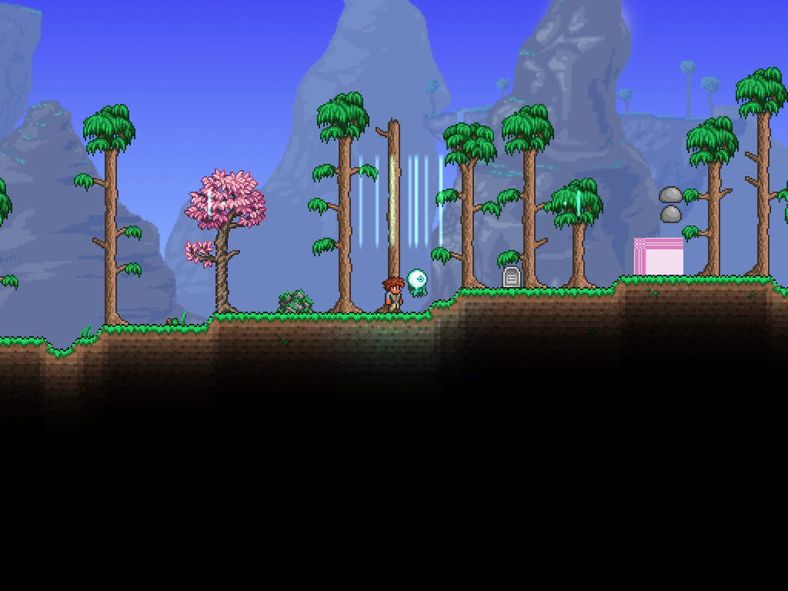
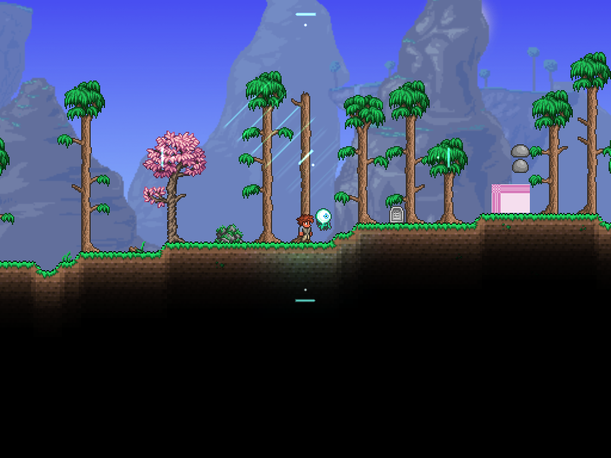

# 声波 Demo 验收记录

日期：2026-10-25。基础检查点为 `0d43c80`，当时保存全部既有天裁／VFX 工作；本轮新增声波内容，不修改 Basic 核心。

## 环境与真实结果

- 本机 TML：1.4.4.9+2026.08.3.0，FNA D3D11，.NET 8.0.19；Luminance 1.0.14、SubworldLibrary 2.3.0.1。
- 主项目构建：PASS，0警告0错误；TML使用编译产物打包成功。打包日志出现 `Image loading failed: unknown image type` 提示，但产物加载、实际游戏和截图成功，不将提示隐瞒为完全无日志警告。
- 声波离线：PASS，14/14，[报告](2026-10-25-sound-offline.json)。包含同相、反相、π/2、不等幅、次序独立、相消后不恢复满振幅、相位采样、镜面反射、SAT、近零方向容差、能量有界和表现过期。
- 已有框架回归：Calculate 23/23、Element 14/14、VFX 21/21 PASS；[VFX报告](2026-10-25-sound-vfx-regression.json)。VFX构建的NuGet漏洞审计源不可达产生NU1900，测试通过不代表审计通过。
- 单人实际客户端：PASS，33/33；[完整报告](sound-2026-10-25/final/report.json)。六种场景真实运行1440刻，使用实际AI、Projectile.Damage、元素事务与完整Draw，非手动调用StrikeNPC。禁用隔离存档自动保存，结束退出。
- 真实本机TCP专服／双客户端：PASS，4/4、6/6、6/6。报告：[服务器](sound-2026-10-25/final/network-server.json)、[客户端一](sound-2026-10-25/final/network-client1.json)、[客户端二](sound-2026-10-25/final/network-client2.json)。额外逐值比较三阶段伤害及风库存，两个客户端都与服务器一致。
- 联机通过后只补充客户端表现心跳保险、常量提取及测试脚本镜像逐值断言；最终单人再次33/33通过。最终启动曾被新订阅模组提示暂停，关闭提示后正常完成，隔离目录仍只启用原三项依赖。最后的DLL与打包产物哈希保存在 final/build-hashes.json。

## 实测数值

所有靶标零防御、禁用伤害随机和暴击。每个场景单靶只被一个波包命中一次。

| 场景 | 实际伤害 | 实际风量 | 备注 |
| --- | ---: | ---: | --- |
| 单波 | 83 | 0.827236 | 目标在发射点右侧240像素 |
| 反射 | 68 | 0.680150 | 经过45°镜面，转向上方命中 |
| 同相融合 | 105 | 0.524003 | q=1 |
| 反相融合 | 21 | 2.096011 | q约0 |
| 中间相位融合 | 63 | 1.310007 | q约0.5 |

三个融合场景距离完全相同，数值含传播衰减。专服实际重复验证反射／同相／反相三个场景，伤害分别68／105／21，风量与单人一致；客户端只显示同步结果，不执行托管NPC伤害。

## 截图检查

1024×768客户端后缓冲，在每个场景第65刻截图。已查看全部六张：波峰有明确间隔和柔边；单波向右时波面竖直，反射向上后波面水平；同相波明显更亮、更厚，反相波较暗偏绿，中间相位介于两者。短暂的压缩纹理位于融合处，后续波独立前进。截图只证明采样帧，连续手感和其他分辨率不作已通过声明。

| 单波 | 反射 |
| --- | --- |
|  |  |

| 同相 | 反相 |
| --- | --- |
|  |  |

| 中间相位 | 多哨兵 |
| --- | --- |
|  |  |

## 失败与修复证据

1. [单人首轮](sound-2026-10-25/initial/report.json)：同相／反相／中间相位的q已正确，但正对碰角度的sin(π)残差被归一化成竖直传播，未击中右侧靶标。改为相对容差判断零动量，补离线回归。风检查读错水槽，改为实际风槽；结果明细持有可变列表导致后续清空，改存数组快照。修复后33项全通过。
2. [联机首轮服务器](sound-2026-10-25/initial/network-server.json)：哨兵未发射，三端无波。核对本机NewProjectile方法体发现服务器代玩家生成不自动写ai、不自动发送，补显式初始化与出生广播。
3. [联机第二轮服务器](sound-2026-10-25/initial/network-second-server.json)：反射、反相成功，但连续清场后的同相哨兵未发射。原生Kill经owner回传与紧邻复用identity有冲突；在原生范围轮转空闲identity后，第三轮三端全部通过。原失败报告保留，不用最终通过覆盖历史失败。

## 尚未验收

主机模式、晚加入／重连、丢包／高延迟、身份环回后的极端迟到消息、第三方客户端同时生成大量弹幕、正式召唤栏位、多体节敌人预算、暂停／缩放／切分辨率／世界切换。代码有世界清理与视觉心跳保险，离线验证已覆盖表现过期，但未声称完成上述所有实机操作。

身份轮转沿用原生有限索引与客户端信任模型，不能替代可靠的跨代反作弊协议。后续正式武器应专门验证混合攻击与高延迟条件。
