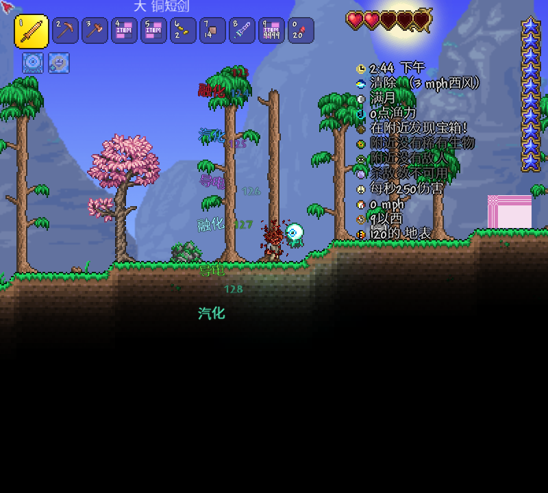

# 元素文字验收（2026-10-26）

- tML：1.4.4.9+2026.08.3.0。本机实际方法体确认 `HideCombatText` 随 StrikeNPC 网络包发送；反应寿命覆盖原版文字 Update，避免原版额外缩小退场延长 2.5 秒。
- PASS：主项目构建 0 警告／0 错误；打包器仍输出既有 `Image loading failed: unknown image type`，不是本轮消除的警告。
- PASS：`Tests/ElementText/ElementText.Tests.csproj` 14/14，覆盖色值、首标签、静置三种选色、本地化键、枚举数值、32 像素圆形边界、倾角、150 刻和清理。
- PASS：原元素离线 15/15，Calculate 离线 23/23。
- PASS：`Tests/Run-ElementTextLive.ps1` 真实客户端 10/10，包括普通火伤仅一个数字、融化名称、无敌无文字、静置融化、玩家受伤、暴击、生命周期、跨反应排斥及原版池复用。
- PASS：`Tests/Run-ElementLive.ps1` 原有元素真实客户端回归 15/15。
- 已检查最终截图中的六种元素色和中文倾斜文字。截图展示的是开发色样，特意让不同元素搭配相同反应名，以展示“按本击元素选色”。数字仍按原版轨迹上浮，反应名停留原位置。
- 未验证：专服／双客户端文字展示、主机模式、其他模组改写伤害字的兼容性、不同缩放下的人工观感。
- 已知边界：远端玩家原版伤害包没有完整反应方案；无法从伤害来源恢复元素的远端静置玩家数字仍保留原版色，所属端数字和同步反应名颜色完整。

[文字实机报告](element-text-2026-10-26/text-live.json) · [元素实机回归](element-text-2026-10-26/element-regression.json) · [构建哈希](element-text-2026-10-26/build-hashes.json)

