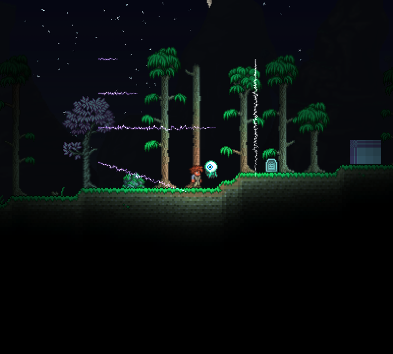
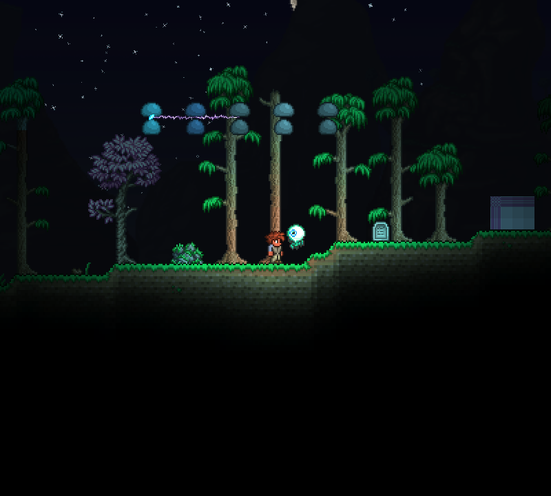

# 双端点闪电与导电接入验收（2026-10-26）

先独立实现并测试40／80／240像素横线、斜线及竖线，检查截图后再接入导电。最终客户端为tML 1.4.4.9+2026.08.3.0、FNA D3D11、RTX 5060 Laptop GPU、800×720窗口。隔离存档obj/lightning-live，不保存世界；正常Mods包也已重新打包。

|层级|状态|范围|
|---|---|---|
|材质编译|PASS|D3D9 Effect 1064字节|
|分析器构建|PASS|0警告0错误|
|Vfx离线|PASS 36/36|新增3组闪电测试，包括4000组长度／方向／种子约束组合、密度、异常输入和寿命|
|独立实机阶段|PASS 5/5|五种样例创建、三张截图回读、清理|
|最终实机|PASS 11/11|[报告](lightning-2026-10-26/report.json)，包含五张截图回读|
|元素实机回归|PASS 15/15|[机制报告](lightning-2026-10-26/element-live-tests.json)|
|视觉检查|PASS|细密白芯／紫色柔光、有限偏移、横竖斜方向与淡出；链弧到第三靶结束|
|多人／其他图形后端|未执行|未验证多人、OpenGL／Vulkan、第三方光照兼容|

真实链伤仍为150→95→53，并在高防御目标前终止；派生无附着，只生成两条有效链段。截图回读成功本身不代表观感合格，本轮另行检查了实际图片。

初次沙箱构建无诊断退出；沙箱外构建暴露测试代码Vfx命名冲突，改为global限定后通过。离线运行有NuGet漏洞源访问警告，测试本身36/36。tML打包仍报告既有“Image loading failed: unknown image type”，不将打包记为无警告。

[独立淡出](lightning-2026-10-26/standalone-fade.png)、[独立到期](lightning-2026-10-26/standalone-ended.png)、[导电淡出](lightning-2026-10-26/reaction-chain-fade.png)。

复现：先编译Lightning.fx，再运行`dotnet run --project Tests/Vfx/Vfx.Tests.csproj --no-restore`和PowerShell 7脚本`Tests/Run-LightningLive.ps1`。首次实机脚本需要obj/element-live中的测试玩家、世界、Mods和config.json作为种子；脚本检查本轮报告时间、条目数和失败项。

几何及亮度时序按需求适配，发光材质为自行重建，不宣称与1.4.5原版逐像素一致。
