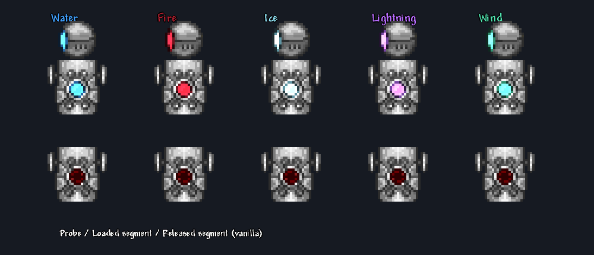
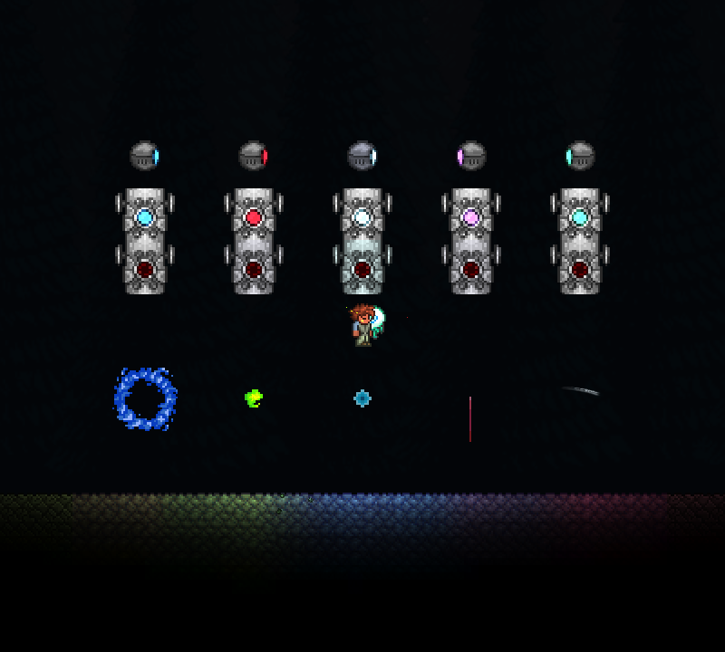

# 神圣毁灭者一阶段验收（2026-10-30）

## 实现及绘制调查

本轮保持 DestroyerBehavior.States.cs 运动、身体激光与原版 HitEffect 释放逻辑。体节由服务器独立等概率分配五元素，探测怪从生成来源继承；两者通过 ExtraAI 同步。本体各段减伤共用 DestroyerBarState.Remaining×1%，释放不减计数，击败才减计数。计数初始化后归零只暴露二阶段资格，二阶段技能尚未接入。

本机原版 Main.DrawNPC 与 NPC.FindFrame 源码显示，身体使用 NPC_135 本图和 TextureAssets.Dest[1] 发光层；探测怪另有 TextureAssets.Probe 发光层。身体 ai[2]==0 使用载荷帧，释放后使用第二帧。直接给整张贴图乘元素颜色会染色金属，也会把红色灯乘蓝色变黑。因此通过官方 PreDraw 分别重染本图红色区域和发光图强度，保留原版帧、锚点、旋转、翻转及透明度；释放后交回原版绘制，空槽仍是原版暗红色。没有使用 IL Hook。

探测怪没有新增运动 AI：原生发射的 PinkLaser 实例通过父 NPC 来源选取元素行为，普通探测怪和其他来源激光不启用。水弹使用 Projectile_385 外观，命中后返回原探测怪、返程能再次伤人；原探测怪消失或槽位复用时销毁。风刃沿直线飞行并复用 Idyllic，弧线碰撞使用相同透视变换。五类弹幕带对应元素标签，不带 Hallow 标签；本体和探测怪接触攻击不额外添加元素。

首版参数集中于 DestroyerPhaseOneRules：元素附着量1、非雷弹寿命180刻、水弹返程速度9／加速度0.3、风刃宽度128／碰撞厚度6。它们是可调初值，尚未完成战斗平衡验收。射击伤害、计时、受击重置和视线条件继续由原版探测怪 AI 决定。

## 验证证据

- 构建：0警告、0错误；打包仍有既有资源的 unknown image type 提示，未阻止本轮加载。
- [单人一阶段报告](singleplayer.json)：45/45，包括真实召唤、五元素继承、原生射击时机、受击重置、弹幕标签、水弹首次及返程两次实际命中、计数／减伤、金属像素保持和归零资格。
- [原版状态机回归](vanilla-regression.json)：52/52，包括原版与自定义分流、运动对照、链、激光、淡入、释放及字段隔离。
- 真实TCP联机38/38：[服务器12项](network-server.json)、[召唤客户端14项](network-client1.json)、[晚加入客户端12项](network-client2.json)。覆盖首刻标记、继承、计数／减伤、五元素弹幕及非神圣标签同步、真实远端水弹命中返程。最终运行目录为 obj/mechanical-network/20261030-190059，日志未检出 Exception／ERROR／underflow。





复现命令（顺序运行，避免共用隔离包被客户端锁定）：

```powershell
pwsh -File Tests/Run-DestroyerPhaseOneLive.ps1
pwsh -File Tests/Run-MechanicalLive.ps1 -Mode state
pwsh -File Tests/Run-MechanicalNetwork.ps1 -PhaseOne
```

测试仅在显式环境开关下启用，使用隔离存档。释放调用原生 HitEffect，射击走原生 AI，水弹通过真实玩家受伤触发返程；为稳定观察，夹具固定样本位置，联机保活样本探测怪和弹幕，手动设置射击计时。五色图由实际客户端调用正式绘制函数生成，世界图另行捕获。以上是受控机制证据，不等同于完整战斗手感、特殊世界、高延迟／丢包、重连或长时间多人战斗验收。本轮未向日常游玩 Mods 目录部署。

## 联机修复

返程消息使用130，避开已有129号结界消息。命中由玩家客户端判定后通知服务器，服务器检查来源与距离并立即发送 SyncProjectile；不能只在网络处理或 PostUpdateEverything 设置 netUpdate，因为原版下一次 Projectile.Update 开头会清除它。弹幕设为 netImportant 支持晚加入，首次客户端配置尺寸时保留已同步位置。

晚加入期间受伤文字可能先于来源实体组件到达，ElementTextSystem 改为检查 active 与 TryGetGlobal，缺失时使用空标签，避免异常。早期失败报告保留在 obj/mechanical-network 下，最终报告独立归档，不将修复前结果记为通过。
