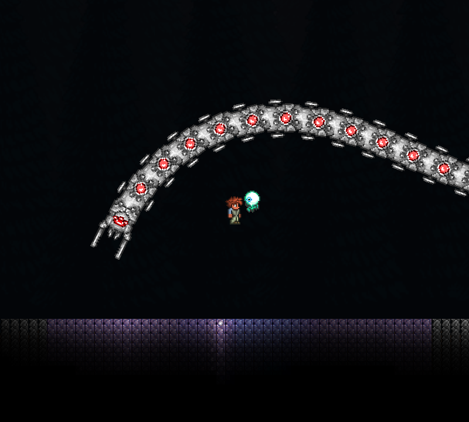
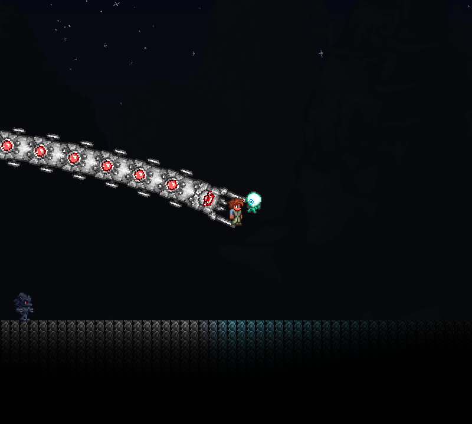

# 三王神圣覆盖与毁灭者状态机验收

日期：2026-10-28。基线：Terraria 1.4.4.9／tModLoader 2026.08.3.0，Windows D3D11，隔离大师世界。测试通过环境变量启用，正常游戏不运行测试驱动。

| 阶段 | 结果 | 证据 |
| --- | --- | --- |
| 三王空行为 | 34/34 | [历史报告](empty-report.json) |
| 最终毁灭者状态机 | 52/52 | [单人报告](state-report.json) |
| 服务器 | 6/6 | [报告](network-server.json) |
| 召唤客户端 | 8/8 | [报告](network-client1.json) |
| 晚加入客户端 | 6/6 | [报告](network-client2.json) |

最终联机运行目录为 obj/mechanical-network/20261028-195013。构建 0 警告／0 错误。

单人通过实际方块构造神圣／普通环境，再驱动玩家使用原生召唤物，没有直接伪造 ZoneHallow 或手工设置生成头部的 Hallow。确认物品只消耗一次、普通版本仍运动、神圣双子／骷髅王空行为停止原版运动。毁灭者最终版本检查完整子节、标记继承、淡入和状态；另以定向测试检查激光、共享生命、原版 HitEffect 释放探针、释放后的继续射击、普通 NPC 无组件及槽位重置。

8 组各 90 刻的运动内核对照调用真实 VanillaAI 和候选 PreAI，覆盖 FTW 开关、撤退与地形组合。最大位置差 5.390625 像素，最大旋转差 0.03553033 弧度；容差为 8 像素和 0.05 弧度。最初 4 像素阈值失败后依照基本行为验收目标调整，未将结果描述为逐位相同。内核对照不替代完整世界回放。

联机由真实服务器和两个客户端完成，第二个客户端在召唤完成后加入，验证头身尾同步及首次 AI 前标记；召唤客户端检查真实生物群系和消耗。未模拟高延迟或消息跨多刻分批接收。

## 复跑

需要本机 tML 及隔离种子 obj/element-live 内的 testPlayer、testWorld、Mods 和 config.json；脚本依赖该已有测试夹具，不是全新克隆后一条命令自动创建世界。

```powershell
pwsh -File Tests/Run-MechanicalLive.ps1 -Mode state
pwsh -File Tests/Run-MechanicalNetwork.ps1
```

客户端测试使用 obj/mechanical-state-live，联机按时间建立独立目录。正常玩家存档不作为测试场地。empty 模式只用于最初空实现阶段；最终代码已实现毁灭者，不能期待该历史模式继续通过。测试脚本默认已切换为 state。

## 绘制检查

两张截图均由真实客户端绘制，测试为了方便观察平移完整链并补光，没有替代 NPC 绘制。已检查原版节段贴图、比例、旋转、红色发光及淡入后的显示；位置和姿态不同，不作逐像素比较。





## 证据边界

机械美杜莎挂接代码保留但完整组合战斗未实机验证。FTW 开关内核对照不代表完整特殊种子验收；其他难度、第三方 Boss 重做兼容、OpenGL 和长期高延迟压力仍待专项验证。原版掉落等外围继续复用，没有将其每个分支重新执行一遍。双子魔眼与机械骷髅王神圣行为仍为空，这是本次交付范围。
