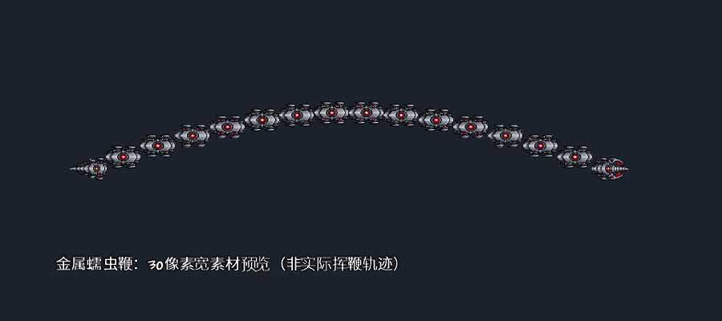

# 金属蠕虫鞭与刃杖验证（2026-10-31）

基线：本机Terraria 1.4.4.9／tModLoader 2026.08.3.0，.NET 8。机制与数值以[Hallow.md](../../Hallow.md)的实施约定为准。

## 实现

- 金属蠕虫鞭沿用原版DefaultToWhip／SwordWhip默认参数与控制点碰撞。基础攻击24刻；按原版迪朗达尔物品28刻补偿距离倍率，保持相同长度，不继承迪朗达尔额外攻速Buff。
- 第一笔有效鞭击刷新owner独立标记并生成一次探测怪，后续目标继续标记但不再生成；挥空不生成。五元素等概率、50%本次初始伤害快照、零附着神圣召唤攻击。探测怪绕敌飞行，生成后180刻发射、240刻消失，水弹命中后不返程。
- 标记12点附加伤害遵循原版仆从倍率，只对标记者自己的仆从／哨兵及其弹幕生效；新探测怪派生弹被排除。每owner独立240刻计时，可同时存在多人标记。
- 刃杖以八分之一单位整数保存1.25水储量，普通有效命中扣2、同owner标记命中扣1；每击0.25附着，不改变反应消耗或CD倍率。耗尽由服务器停止伤害并进入无伤返程，接近玩家补满；原版伤害、穿甲、召唤位、Buff与攻击AI保持。
- 服务器直接生成玩家owner弹幕会绕开原生owner的AI初始化和identity分配，因此改为服务器确认后发132号生成指令，owner按原生NewProjectile生成探测怪及单次攻击。服务器不接收客户端生成指令，伤害继续走项目既有NPC权威管线。网络重建实例没有OnSpawn时，首击从同步damage补齐快照，防止派生攻击退化为1点。
- 神圣毁灭者头部死亡才触发掉落；普通模式一把世界物品，专家／大师复用原版DropItemInstanced及参战记录，不向普通宝藏袋追加。保存并恢复该API会清零的NPC.value，保留原有金钱掉落。

## 验证

- 构建0警告0错误；隔离打包仍有既有unknown image type提示，不阻止加载。
- 元素离线回归16/16通过。
- 以下报告属于立即发射的历史版本，新绕敌时序的单人专项29/29通过，见[本轮报告](orbit-singleplayer.json)：179刻不发射且发生位移、180刻一次发射、239刻仍存在及240刻消失。时序边界由真实客户端内手动推进正式AI验证，不等同于人工观察四秒动态；联机回归19/19通过（运行目录obj/metalworm-network/20261031-193634）：[服务器](orbit-network-server.json)、[客户端1](orbit-network-client1.json)、[客户端2](orbit-network-client2.json)，实际等待延迟发射后确认唯一探测怪和唯一派生弹。目标失效重选实战、运动观感及高延迟待验收。
- [单人27项](singleplayer.json)：正式Projectile.Damage驱动鞭击／刃杖命中，涵盖空挥、双目标单探测怪、伤害快照、元素标签、普通5击／同owner10击、其他owner隔离、无伤返程、回充、控制点长度与掉落分流。标记240刻为真实游戏时间；掉落由正式OnKill入口驱动，不是完整Boss战斗。
- 三端联机19/19：[服务器9项](network-server.json)、[客户端1五项](network-client1.json)、[客户端2五项](network-client2.json)。运行目录为obj/metalworm-network/20261031-190625；覆盖owner隔离、服务器扣量与回充、双方镜像，以及服务器重建鞭子经owner生成唯一探测怪／唯一派生弹，验证50%伤害与元素标签。夹具通过阶段文件编排，但标记、储量和弹幕通过真实TCP包传递；耗尽阶段固定远离玩家避免回充抢先，回充阶段放行正式PreAI。
- 单人和联机测试均为受控机制验证；不等同于完整战斗手感、实际挥鞭动态视觉、高延迟／重连或多人个人掉落实战验收。本轮未向日常Mods目录部署。

复现命令：`dotnet run --project Tests/Element/Element.Tests.csproj --no-restore`；顺序运行`pwsh -File Tests/Run-MetalWormLive.ps1`与`pwsh -File Tests/Run-MetalWormNetwork.ps1`，不要在单人客户端未退出时对同一隔离模组打包。

## 素材与试用

开发命令`/metalworm`领取鞭子与原版刃杖。物品描述已补充中文及英文。

原图：[MetalWormWhip.png](../../../Assets/Textures/Hallow/MetalWormWhip.png)，使用imagegen生成并保留透明背景。三个部件的裁切矩形集中于MetalWormRules.HeadFrame／BodyFrame／TailFrame；实际绘制宽度由DrawWidth=30控制，原图分辨率不等于游戏显示像素数。替换素材时同步这三个矩形即可，鞭子长度与碰撞不依赖贴图尺寸。

以下为FNA实际素材绘制陈列，已查看；用于检查30像素宽的清晰度，不表示游戏中的挥鞭运动轨迹。

