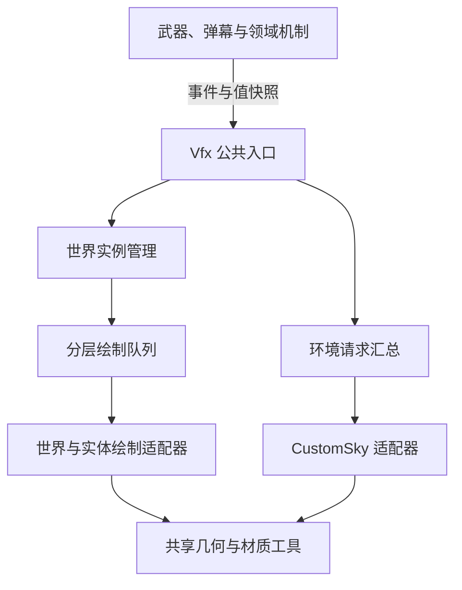
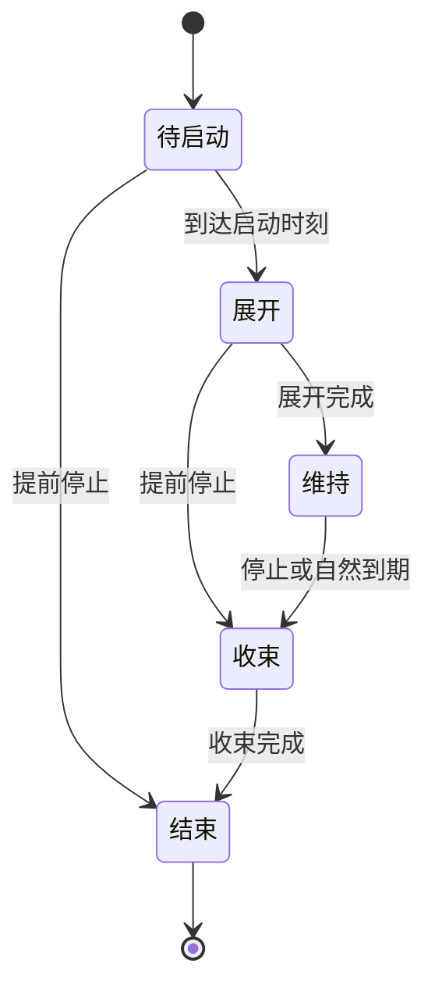

# tML 视觉特效框架设计

> 版本：1.0  
> 日期：2026-10-24  
> 用途：在 tModLoader 模组内搭建不额外占用弹幕槽位、便于扩展的客户端特效框架。  
> 范围：管理框架、公共绘制工具、武器／弹幕特效、全局背景特效、领域特效的主要视觉实现。  
> 状态：基础框架与三个示例已实现，框架位于 Basic/Graphics，示例位于 Contents/Vfx；离线 14/14，已进行单人截图验收，其他验收边界见 TODO.md、Vfx-Usage.md 与 testing/2026-10-24-vfx.md。

### 2026-10-24 项目落地说明

- 本文下方的接口草案和目录示意用于表达设计，实际接口以 `Vfx-Usage.md` 为准；公共工具已落在 `Basic/Graphics`，内容落在 `Contents/Vfx`。
- 当前使用自建网格与 FNA BasicEffect 处理精确接缝、三弧缺口与双端扫掠；程序化软遮罩服务云雾／光柱。Luminance 适配器、流光 shader、离屏后处理属于可选扩展，本次没有另建这些设施。
- 三叶结按作者新给参考图拟合三段对称贝塞尔弧，只画中心线。轮廓控制点、颜色与动画参数是可替换的示例样式。
- 当前世界实例预算为 256，满额拒绝新实例而不抢占旧实例；环境最多保留当前样式与一个淡出样式。正式机制源身份、晚加入重建及联机协议仍由后续机制接入完成。
- 依赖实际核对为 tML 1.4.4.9+2026.08.3.0、Luminance 1.0.14；下文 Luminance 1.0.12 是原设计核对的源码基线，不代表本机实际运行版本。

## 1. 设计结论与适用范围

采用 **一个 `Vfx` 公共入口、两类内部管理、共享绘制工具**：

- **世界特效实例**：管理剑气轨迹、弹幕拖尾、附着光效、领域图案等具有位置和独立生命周期的表现。
- **环境请求**：管理多个来源对天空、背景色调等全局表现的共同需求。
- **绘制工具**：提供曲线采样、轨迹缓存、带状网格、精灵／粒子绘制、材质参数与渲染状态控制。

武器特效与领域特效共用世界实例管理。全局背景使用请求汇总，再接入 `CustomSky`。三类内容不需要各建一套生命周期管理器。

### 1.1 核心约定

1. **机制先执行，表现独立跟进。** 机制创建后立即生效，视觉可以稍后出现并展开；机制关闭后立即失效，视觉可以继续旋转、缩小、淡出。
2. **纯视觉不额外创建 Projectile。** 已有机制弹幕可以为特效提供状态，也可以在自己的绘制钩子中绘制附属效果；独立残迹与领域由普通 C# 对象管理。
3. **统一生命周期不等于统一绘制位置。** 天空、地形之后的世界效果、实体前后的效果，仍接入各自合适的绘制入口。
4. **绘制只读取状态。** 年龄、旋转、展开进度和粒子运动在更新阶段推进，绘制次数不影响动画速度。
5. **内容决定外观，框架决定管理。** 新增颜色、路径、材质通常增加配置；新增行为增加一个特效类，不修改管理器的类型分支。

这里的“零新增弹幕”仅指视觉表现不新增弹幕。武器或领域机制原本是否使用 Projectile，由机制实现自行决定。

### 1.2 三个示例的约定

| 示例 | 本文覆盖的主要视觉 | 管理方式 |
| --- | --- | --- |
| 真近战剑气 | 随挥动生成的弧形扫掠轨迹、亮边、柔光、结束后的短暂残留 | 短寿命世界实例；简单附着部分可直接随实体绘制 |
| 金色天空 | 金色背景基调、简化云雾、从画面上方投下的金色光柱 | 环境请求汇总 + `CustomSky` |
| 金色领域 | 中央三叶结细发光路径、边界金色粒子、整体旋转、旋转展开与收束 | 一个复合世界实例 |

中央图案以最新提供的三叶结参考轮廓为准，提取其**中心线路径**形成细光线。2026-10-24 作者确认：实际使用三段弧线的中心线轨迹，按参考图拟合曲率与穿插关系。参考图中的宽条填充不属于目标效果，也不再沿用“三段各为 $2\pi/3$ 圆弧”的旧约束。

本文不规定伤害、碰撞、增益、领域互斥、触发条件、具体颜色值、动画时长或粒子数量。这些由各内容的机制与美术设计补充。

### 1.3 依赖接口基线

- tML：以官方 stable 文档中的 `ModSystem`、`ModProjectile`、`CustomSky` 接口为依据；涉及天空更新顺序时参照官方 `1.4.4` 分支补丁。[T1]、[T2]、[T3]、[T5]
- Luminance：接口核对基于官方 `release` 分支快照 `2bd31bebe81905f597c4070d6a709efd1da1186c`，该快照 `build.txt` 声明版本 `1.0.12`。[L0]
- 图形层：使用 tML 运行环境提供的 `Microsoft.Xna.Framework` 与 `Microsoft.Xna.Framework.Graphics` 类型。

本文中的 `Vfx`、`WorldVfxSystem`、`WorldEffect`、`EnvironmentController`、`VfxDrawQueue`、`TrailBuffer` 等名称均为**项目拟实现的类型**，不是 tML 或 Luminance 自带接口。接入时在项目中记录实际 tML 与 Luminance 版本，再核对适配层。

## 2. 总体结构



### 2.1 模块职责

| 模块 | 负责 | 边界 |
| --- | --- | --- |
| `Vfx` | 创建、提交目标状态／轨迹样本、停止、撤销环境请求 | 不执行伤害，不直接发起 GPU 绘制 |
| `WorldVfxSystem` | 实例集合、句柄查找、命令处理、更新、结束与回收 | 不识别具体武器或领域的机制规则 |
| `WorldEffect` | 单个效果的动画状态与绘制内容 | 不承担全局实例调度 |
| `EnvironmentController` | 汇总请求、选择样式、计算环境过渡 | 不生成额外世界实体 |
| `GoldenSky` 等天空适配器 | 将环境状态接入 tML 天空绘制 | 不重复推进控制器已经推进的时间 |
| `VfxDrawQueue`／绘制适配器 | 确定绘制阶段、顺序、材质与 GPU 状态 | 不更改效果生命周期 |
| 资源与几何工具 | 缓存纹理／路径、采样曲线、生成网格、提交绘制 | 不掌握玩法来源的生死 |

初版可以只设一个承担主要更新与清理的 `ModSystem`；`EnvironmentController` 是它持有的普通对象。天空类继承 `CustomSky`，但无需为每类效果建立额外的 `ModSystem`。

### 2.2 建议目录

| 目录／文件 | 内容 |
| --- | --- |
| `Common/Vfx/Vfx.cs` | 薄门面与内容便捷入口 |
| `Common/Vfx/WorldVfxSystem.cs` | 实例集合、命令队列、统一更新与清理 |
| `Common/Vfx/WorldEffect.cs` | 最小实例契约、上下文、句柄 |
| `Common/Vfx/Environment/` | 环境请求、样式仲裁、过渡状态 |
| `Common/Vfx/Rendering/` | 绘制队列、阶段适配器、材质绑定 |
| `Common/Vfx/Geometry/` | 路径采样、描边网格、双边轨迹网格、轨迹缓存 |
| `Common/Vfx/Assets/` | 样式定义、路径数据、共享资源索引 |
| `Content/Vfx/Slashes/` | 剑气与弹幕轨迹实例 |
| `Content/Vfx/Wards/` | 领域实例与领域样式 |
| `Content/Vfx/Skies/` | 金色天空等具体背景 |
| `Assets/Textures/Vfx/` | 软光点、光条、噪声、遮罩等贴图 |
| `Assets/AutoloadedEffects/Shaders/` | 按项目 Luminance 加载约定组织的普通 shader |

这些目录是职责边界，不要求每行都发展成一个子框架。初版文件较少时可以合并。

### 2.3 宿主的接线顺序

1. 项目引用 Luminance，将其类型使用集中在绘制与粒子适配层；内容类主要依赖本项目的 VFX 接口。
2. 在客户端初始化集合、样式表与天空适配器。资源请求遵守 tML 内容加载时序；自有 GPU 资源在正确的图形线程创建，不放在任意静态初始化中。
3. 将 `GoldenSky` 注册到 `SkyManager.Instance["ModName:GoldenSky"]` 一类唯一键下，由环境控制器负责所需的激活与停用。[T8]
4. 在选定的 `ModSystem` 更新入口处理命令与动画，在具体绘制钩子执行对应 pass。
5. 世界清理时清空实例和请求；模组卸载时解除本模组增加的钩子并释放自有资源。

这样入口、更新、绘制与清理都有固定位置。新增一种效果通常只需要内容类、样式资源和一个便捷创建方法。

## 3. 世界实例管理

### 3.1 数据结构

初版使用以下结构即可：

- 一个活动实例列表，负责顺序更新。
- 一个句柄到实例记录的字典，负责查找。
- 一个简短命令队列，避免在遍历中直接增删实例。
- 一个待移除列表，统一完成释放。
- 按实际需要建立的绘制命令集合。

待启动效果也登记在实例记录中。它已经拥有句柄，只是还不能绘制；不要把延迟启动实现为一个脱离实例管理的“未来再创建”回调。

### 3.2 最小公共操作

以下是语义约定，名称可以按项目习惯调整。

| 操作 | 语义 |
| --- | --- |
| `Create(effect, delay)` | 登记效果，立即返回句柄，可选择延迟进入 |
| `SetTarget(handle, state)` | 提交中心、半径、朝向等最新目标；由具体效果决定如何跟随 |
| `AppendSample(handle, sample)` | 追加轨迹样本；保留路径历史，不能退化为只留最后值 |
| `Stop(handle, finalState)` | 保存结束信息，进入正常收束；重复调用不重新计时 |
| `Kill(handle)` | 立即移除，取消尚未播放的内容 |

`SetTarget` 和 `AppendSample` 不必成为所有效果都支持的泛化接口。可以提供 `SetWardTarget`、`AppendSlashSample` 等有明确参数类型的便捷方法，由它们向同一实例管理器投递命令。

一次性剑气可以自行到期，调用方无需保存句柄。持续领域需要保存句柄，以便更新目标与关闭。

### 3.3 句柄与来源身份

推荐初版采用单调递增的非零 `ulong` 作为本地效果编号：

- `0` 表示无效句柄。
- 在一次模组加载周期内不复用编号，切换世界时也不把计数器归零。
- 清空世界后，旧编号不再存在于字典中。
- 如果以后改为槽位复用，句柄必须包含 generation；跨世界仍需保证不会与旧句柄碰撞。
- 环境请求使用不同的句柄类型，避免误传。

**视觉句柄和玩法来源标识分开。** 一个来源可以产生多个视觉实例；旧领域的收束与新领域的展开可以同时存在。

来源可以记录领域 ID、攻击序号等，用于查找、去重和异常清理，但不能拿 `Projectile.whoAmI` 直接充当长期视觉身份。它是本地数组索引；若确实需要跟随现存弹幕，应验证 `active`、`owner`、`identity`、`type`，必要时补充机制自己的创建序号。[T4]

### 3.4 实例接口草案

下面只展示拟定的项目接口，不是可直接编译的完整实现。

```csharp
// 日期：2026-10-24
// 用途：说明世界特效的最小接口边界；上下文与队列由项目自行定义。
public readonly record struct EffectHandle(ulong Value);
public readonly record struct EnvironmentHandle(ulong Value);

public abstract class WorldEffect
{
    public abstract bool IsFinished { get; }

    public abstract void Update(in VfxUpdateContext context);

    public abstract void CollectDrawCommands(
        VfxDrawQueue queue,
        in VfxDrawContext context);

    public abstract void Stop(in VfxStopContext context);

    // 仅释放实例独占资源；共享纹理与 shader 由资源层持有。
    public virtual void ReleaseOwnedResources() { }
}

public readonly record struct WardVisualState(
    Vector2 Center,
    float TargetRadius,
    float TargetRotation);

public readonly record struct SlashPoseSample(
    Vector2 InnerWorldPosition,
    Vector2 OuterWorldPosition,
    double SampleTime);
```

接口不要一开始加入碰撞、网络序列化、任意参数字典、反射注册或多线程任务。`WardEffect` 自己维护领域状态；`SlashTrailEffect` 自己维护轨迹缓存。

实例记录可负责统一的待启动时间和句柄状态。具体类负责自己的展开、维持与收束曲线；通用的渐入渐出计时器可以复用，但不必强迫所有内容都经历相同阶段。

在提交状态的边界检查非有限坐标、非法半径与空路径等输入。对不可绘制的数据跳过或在开发期提示，避免 NaN／Infinity 进入几何缓冲。此检查只保护表现，不改写机制状态。

## 4. 生命周期、更新顺序与状态快照

### 4.1 生命周期



`Kill` 可从任何阶段直接进入结束。短暂剑气可以省略维持阶段；无展开动画的效果可以直接进入维持阶段。

### 4.2 每次完整游戏更新

建议由 `ModSystem.PostUpdateEverything()` 驱动本框架的客户端更新。这个钩子也会在服务器执行，所以入口必须使用 `Main.dedServ` 等明确条件排除专用服务器视觉逻辑。[T1]

一次更新执行：

1. 取出本轮待处理命令，按提交顺序应用到实例与环境请求。
2. 处理已经取消的待启动实例，再激活本轮到期的实例。
3. 更新世界实例的动画状态；推进环境控制器的过渡。
4. 标记并移除完成的实例，释放其独占数据。
5. 绘制阶段读取这些状态，生成当帧绘制命令。

处理命令时以本轮队列的边界为准；更新过程中新增的命令留到下一轮，避免递归修改集合。初版按顺序处理全部命令就足够，不必先做复杂的合并优化。

**创建与停止发生在同一轮时，应能得到“未显示就取消”的结果。** 因此待启动实例在本轮命令处理完成之前不急于进入展开。

### 4.3 目标状态与路径历史的区别

领域的中心或半径在一轮中被修改多次，通常只需要最终目标。剑气轨迹的多个样本则构成形状本身，不能全部合并为最后一个样本。

Projectile 的额外更新可能提供更密集的姿态样本，但它不能让整个视觉系统重复推进寿命。`extraUpdates`、旧位置数组的记录节奏与绘制帧率不是同一概念。[T4]

项目统一约定：

- **视觉时间**：由选定的游戏更新时钟推进。
- **轨迹采样**：允许在源对象子更新中多次记录，包含顺序／时间。
- **绘制次数**：不改变上述两者。

暂停期间是否继续某些装饰动画应由时钟策略决定。初版建议跟随游戏更新暂停，避免混用现实时间造成突然跳跃。

### 4.4 机制状态、目标状态与显示状态

至少区分三层：

| 状态 | 所有者 | 用途 |
| --- | --- | --- |
| 机制状态 | 武器、弹幕或领域系统 | 命中、增益、有效范围等玩法判断 |
| 视觉目标状态 | VFX 实例 | 接收机制已经发生的变化 |
| 当前显示状态 | VFX 实例 | 插值、展开、收束后的实际绘制参数 |

可以采用指数跟随：

$$
x_{n+1}=x_n+\left(1-e^{-k\Delta t}\right)(x_{\text{target}}-x_n).
$$

中心、半径可分别配置响应系数；角度需要按最短角差处理。该公式是视觉策略，机制仍使用机制状态。

持续跟随的半径与开闭包络建议分开，例如：

$$
R_{\text{display}}=R_{\text{follow}}\,E_{\text{open}}.
$$

这样修改目标半径不会重播展开动画。发生传送等不适合平滑追随的变化时，由内容适配器明确提交“立即定位／断开轨迹”，不要让框架盲目跨越整个地图插值。

### 4.5 正常停止的契约

`Stop` 执行后：

- 保存最后有效的位置、目标参数以及需要保留的轨迹数据。
- 捕获停止瞬间的**当前显示状态**，以此作为收束起点，避免展开一半时突然跳到完整大小。
- 停止继续依赖源实体；后续收束只读实例自己的状态。
- 普通 `SetTarget` 与追加样本命令不再恢复该实例；重新播放需创建新实例。
- 重复 `Stop` 不重置收束计时。

`finalState` 用于补足最终目标信息，不意味着必须瞬间把显示值吸附到目标。若某种内容确实需要吸附，单独定义该策略。

对于数组、列表和轨迹缓存，值类型包装不等于深拷贝。跨帧保存的数据必须复制到实例持有的缓冲区，或明确转移所有权；不要在源销毁后继续引用其可变缓存。

### 4.6 边界行为

| 情况 | 规定行为 |
| --- | --- |
| 延迟启动前收到 `Stop` | 取消，不播放开场与收束 |
| 展开过程中收到 `Stop` | 从当前显示状态收束 |
| 收束过程中再次 `Stop` | 保持现有收束进度 |
| 停止后收到过期目标更新 | 忽略，不复活 |
| 对无效或已结束句柄操作 | 安全无操作，可在调试模式记录 |
| 来源异常消失 | 通过最后有效快照收束；需要立即清除时使用 `Kill` |
| 创建新领域、旧领域仍在收束 | 两个视觉实例可以短暂共存 |
| 退出世界 | 立即清空，不等待收束 |

## 5. 全局环境请求

### 5.1 请求令牌

全局背景不适合使用一个公共 `bool GoldenSkyActive`。多个来源同时开启时，任意一个来源关闭都不应误伤其他来源。

拟定操作：

| 操作 | 语义 |
| --- | --- |
| `AcquireEnvironment(style, parameters)` | 创建一个独立请求，返回令牌 |
| `SetEnvironmentTarget(handle, parameters)` | 修改该请求的强度、优先级等 |
| `ReleaseEnvironment(handle)` | 只撤销该请求 |

一个领域若同时需要局部图案和全局天空，持有一个世界效果句柄与一个环境请求令牌。两者可采用不同的淡出时间。

调用方负责正常撤销请求，来源适配器负责异常销毁、断线等情况下的撤销；世界清理再统一兜底。不要让来源已经不存在的令牌永久维持天空。

### 5.2 初版聚合规则

同一背景样式使用强度最大值：

$$
I_{\text{target}}=\max_{i\in\text{active requests}} I_i.
$$

请求为空时目标强度为零。不同来源不会重复绘制同一套天空，也不会因强度相加而不断过曝。

不同互斥样式按项目定义的优先级选择；平级采用稳定规则，例如样式 ID 或当前占用者优先，避免每帧抖动。优先级选择、同类强度聚合、显示强度过渡是三个不同步骤。

切换样式时，可以保留旧样式淡出、新样式淡入。初版约定最多保留所需的过渡层数，避免每次变化都积累一份天空。若收束尚未结束又出现新请求，从当前强度继续转向新目标，不先归零。

这套仲裁只管理本模组的请求，不假定能统一控制其他模组的天空。也不应把 `ModSceneEffect` 的优先级当作所有 `CustomSky` 实例的自动互斥开关。[T7]

### 5.3 与 `CustomSky` 的分工

推荐由 `EnvironmentController` 推进显示强度、云层相位与光柱时间；`GoldenSky` 读取已计算的环境状态。

对应规则：

- 有可见过渡或有效请求时保持天空活动。
- 请求归零后先淡出，强度到零再完成停用。
- `IsActive()` 应包含仍在淡出的状态。
- `Reset()` 与世界清理将天空恢复到无请求、无可见残留的状态。
- `CustomSky.Update()` 不再次推进同一套时间。

`CustomSky.Draw(spriteBatch, minDepth, maxDepth)` 会接收背景深度区间；实现应按区间绘制对应层，不能每次调用都画一遍完整天空。[T2]

官方 `1.4.4` 补丁中的 `SkyManager.Update` 存在按 `Main.worldEventUpdates` 循环更新天空的逻辑，因此不要把天空自身的 Update 次数直接当作本框架的统一时钟。[T5]

## 6. 渲染接入与状态约定

### 6.1 先确定实际绘制入口

| 表现需求 | 入口与适配方式 |
| --- | --- |
| 覆盖天空／背景 | `CustomSky.Draw`，按背景深度拆分 |
| 现有弹幕身上的光效、前后附属图层 | 该弹幕的 `PreDraw`／`PostDraw` |
| 玩家装备或武器的普通精灵层 | 按需要接入 `PlayerDrawLayer` 等现有绘制路径 |
| 地形之后的独立世界效果 | 可从 `ModSystem.PostDrawTiles` 建立第一种世界绘制适配器 |
| 特定实体前后、人物上方等更精确顺序 | 在确认目标版本绘制流程后增加对应适配器 |

已有弹幕的 `PreDraw`／`PostDraw` 能直接绘制额外内容，无须再生成弹幕；`PostDraw` 在 `PreDraw` 返回 false 后仍会调用。[T3]

`PlayerDrawLayer` 主要向 `DrawDataCache` 添加精灵绘制数据，不能直接当作任意三角网格的通用入口；人物残影也可能导致多次调用。[T6]

`PostDrawTiles` 是固定的世界绘制位置，官方约定在其中自行开启和结束 SpriteBatch。它不会自动提供“人物之前／之后”等所有层级。[T1]

初版只声明已经接入并验证过的绘制阶段。对尚未实现的阶段进行开发期提示，不把一个虚拟枚举值默默映射到错误位置。

### 6.2 管理与绘制可以分别选择

简单贴图可以直接随现有实体绘制，共享材质工具即可。

当效果需要独立寿命、源消失后继续收束、多层组合或统一限额时，再交给世界实例管理。受管理的实例也可以通过指定实体绘制适配器显示，但必须有明确的单一提交路径，防止实体钩子和全局队列把同一部分画两遍。

### 6.3 绘制队列的最小信息

每条绘制命令至少记录：

- 实际绘制阶段。
- 阶段内顺序，以及必须保留的透明覆盖关系。
- 材质／shader、混合方式、采样状态。
- 几何或精灵数据的只读引用。
- 本次绘制需要的颜色、透明度、局部时间等参数。

先按阶段与覆盖关系确定顺序，再合并相邻且兼容的材质批次。不要为了少切一次材质，破坏领域图案的交叉关系或精灵的透明顺序。

队列可以最初只是带排序键的普通结构体列表，不必建立完整渲染图。CPU 缓存可在生成绘制数据时复用，但不能借此推进生命周期或改变机制状态。

### 6.4 坐标、宽度与时间

统一约定：

| 数据 | 约定 |
| --- | --- |
| 世界实例位置与路径 | 世界像素坐标 |
| 路径资产 | 归一化局部坐标；经实例变换后得到世界坐标 |
| 天空背景 | 屏幕坐标／归一化 UV，视差显式计算 |
| 描边宽度 | 工具 API 明确使用半宽或总宽，避免同名混用 |
| 动画时间 | 实例局部时间由 Update 提供 |
| 相机变换 | 在后端适配处执行一次，不在多层重复减相机位置 |

物体尺寸默认采用世界像素。若需要“镜头缩放后仍为固定屏幕宽度”的描边，要单独定义并换算，不能把两种宽度含义混在同一字段中。

### 6.5 SpriteBatch 与 GPU 状态

绘制适配器负责本阶段的 `Begin/End`、shader、纹理槽、混合、采样、光栅化及必要的矩阵设置。

- 一个效果不应为每颗粒子随意切换 SpriteBatch。
- 不能通过臆测恢复“原来的 SpriteBatch 设置”；适配器必须了解所接入阶段的进入与退出契约。
- 进入自有 pass 时显式设置所需状态，退出时恢复宿主期望状态。
- 普通 SpriteBatch 绘制与原始网格提交之间的切换由后端统一处理。
- 共享 shader 在每次真正提交实例前绑定该实例参数，不能认为修改共享对象后每个实例自然保留独立参数。

透明材质需要统一预乘 Alpha 约定。柔光与线芯分别选择合适混合方式；减少大面积高强度叠加，保留金色而不是把所有区域堆成白色。

## 7. 公共工具搭建

### 7.1 样式定义与运行实例分离

样式定义只保存共享内容：

- 贴图、路径与 shader 标识。
- 基础颜色、线宽、辉光宽度。
- 展开与收束曲线、跟随策略。
- 粒子分布、扰动规则、轨迹采样策略。

实例保存运行状态：

- 当前值与目标值、局部时间、阶段。
- 停止时捕获的显示状态。
- 轨迹缓存、粒子随机种子与个体参数。
- 只读样式引用、可选来源标识。

同一种领域只换颜色与图案时，增加样式／路径；出现不同运动行为时，再新增实例类。初版使用普通 C# 类型和静态资源表即可，无需特效脚本语言。

### 7.2 路径采样器

提供圆弧、椭圆弧、三次贝塞尔、多段路径等基础采样。

输出除坐标外，建议保存累计弧长或归一化弧长。流光速度、纹理重复密度与粒子沿线移动应尽量按弧长计算，避免曲线采样不均导致速度忽快忽慢。

采样密度按曲率和屏幕可见尺寸调整，并设上限。细节不足时细分弯曲部分，不必对所有直线段均匀增加大量顶点。

### 7.3 `TrailBuffer`

用固定容量环形缓冲区保存轨迹样本及时间。

需要支持：

- 追加样本，剔除过旧样本。
- 忽略重复点，限制不必要的超密样本。
- 高速转动时适当补点。
- 传送、来源切换、方向突变时断开路径。
- 关闭后停止追加，保留已有内容直到淡出结束。

为刀刃扫掠保存“内外两端”；为普通细线拖尾保存“中心点 + 宽度”即可。两者复用缓存管理思路，不强迫采用同一种几何表示。

### 7.4 两种网格工具

| 工具 | 输入 | 适合内容 |
| --- | --- | --- |
| 中心线描边 | 有序路径、半宽、颜色、弧长 | 三叶结细线、普通拖尾、边界光弧 |
| 双边扫掠带 | 连续采样的内边与外边、UV、颜色 | 宽度和内外形状需要独立控制的剑气 |

中心线描边必须处理零长度段、尖角连接、端点与闭合缝；双边扫掠带需要限制退化三角形，避免在急转或半径趋近零时产生翻折。

闭合路径的切线应首尾循环计算。简单地在普通开口轨迹末尾重复首点，不一定能得到平滑的接缝；需要精确闭合时由描边工具处理环形索引与首尾法线。

### 7.5 Luminance 轨迹适配器

可以封装 `PrimitiveRenderer.RenderTrail` 作为中心线绘制后端；它接受路径数据，不要求输入来自 Projectile。[L1]

本次核对的版本需要遵守：

- 输入最终世界坐标；内部已减去 `Main.screenPosition`。
- `WidthFunction` 实际为半宽。
- 参数化曲线可采用 `Smoothen: false`，避免额外平滑改变形状。
- 该版本非平滑分支没有应用 `OffsetFunction`；变换应预先作用于路径点。
- `Vector2.Zero` 会被过滤；不要用未初始化数组充当有效路径。
- 非平滑至少需要三个有效点；平滑分支实际需要至少五个。
- 默认使用 `Pixelate: false`。像素化需要专门渲染上下文，不能只在普通 pass 中打开该开关。[L1]、[L2]、[L7]

若需要两个独立边界、特殊 UV 或精确的闭合接缝，采用自建网格后端，不必强行套入中心线宽度函数。

### 7.6 材质与 shader 工具

第一批可复用材质：

| 材质 | 用途 | 最小输入 |
| --- | --- | --- |
| `SoftGlow` | 软光点、宽柔光描边 | 颜色、透明度、尺寸 |
| `PathCore` | 清晰金色线芯／剑气亮边 | 颜色、宽度、沿线亮度 |
| `FlowingPath` | 沿路径滑动的细高光 | 弧长 UV、实例时间、速度 |
| `SlashBody` | 剑气扫掠主体 | 沿轨迹与跨宽度 UV、尾部衰减 |
| `SkyBeam` | 光柱横向软边、纵向衰减 | 局部 UV、噪声相位、强度 |

这些是项目材质名称，不是库内置内容。

Luminance 提供 `ShaderManager.GetShader`、`ManagedShader.TrySetParameter`、`SetTexture`、`Apply` 等工具。它管理 shader 调用，但不会自动建立实例生命周期、绘制阶段或离屏目标。[L3]、[L4]

与 Luminance primitive 配合时，顶点格式与矩阵参数应遵守其后端约定；自建网格可使用自己的顶点声明与效果文件。不要把两套顶点布局直接互换。

`ManagedShader.Apply()` 会设置全局时间相关参数；需要跟随展开、暂停与收束的动画，应额外传入实例局部时间，而不是把全局时间当实例年龄。[L3]

### 7.7 粒子选择

领域边界这种共同受中心、半径与阶段控制的粒子，优先存为父实例内部的固定数据数组。每个元素只保存初始角、相位、幅度、尺寸和亮度，不必注册成独立效果。

剑气飞散火星等独立短寿命粒子可使用 Luminance Particle。其粒子系统已有独立预算和生命周期，不要再让自有管理器重复更新同一批粒子。[L5]、[L8]

该快照的粒子更新使用并行循环，并在 `Update()` 后执行速度积分与计时。若粒子按公式直接设置绝对位置，保持速度为零；粒子 Update 中不要修改共享 VFX 集合或调用 GPU。[L5]

### 7.8 资源与离屏目标

纹理、路径、材质配置共享并缓存。每帧不要重新请求同一资源，也不要为每个领域复制相同路径资产。

前三个示例可以先用普通网格与精灵完成。只有确实需要多遍模糊、遮罩组合或特殊后处理时再引入 RenderTarget；不要默认每个效果拥有一张全屏目标。

实例结束仅释放独占缓存。共享资源由统一资源层或原加载框架负责生命周期，避免一个效果结束后把其他实例仍在使用的资源销毁。

## 8. 示例一：真近战剑气与弹幕轨迹

### 8.1 输入数据

剑气接收挥动姿态的快照或连续样本，不直接控制挥动与伤害。

对第 $k$ 个样本，设握持位置为 $H_k$，刀刃方向为单位向量 $d_k$，可见轨迹的内外距离为 $r_{\mathrm{in},k}$、$r_{\mathrm{out},k}$：

$$
A_k=H_k+r_{\mathrm{in},k}d_k,\qquad
B_k=H_k+r_{\mathrm{out},k}d_k.
$$

$A_k$、$B_k$ 构成该时刻的内外端。相邻两组端点组成一个四边形，再拆成两个三角形。握持点移动与刀刃转动会自然形成扫掠带。

简单、窄且宽度规律的弧线可使用中心线描边；需要明显的扇面变化、内外边独立造型时使用双边网格。

### 8.2 三层构成

1. **主体**：覆盖扫掠区域，用暖金色与柔和透明度建立体积。
2. **亮边／线芯**：沿外侧或指定的能量路径绘制窄高光，保持轮廓清楚。
3. **柔光**：同形状的低强度宽层，提供发光感。

UV 的一个方向沿历史轨迹，另一个方向跨越内外边界。材质分别控制尾部衰减、横向软边与流动噪声。

沿时间的显示权重可以按样本年龄计算：

$$
\alpha_k=F\!\left(\frac{t-t_k}{T_{\text{trail}}}\right),
$$

其中 $F$ 是随年龄递减的曲线。不要只按“样本在列表中的下标”表示年龄，否则改变采样频率可能改变拖尾的实际持续时间。

### 8.3 停止与纯视觉残留

挥动结束或弹幕消失后：

- 停止接收样本。
- 保留实例已经持有的轨迹。
- 按局部时间降低透明度、收窄亮边或推进消散遮罩。
- 到期后移除实例。

这段残留无需源弹幕继续存在。机制是否仍可命中由原机制判断，不读取残迹的可见面积。

### 8.4 关键实现取舍

- 如果允许整个视觉动作后置，可以在收到攻击事件后按已知挥动曲线独立播放。
- 如果要求紧贴实际刀刃，则采集真实姿态，再独立控制辉光强弱与结束残留。
- 高速挥动按角差或路径长度补样；角色传送时断开，不生成跨地图光带。
- 常规弹幕拖尾复用采样缓存与中心线材质；不必另建“弹幕特效管理器”。

## 9. 示例二：金色天空与天顶光柱

### 9.1 视觉分层

第一版由三类背景图层组成：

| 图层 | 实现 | 作用 |
| --- | --- | --- |
| 金色基调 | 屏幕大小的渐变面片或简化背景贴图 | 建立整体黄金色调 |
| 云雾／纹理 | 低对比度贴图或缓慢移动的噪声层 | 提供变化与空间感 |
| 天顶光柱 | 数个长梯形、扇形或光条面片 | 形成自上而下的方向感 |

所有图层使用环境控制器提供的总强度。光柱的数量、位置、宽度和相位在激活时确定，不每帧重新随机。

### 9.2 光柱生成

每条光柱存储顶端位置、方向、长度、上下宽度与扰动相位。使用局部 UV 构造柔化强度，例如：

$$
M(u,v,t)=H(u)\,V(v)\,\bigl(b+aN(u,v,t)\bigr),
$$

其中：

- $H(u)$ 负责横向软边。
- $V(v)$ 负责纵向衰减与端点消隐。
- $N$ 是低频变化，$a$ 应使光柱只轻微起伏。

用普通 shader 绘制这些背景面片即可。金色光柱不必做物理体积光或逐像素遮挡；风格化形状、稳定亮度与适当层次已经能表达目标。

### 9.3 坐标与分层

金色基调使用屏幕空间 UV，使其在不同分辨率下完整覆盖。云雾可以加轻微相机视差；光柱的上端可位于屏幕上方或指定远景锚点。

这不必对应世界地图中一个真实“天顶坐标”。若后续需要光柱指向某个世界位置，再给该样式添加明确的世界到背景投影规则。

`CustomSky` 根据当前深度区间绘制相应内容，确保一层只在对应区间提交。背景层完成后，人物、弹幕与 UI 继续走原来的绘制流程。[T2]

### 9.4 背景与全屏后处理

当前需求优先实现为背景绘制。普通 shader 只处理提交给它的天空面片。

全屏滤镜处理的是已经进入屏幕捕获链路的画面，不会自动区分“背景”和“人物”。Luminance 的屏幕修改器与过滤器处于屏幕目标处理流程中，因此若以后加入整屏调色，应单独定义其范围与强度，而不是用它代替背景实现。[L4]、[L6]

如果需要调整原版云层的可见程度，可评估 `GetCloudAlpha()`；它不管理自己绘制的云雾贴图。[T2]

## 10. 示例三：三叶结领域

### 10.1 一个实例包含所有受控部分

`WardEffect` 内部保存：

- 中心、目标半径、显示半径与整体旋转。
- 展开／维持／收束的阶段数据。
- 共享三叶结路径引用。
- 边界粒子的固定参数数组。
- 可选的沿线流光、局部闪点与低强度边界辉光。

中心路径与粒子共同使用父实例的变换和生命周期。无需为每条路径、每个粒子创建 Projectile，也无需为它们各申请一个世界效果句柄。

### 10.2 三叶结路径资产

以参考图提取闭合中心线，再分为便于控制的曲线段。推荐先用手工调整的三次贝塞尔曲线描述路径：

$$
B(u)=(1-u)^3P_0+3(1-u)^2uP_1+3(1-u)u^2P_2+u^3P_3,
\qquad 0\le u\le 1.
$$

路径保存在局部坐标中，中心为原点，尺寸归一化。对称部分可以由一份控制数据旋转复制，但连接与穿插顺序仍需按参考图确认。

实例绘制时进行平移、旋转与缩放：

$$
p_{\text{world}}=C+s\,\mathcal R(\theta)\,p_{\text{local}}.
$$

这里的 $s$ 是图案显示尺度，可以是领域显示半径的某个比例。线宽可以另行控制，避免图案扩大后变成宽实心条。

### 10.3 交叉处的上下穿插

若需要参考图中的编织感，在路径资产中标记交叉位置与上下关系：

- 下穿段在交叉附近留出短缺口，或对其透明度进行局部衰减。
- 上穿段保持连续。
- 线芯和柔光共同处理缺口，避免宽柔光把缺口重新填满。
- 不用黑色补丁遮盖背景；否则在明亮天空等场景会出现不自然的黑块。

加法混合下，仅把“上穿段后画”不能可靠遮住下穿段；必须真正裁剪或衰减下穿部分。

沿线流光使用全路径累计弧长。即使路径为了交叉被切成多个绘制段，也保留原弧长相位，避免每段都从零开始。

### 10.4 边界粒子的运动

每颗粒子记录固定的基础角 $\phi_i$、扰动相位 $\psi_i,\chi_i$、径向幅度 $a_i$、垂直幅度 $b_i$ 及亮度／尺寸。

一个可复用的位置模型是：

$$
\rho_i(t)=R_{\text{display}}(t)+a_i\sin(\omega_{r,i}t+\psi_i),
$$

$$
\eta_i(t)=\phi_i+\theta(t),
$$

$$
p_i(t)=C(t)+\rho_i(t)
\begin{pmatrix}
\cos\eta_i(t)\\
\sin\eta_i(t)
\end{pmatrix}
+b_i\sin(\omega_{y,i}t+\chi_i)
\begin{pmatrix}
0\\1
\end{pmatrix}.
$$

这里将“垂直浮动”解释为游戏画面的 Y 方向，与沿半径方向的轻微浮动叠加。若具体美术设计选择切线方向，只需替换最后一个方向向量，管理框架不变。

粒子的随机参数在创建时生成并保存。固定参数配合连续函数即可形成平滑运动，不需要每 tick 重置粒子或重新随机位置。

### 10.5 旋转、展开与收束

整体角度持续推进：

$$
\theta(t)=\theta_0+\int_0^t\omega(\tau)\,d\tau.
$$

展开与收束阶段可以使用不同角速度曲线，但不重置当前角度。

将阶段进度归一化为 $u\in[0,1]$。展开时：

$$
R_{\text{display}}(u)=R_{\text{follow}}(u)E_{\text{in}}(u),
\qquad
\alpha(u)=A_{\text{in}}(u).
$$

其中 $E_{\text{in}}(0)=0$、$E_{\text{in}}(1)=1$。机制范围在创建时即可有效，视觉仍从零展开。

关闭时捕获当前显示半径 $R_s$ 与透明度 $\alpha_s$，使用：

$$
R_{\text{display}}(u)=R_s\bigl(1-E_{\text{out}}(u)\bigr),
\qquad
\alpha(u)=\alpha_s A_{\text{out}}(u),
$$

其中 $E_{\text{out}}(0)=0$、$E_{\text{out}}(1)=1$，$A_{\text{out}}(0)=1$、$A_{\text{out}}(1)=0$。中心路径和边界粒子跟随半径共同收拢，保持旋转直到消失。

半径接近零时直接跳过退化网格。径向／垂直扰动幅度也随开闭包络缩小，否则领域半径已为零，粒子仍可能在原点外抖动。

### 10.6 线芯、柔光与消散

中央路径使用细金色线芯和低强度宽柔光。边界粒子使用软光点，必要时叠加少量更锐利的亮点。

关闭时，最小实现是缩小加透明度衰减。若需要更明显的消散，再用沿线噪声遮罩逐步截断路径，并让少量独立散点短暂脱离；这属于内容层增强，不改变领域实例管理方式。

## 11. 机制层如何调用

以下流程强调职责和顺序，方法名均为项目拟定。

### 11.1 领域创建

1. 机制系统创建领域并立即使其有效。
2. 从机制状态构造 `WardVisualState`。
3. 调用 `Vfx.CreateWard`，保存返回句柄。
4. 如需天空变化，单独取得环境请求令牌。
5. 视觉系统在自己的更新／绘制阶段完成展开。

### 11.2 领域移动或调整半径

1. 机制系统更新真实中心或范围。
2. 提交新的视觉目标快照。
3. `WardEffect` 按自己的跟随曲线更新显示值。

### 11.3 领域关闭

1. 机制系统立即取消领域效果。
2. 向视觉实例提交最后有效快照并 `Stop`。
3. 撤销该来源的环境请求。
4. 源对象可以结束；视觉实例自行完成收束。

### 11.4 示意调用

```csharp
// 日期：2026-10-24
// 用途：说明机制与视觉调用顺序；所有 Vfx 方法均为项目拟定接口。

// 创建：机制立即生效，视觉随后展开。
field.Activate();
wardVfx = Vfx.CreateWard(style, MakeVisualState(field), optionalDelay);
skyRequest = Vfx.AcquireEnvironment(goldenSkyStyle, environmentParameters);

// 更新：机制先更新，然后提交视觉目标。
field.UpdateMechanics();
Vfx.SetWardTarget(wardVfx, MakeVisualState(field));

// 关闭：先保存快照并结束机制，再通知视觉收束。
var finalVisualState = MakeVisualState(field);
field.Deactivate();
Vfx.StopWard(wardVfx, finalVisualState);
Vfx.ReleaseEnvironment(skyRequest);
```

调用层不直接执行 Draw。这里的“机制之后调用绘制过程”，在实现上对应“机制之后提交表现请求，实际绘制由引擎的绘制阶段执行”。

## 12. 联机、来源绑定与清理

### 12.1 联机职责

特效实例、网格和粒子数组只存在于客户端。专用服务器上的视觉门面安全返回无效句柄／空请求，不加载图形资源。

机制继续沿用其原有的权威端与同步方式；本框架不改变 tML 的伤害或实体所有权规则。

视觉需要的数据优先来自已有机制同步：

- 一次性效果：来源 ID、攻击／触发序号、样式、初始状态。
- 持续效果：当前有效状态、中心、半径、必要的开始时间或阶段。
- 需要一致分布时：少量随机种子，而不是逐粒子同步位置。

本地 `EffectHandle` 不是网络身份，不直接传给另一客户端使用。

### 12.2 创建、重复消息与晚加入

对需要显式同步的效果，使用机制自己的来源标识与激活序号进行去重。重复创建消息不重复播放同一次效果；停止后过期更新不重新打开效果。

长期领域和天空必须能从当前机制状态恢复，不能仅依赖过去的一次创建事件。晚加入客户端可以直接进入当前阶段，或播放简短本地进入效果，具体由内容决定。

只有确实存在乱序事件时，再增加修订号或短期结束记录。初版无需为所有本地装饰建立完整可靠消息协议。

`ModProjectile.OnSpawn` 不保证在远端接收网络生成的弹幕时执行，不能把“所有客户端创建同一视觉”的唯一入口放在这里。可由同步后的实体状态初始化，或由明确的表现事件触发。[T3]

### 12.3 来源绑定

尽量由机制层主动提交快照。如果必须按源实体自动跟随：

- 保存可校验的来源身份。
- 每次读取前验证来源仍为原对象。
- 验证失败时使用最后有效快照收束。
- 收束后解除绑定，不继续读取实体槽位。

不要把每帧“之后去读某个源对象”的闭包当作主要状态接口；这种引用更难处理销毁、复用和联机重建。

### 12.4 世界与模组清理

世界退出／清空时统一处理：

- 活动与待启动实例。
- 待处理命令、待移除列表、当帧绘制引用。
- 来源映射与联机去重记录。
- 环境请求与天空可见过渡。

`OnWorldUnload` 与 `ClearWorld` 可调用同一个幂等清理函数；实际调用次数不影响正确性。模组卸载再解除注册的绘制钩子，并释放本模组拥有的 GPU 资源。[T1]

效果自然结束不销毁共享资源。世界切换也无需播放离场动画。

## 13. 性能与质量策略

不占用弹幕槽位仍会消耗 CPU、GPU、内存与透明覆盖带宽。初版优先控制真正会增长的部分：

| 成本 | 初版措施 |
| --- | --- |
| 独立实例数 | 设视觉预算，优先保留近处与重要效果 |
| 轨迹样本／顶点数 | 环形缓存、最大点数、按距离与曲率采样 |
| 边界粒子数 | 父实例固定数组，远处降低绘制密度 |
| 透明覆盖面积 | 控制柔光宽度与强度，减少重复全屏叠加 |
| 材质切换 | 在不破坏顺序的前提下合并兼容批次 |
| 内存分配 | 复用路径输出、绘制命令和顶点缓冲，避免每帧 LINQ 链与临时数组 |
| 不可见效果 | 进行包围范围裁剪；生命周期仍正常推进 |

镜头外裁剪只影响绘制，不让持续效果停止计时。重新进入画面时应处于正确阶段。

远景／低质量可减少粒子与柔光层，保留剑气亮边和领域主轮廓。质量选项不影响伤害或领域范围。

先使用普通集合与可复用缓存；发现明确分配或提交瓶颈后，再增加对象池、合并网格或离屏合成。不要在尚无性能数据时引入 ECS、完整渲染图或全量多线程更新。

## 14. 分阶段落地

### 第一阶段：生命周期闭环

实现 `Vfx` 门面、世界实例列表、句柄字典、命令队列和统一清理。用简单圆环验证创建、跟随、延迟、停止、强制移除。

完成标准：停止可幂等，待启动可取消，旧句柄不会影响新实例，来源销毁后可继续收束。

### 第二阶段：公共几何与材质

实现路径采样、轨迹缓存、中心线描边、双边扫掠带，以及线芯／柔光两种基本材质。接入一个明确的世界绘制阶段。

完成标准：坐标与相机缩放正确，零长度段不会生成异常网格，闭合图案无明显接缝，退出绘制阶段后其他内容显示正常。

### 第三阶段：三个示例骨架

- 剑气：真实姿态采样或独立挥动曲线，停止后残留。
- 天空：请求聚合、背景基调与简化光柱，支持多来源撤销。
- 领域：三叶结路径、固定边界粒子、旋转开闭。

完成标准：三类表现复用公共工具；新增颜色／路径无需修改管理器。

### 第四阶段：项目接入与联机验证

连接实际机制状态与来源标识，处理晚加入和来源失效；根据效果层级需要增加少量绘制适配器。

完成标准：单机、联机、专用服务器、世界切换下行为一致；视觉开关不改变机制结果。

### 14.1 最小验收清单

| 场景 | 预期 |
| --- | --- |
| 创建后立即关闭 | 不出现迟到的展开效果 |
| 展开一半关闭 | 从当前大小和透明度连续收束 |
| 连续关闭两次 | 不延长或重启收束 |
| 源弹幕死亡后槽位复用 | 旧特效不跟随新弹幕 |
| 旧领域收束时新领域创建 | 视觉可共存，机制仍按自己的规则执行 |
| 两个来源请求同一天空，释放一个 | 天空继续满足剩余请求 |
| 天空淡出中重新请求 | 从当前强度平滑回升 |
| 弹幕存在额外更新 | 轨迹更密，视觉年龄不额外加速 |
| 同一帧执行多个 Draw pass | 动画速度与普通绘制相同 |
| 修改分辨率、缩放、镜头位置 | 背景覆盖与世界路径坐标正确 |
| 暂停后恢复 | 不因混用时间而突跳 |
| 退出并进入另一个世界 | 无旧实例、天空残留或旧句柄误命中 |
| 客户端晚加入 | 能重建当前持续领域与环境表现 |
| 专用服务器 | 不创建或访问 GPU 资源 |

这些是实际接入后的验证场景，不表示本文已经完成游戏内测试。

## 15. 交由内容设计补充的部分

| 内容 | 待补充 |
| --- | --- |
| 剑气 | 挥动轨迹、与武器的相位关系、内外边造型、颜色、持续时间、闪光与火星 |
| 金色天空 | 渐变配色、云层风格、光柱布局、出现范围、强度、与其他背景样式的优先级 |
| 领域 | 三叶结控制点与交叉顺序、图案与半径比例、粒子分布、角速度、开闭曲线、消散方式 |
| 机制接入 | 创建与关闭条件、真实范围、伤害／增益、领域互斥、来源网络身份 |
| 项目配置 | 实际依赖版本、目标绘制层、质量档位、预算上限 |

这些参数都应落在内容类、样式配置或机制适配器中。框架只保留创建、状态提交、更新、绘制和清理这几条稳定路径。

## 16. 官方资料与核对来源

以下链接用于确认已有接口与实现边界。本文的模块划分、句柄设计、动画曲线及三类内容组织方式属于本方案的工程建议。

| 标识 | 来源 | 用途 |
| --- | --- | --- |
| [T1] | tML `ModSystem` stable 文档 | 更新、世界绘制与清理钩子 |
| [T2] | tML `CustomSky` stable 文档 | 天空生命周期与深度区间接口 |
| [T3] | tML `ModProjectile` stable 文档 | 附属绘制、生成与生命周期接口 |
| [T4] | tML `Projectile` stable 文档 | identity、数组索引、额外更新与历史位置 |
| [T5] | tML `1.4.4` 的 `SkyManager.cs.patch` | 天空更新循环 |
| [T6] | tML `PlayerDrawLayer` stable 文档 | 玩家绘制数据缓存 |
| [T7] | tML `1.4.4` 的 `SceneEffectLoader.cs` | 场景效果调用与优先级边界 |
| [T8] | tML `SkyManager` stable 文档 | 天空注册与激活入口 |
| [L0] | Luminance 固定快照 `build.txt` | 核对源码版本 |
| [L1] | Luminance `PrimitiveRenderer.cs` | 轨迹坐标、宽度、采样与网格边界 |
| [L2] | Luminance `PrimitiveSettings.cs` | 轨迹参数 |
| [L3] | Luminance `ManagedShader.cs` | shader 参数、纹理与实例时间处理 |
| [L4] | Luminance `ShaderManager.cs` | 普通 shader 与屏幕滤镜的注册／管理 |
| [L5] | Luminance `ParticleManager.cs` | 粒子更新、并行与生命周期边界 |
| [L6] | Luminance `ScreenModifierManager.cs` | 屏幕捕获后处理链路 |
| [L7] | Luminance `PrimitivePixelationSystem.cs` | 像素化专用上下文 |
| [L8] | Luminance `Particle.cs` | 粒子生成与数量预算 |

[T1]: https://docs.tmodloader.net/docs/stable/class_mod_system.html
[T2]: https://docs.tmodloader.net/docs/stable/class_custom_sky.html
[T3]: https://docs.tmodloader.net/docs/stable/class_mod_projectile.html
[T4]: https://docs.tmodloader.net/docs/stable/class_projectile.html
[T5]: https://github.com/tModLoader/tModLoader/blob/1.4.4/patches/tModLoader/Terraria/Graphics/Effects/SkyManager.cs.patch
[T6]: https://docs.tmodloader.net/docs/stable/class_player_draw_layer.html
[T7]: https://github.com/tModLoader/tModLoader/blob/1.4.4/patches/tModLoader/Terraria/ModLoader/SceneEffectLoader.cs
[T8]: https://docs.tmodloader.net/docs/stable/class_sky_manager.html
[L0]: https://github.com/LucilleKarma/Luminance/blob/2bd31bebe81905f597c4070d6a709efd1da1186c/build.txt
[L1]: https://github.com/LucilleKarma/Luminance/blob/2bd31bebe81905f597c4070d6a709efd1da1186c/Core/Graphics/Primitives/PrimitiveRenderer.cs
[L2]: https://github.com/LucilleKarma/Luminance/blob/2bd31bebe81905f597c4070d6a709efd1da1186c/Core/Graphics/Primitives/PrimitiveSettings.cs
[L3]: https://github.com/LucilleKarma/Luminance/blob/2bd31bebe81905f597c4070d6a709efd1da1186c/Core/Graphics/Shaders/ManagedShader.cs
[L4]: https://github.com/LucilleKarma/Luminance/blob/2bd31bebe81905f597c4070d6a709efd1da1186c/Core/Graphics/Shaders/ShaderManager.cs
[L5]: https://github.com/LucilleKarma/Luminance/blob/2bd31bebe81905f597c4070d6a709efd1da1186c/Core/Graphics/Particles/ParticleManager.cs
[L6]: https://github.com/LucilleKarma/Luminance/blob/2bd31bebe81905f597c4070d6a709efd1da1186c/Core/Graphics/SpecificEffectManagers/ScreenModifierManager.cs
[L7]: https://github.com/LucilleKarma/Luminance/blob/2bd31bebe81905f597c4070d6a709efd1da1186c/Core/Graphics/Primitives/PrimitivePixelationSystem.cs
[L8]: https://github.com/LucilleKarma/Luminance/blob/2bd31bebe81905f597c4070d6a709efd1da1186c/Core/Graphics/Particles/Particle.cs
