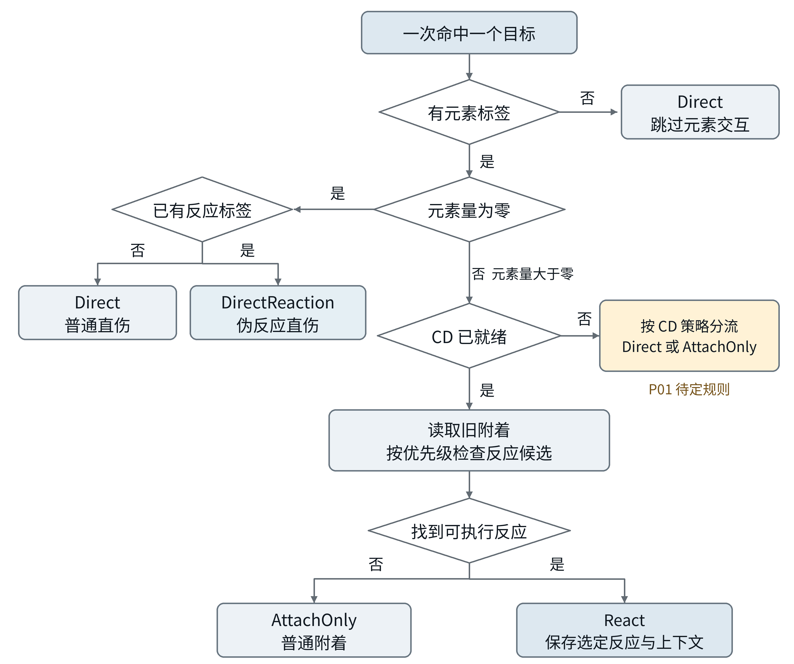
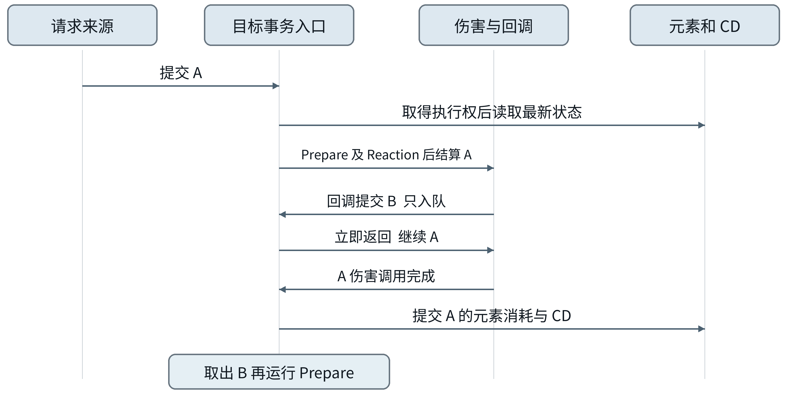
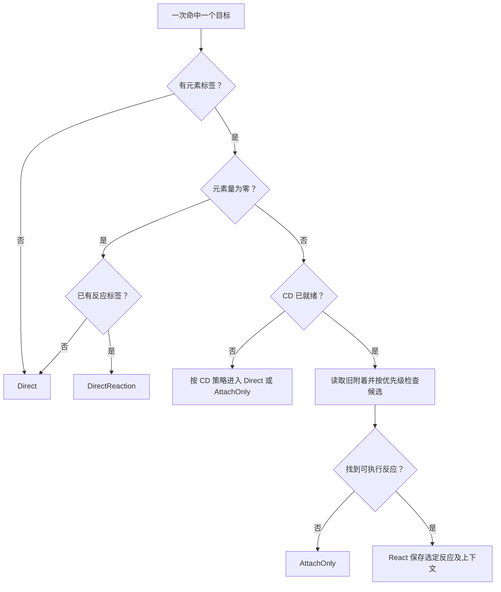

# 元素反应结算系统设计草案

> 转写留存：2026-10-23，来源为同目录同名 Word。以下保留原稿内容（包括已明确的 CD 公式与仍标为待定的 P01），不将补充需求混入原文。实体字段补充、与现有实现的衔接及待确认问题见 [TODO.md](TODO.md#元素反应结算系统-v01-2026-10-23-纳入设计)。图片保留原稿资源。

版本 v0.1    日期 2026年10月23日    适用对象 tModLoader 模组开发

## 1 设计目标与基线

系统采用 Prepare、Reaction、Calculate 三个模块。前置阶段确定处理路线、反应规则、标签和参数，实际计算使用已经确定的输入。目标元素与 CD 的一次完整事务串行执行，保留本击伤害完成后扣除元素并更新 CD 的结算顺序。

现有底层计算模块、乘区规则，以及元素、反应、具有异化能力、已经异化等标签继续使用。本草案规定上层调度与状态交互，不重定义已有伤害公式。文中接口名称为拟定标识。

### 已确定的行为

D01 无元素标签时跳过元素交互，保留合法计算输入并直接结算。

D02 有元素标签且元素量为零时，已有反应标签走伪反应直伤，否则走普通直伤。

D03 伪反应直伤仅获得相应反应加成和提示字，不发生真实反应、不触发反应效果、不增加反应计数。

D04 正元素量通过 CD 资格检查后，按优先级选择满足执行条件的反应；未匹配时执行 AttachOnly。

D05 反应与异化标签在实际伤害计算前确定，计算过程中不重新选反应或临时补标签。

D06 同一目标的后续事务必须等待当前事务完成；允许在同一游戏刻继续处理。

### 模块职责

| 模块 | 职责 | 输出 |
| --- | --- | --- |
| Prepare | 检查资格并选择处理路线 | 路线及选定反应 |
| Reaction | 执行规则并准备最终标签与状态变化 | 固定伤害输入与结算方案 |
| Calculate | 计算和应用伤害，完成状态提交及结果输出 | 伤害结果与反应结果 |

阅读约定：D 为已确定行为；正文中的实现约束为本草案建议采用的工程约定；P 为尚待确定的玩法或接入规则。

## 2 数据与标签契约

同一个反应类型标识可以被计算输入和真实反应结果复用，但二者的语义独立。计算与表现读取伤害分类；反应计数和反应副作用读取本次实际执行结果。

| 拟定数据 | 必要内容 | 用途 |
| --- | --- | --- |
| HitRequest | 目标、来源、伤害输入、元素量、请求标识 | 尚未根据目标状态解析的完整命中请求 |
| DamageInput | 既有基础数值、乘区参数和标签 | 传入现有计算模块的最终输入 |
| ElementState | 目标元素量、CD 及所属分组 | 统一入口管理的已提交状态 |
| PrepareResult | Direct、DirectReaction、AttachOnly 或 React；选定反应 | 决定后续执行路径 |
| ReactionPlan | 最终标签、状态变化、消耗与 CD 修正、产物 | Reaction 输出的待执行方案 |
| ReactionOutcome | 实际反应类型、来源、目标、结果标识 | 成功按规则提交后的真实反应事实 |
| PresentationRequest | 提示字类型、位置、关联请求 | 独立驱动表现，不制造反应事件 |

### 标签与事件的关系

| 信息 | 允许承担的职责 | 不能据此推导的事实 |
| --- | --- | --- |
| 元素标签 | 选择元素相关计算规则 | 本击具有有效元素量 |
| 反应标签 | 选择反应加成和伤害分类 | 本次实际发生了反应 |
| 具有异化能力 | 参与既有异化资格规则 | 允许无元素量伤害进入真实反应 |
| 已经异化 | 描述既有异化状态或来源 | 本次又发生了一次异化或反应 |

Prepare 选到 React 仅代表本次获准执行所选规则。ReactionOutcome 在有效提交后产生；Direct、DirectReaction、AttachOnly 均不因伤害标签而生成这一记录。一次反应产生多笔伤害，也不会由此自动增加多次反应计数。

## 3 Prepare 决策树

决策以一次实际命中一个目标为单位。进入读取目标状态的分支前，应已取得该目标的事务执行权。输入元素量按非负数处理；输入一致性校验见下一节。



图 1  Prepare 路线选择  黄色节点表示尚未定案的 CD 语义

CD 未就绪时的分支由 P01 决定。图中不默认为某一种玩法；实现前需要明确 CD 是否同时禁止附着。该节点最终映射到已有的 Direct 或 AttachOnly 路线。

## 4 Prepare 分支规则

| 路线 | 后续处理 | 元素与反应结果 |
| --- | --- | --- |
| Direct | 直接进入 Calculate | 不产生新的元素交互或真实反应；保留合法输入标签 |
| DirectReaction | 直接进入 Calculate，并请求对应提示字 | 零元素量，不检查正元素量分支的 CD，不消费附着，不产生真实反应 |
| AttachOnly | 由 Reaction 准备普通附着方案，再结算 | 执行叠加、覆盖或残留规则；不产生真实反应计数 |
| React | 由 Reaction 准备选定反应及异化方案，再结算 | 提交成功后形成真实反应结果 |

### 反应优先级

按优先级遍历候选，并逐项检查最终执行条件。高优先级候选不满足条件时继续检查下一项；所有候选均失败时进入 AttachOnly。凡是影响执行资格的资源要求、专属 CD 和异化前置条件，都需要在批准候选时检查清楚。

选定反应后保存必要上下文。后续使用本次方案，不在消耗完成后重新检查底元素是否仍存在，也不在伤害公式内部重新挑选反应。本版以选定一个反应为描述单位，多反应同击规则另行定义。

### P01 CD

| CD 定义 | 未就绪时 | AttachOnly 对该 CD 的影响 |
| --- | --- | --- |
| 附着和反应共用门禁 | Direct | 按共用资格规则开启或更新 |
| 只限制反应 | AttachOnly | 普通附着不自动开启反应 CD |

CD 的分组维度、最终时长及更新方式也属于 P01：可以按目标、来源、反应类型或明确组合定义；增加剩余时长、重置时长、记录下次允许时刻不能混用为同一语义。

CD为倒计时，不等于0时不允许反应；反应后，执行CD+=BaseCD*Multipier，其中BaseCD为这种反应的基础CD，Multipier为反应CD修正

### 建议的输入校验

在请求创建时检查负元素量、缺失必要元素标识、标签组合冲突等配置错误。有效输入进入上述决策树；非法数据应明确报告，不能悄悄转换成另一条正常路线。合法的已有计算标签在直接放行时保留。

## 5 Reaction 与 Calculate 的执行协议

Reaction 负责调用选定规则并准备数据。将反应标签和异化标签的最终写入放在该阶段收尾；Calculate 内部的数学函数读取固定输入。Calculate 的结算外壳负责与引擎伤害入口、元素状态提交和表现输出衔接。

1 取得目标事务执行权后，Prepare 读取旧附着和 CD，确定路线及可执行反应。

2 Reaction 根据所选规则确定异化结果、最终标签、附着方式、消耗量、CD 修正和固有产物。

3 准备本次工作状态。若规则要求在伤害前执行附着，可先在事务内部执行；外部请求不得读取未完成状态并获得新资格。

4 冻结交给计算器的标签与参数，计算并应用本击伤害。期间产生的后续元素事务只入队。

5 伤害完成后，根据有效结算结果应用既定消耗和 CD 修正，提交最终元素状态与 CD。

6 按有效提交结果形成 ReactionOutcome。反应计数与外部反应效果由该结果驱动；表现输出独立处理。

7 当前事务结束，调度器继续处理后续请求。下一个请求重新读取已经提交的状态。

阶段 5 保留伤害后提交的设计。消耗或 CD 修正若依赖本击暴击、伤害结果，需要在方案中显式描述这种依赖；计算后只求得所需结果，不重新选反应或改写已用于本击的标签。若结果依赖还可能改变反应资格，应在 P02 中明确判定方式，不能在伤害已经应用后因资源不足而重新选择反应。

### 异化处理位置

| 异化影响 | 处理位置 |
| --- | --- |
| 反应种类、资格、消耗或产物 | 资格条件进入 Prepare；具体变换与状态方案由 Reaction 确定 |
| 伤害分类、乘区参与方式 | Reaction 组装最终伤害输入时确定 |
| 提示字、颜色、视觉效果 | 输出表现请求时确定 |

异化两标签是否互斥、能否重复异化、限制作用于单击还是整条攻击链，尚待 P03 定义。伪反应继承异化伤害性质时，也不因此产生真实反应事件。

## 6 同目标事务与队列

同一 NPC 或 Player 的互斥范围从 Prepare 读取元素和 CD 开始，一直覆盖到伤害结束后的状态提交。只保护最后几行扣量代码，会允许多个请求提前读取旧状态并重复获得反应资格。



图 2  A 的回调产生 B 时的执行顺序  全部步骤可处于同一游戏刻

| 目标级数据 | 作用 |
| --- | --- |
| ElementState | 保存已提交的元素和 CD，受统一访问约定保护 |
| IsResolving | 表示该目标当前有事务处理，阻止同目标请求递归执行 |
| PendingRequests | 保存尚未运行 Prepare 的请求，按约定顺序取出 |

新请求先入队。目标忙碌时提交调用立即返回；目标空闲时启动处理循环。每完成一个请求就继续取下一个，队列清空后退出。等待表示后续操作排队，不表示在当前回调里阻塞线程。

C# lock 允许同一线程再次进入同一把锁，不能单独阻止同步回调造成的重入。[1] 需要最新提交状态才能执行的逻辑应一起入队；普通展示可读取最后一次已提交快照。

队列不推进游戏时间。时间型 CD 以统一游戏时间判断就绪；同刻处理多个请求不能按请求次数自然递减。派生链必须有限，才能在当前循环中处理完成。

## 7 状态访问与 tModLoader 接入

### 统一管理读写入口

附着、消耗、叠加、衰减、清除、CD 修改和死亡重置，均遵守同一访问约定。下一次反应的资格判断只能在取得执行权后读取状态。所有状态字段的写入应封装，禁止旁路修改。

NPC 可使用启用 InstancePerEntity 的 GlobalNPC 保存独立状态；玩家可用对应 ModPlayer 保存模组字段。[2][3] 出队时检查目标仍有效且身份未变，避免把旧索引上的请求作用于后来复用该位置的实体。

### 完整伤害入口

公开弹幕命中代码按同步调用执行修正、StrikeNPC 和命中后回调，NPCLoader 也同步分发对应钩子。[4][5] 因此，自家协同和额外命中应在进入实际伤害调用前通过事务入口。不能在 ModifyHit 钩子中先返回，再于队列执行时补改已经被引擎使用的伤害修正。

标准钩子用于规定的阶段：GlobalNPC 文档要求 ModifyHitByProjectile 主要修改 HitModifiers，额外副作用放在 OnHit 类钩子。[2] 为其他原生或第三方伤害路径提供接入时，需要逐条确认完整调用范围，不能仅凭一对同名钩子假设事务已经闭合。

### 取消死亡与异常收尾

ModPlayer.OnHurt 在扣血前调用，PostHurt 仅在玩家存活时调用；HurtModifiers.Cancel 会使 OnHurt 等后续钩子不再执行。[3][6] 因此，不能只用 ModifyHurt 开始、PostHurt 结束来管理事务。

完整入口需要覆盖成功、取消、致死和异常路径，并用明确的退出逻辑解除处理状态。try/finally 可防止忙碌标志永久残留，但不会自动撤销已经发生的伤害、掉落或网络副作用。取消和致死命中是否提交元素及 CD，按 P04 的玩法规则决定。

### 执行端与共享资源

建议自定义元素事务在统一游戏更新线程执行，其他线程只投递请求。tModLoader 的部分命中钩子按客户端或弹幕归属选择执行端。[2][3] 本地队列只保证本端顺序；联机仍需确定状态裁决端、同步与去重方式。

若一次反应还修改攻击者共享资源，保护范围需包含那份资源。跨目标回调应遵守同样的非阻塞提交约定；同目标队列不能自动提供跨多个状态对象的完整事务隔离。

## 8 伪反应直伤与派生效果

伪反应直伤是一笔有元素伤害、元素量为零的直接伤害。它携带反应分类，使用现有计算模块取得对应加成并请求反应提示字；本次真实反应结果始终为空。它不参与正元素量分支的 CD 检查或更新。

### 派生请求的构造

| 信息 | 构造约定 |
| --- | --- |
| 归属与来源 | 明确记录攻击者、产生该请求的效果及必要父请求标识 |
| 基础数值 | 指定原始伤害输入、属性来源或明确的计算阶段 |
| 元素与反应分类 | 由派生规则明确给出，交给现有计算器 |
| 异化标签 | 继承策略待 P03 与 P05 定义，不默认整包复制 |
| 元素量与附着 | 该类伪反应请求固定为零，不携带新的附着资格 |
| 真实反应记录 | 不继承为子命中的反应事实；可保留因果来源用于追踪 |
| 触发资格 | 反应副作用禁止；普通命中效果按尚待确定的派生规则处理 |

### 避免重复结算乘区

如果设计为按原始输入派生，子伤害的基础值来自父攻击的原始伤害种子，再应用子攻击自己的倍率与修正。下式中 B 为原始伤害，r 为派生比例，M 为子伤害按既有规则得到的综合修正。


式 1  按原始输入独立结算的派生伤害

例如 B 为 100、派生比例为 50%、子攻击综合修正为 2，子伤害为 100。若把父攻击已经结算出的 200 再当作新白值乘一遍，会重复应用修正。若玩法确实复制最终伤害的一定比例，应另行规定子伤害仍参与哪些乘区。

### 事件与表现

反应计数与反应触发效果只读取真实反应结果。任何仅凭伤害上的反应标签触发玩法副作用的监听器，都不符合伪反应定义。提示字单独输出；合并或限频只影响显示，不影响计数。普通命中效果、自身协同循环、不同派生效果之间的串联规则由 P05 决定。

## 9 行为验收场景

以下为后续实现应验证的行为，不代表已经运行过测试。涉及待定规则的场景，应先确定对应 P 项，再补充具体预期数值。元素量、CD 和计数的断言均针对本击自身的元素处理；普通命中监听器产生的独立请求应单独验证。

| 编号 | 场景 | 应观察到的行为 |
| --- | --- | --- |
| A01 | 无元素标签 | 直接使用合法输入计算，不进入新的元素交互 |
| A02 | 有元素标签且元素量为零，无反应标签 | 普通直伤，不修改元素量或反应 CD |
| A03 | 零元素量且有反应标签，目标带可反应元素 | 获得反应加成和提示；底元素、反应 CD、反应计数不因本击改变 |
| A04 | 正元素量、CD 就绪，无匹配反应 | 执行 AttachOnly；元素按规则附着，不生成真实反应计数 |
| A05 | 最高优先级候选不满足执行条件 | 继续检查下一候选；全部失败才 AttachOnly |
| A06 | 反应消耗恰好使底元素归零 | 本击继续使用已经确定的反应标签，不因提交后状态变化失去资格 |
| A07 | A 的伤害回调对同一目标产生 B | B 先入队；A 扣量与 CD 更新完成后，B 才运行 Prepare |
| A08 | 一次真实反应生成多笔伪反应伤害 | 只有真实结果进入反应计数；子伤害不重复计数 |
| A09 | 同一游戏刻处理多条请求 | 请求读取前序提交结果；时间型 CD 不按请求数量自然递减 |
| A10 | 取消、致死或异常退出 | 按明确规则提交或取消，处理状态有完整收尾；后续请求不会永久等待 |
| A11 | 目标失效或实体索引被复用 | 排队请求不会误作用于不同身份的实体 |
| A12 | 派生复制与属性继承 | 伤害来源和乘区阶段明确，不重复叠加父伤害已经结算的修正 |

伪反应伤害是否允许触发吸血、普通装备命中效果等，不能从 A03 推导；这属于 P05。CD 未就绪时的附着预期由 P01 决定。

## 10 待定规则清单

以下事项需要在对应功能实现前明确。它们不阻止先建立三模块接口、目标状态封装和事务入口，但不能由实现中的默认分支悄悄决定。

| 编号 | 事项 | 需要确定的内容 |
| --- | --- | --- |
| P01 | CD 语义 | 是否同时限制附着；未就绪分支；AttachOnly 是否更新；按目标、来源或反应如何分组；增加、重置或截止时刻的语义 |
| P02 | 反应与附着规则 | 反应列表和优先级；元素消耗及修正公式；叠加、覆盖、衰减和残留规则；哪些修正作用于本击 |
| P03 | 异化语义 | 两标签能否并存；异化改变哪些规则；能否再次异化；限制范围是单击、弹幕还是攻击链；派生继承方式 |
| P04 | 提交与计数条件 | 取消、闪避、免疫、零伤害、致死时是否提交附着、消耗和 CD；真实反应是否计数；按目标、命中或技能如何归并；提示字条件 |
| P05 | 派生行为 | 普通命中效果资格；自身协同和跨效果循环；基础数值取自哪个阶段；属性快照时机；标签与来源继承清单 |
| P06 | 多元素与多反应 | 同一命中的多个元素申请如何拆分；已有反应标签与新真实反应的组合；是否允许一击多个真实反应 |
| P07 | 引擎与联机 | 项目采用的 TML 版本和完整伤害入口；原版与第三方兼容范围；元素状态裁决端、结果同步及去重 |
| P08 | 共享资源范围 | 反应同时修改玩家共享资源或跨目标状态时的串行范围，以及跨目标后续请求顺序 |

### 明确保留的边界

具有异化能力与已经异化不被预设为互斥；零元素量伪反应不因这些标签而获得真实反应资格；不触发反应效果不等于禁止所有普通命中效果。

本草案不指定任何具体反应倍率、CD 时长或元素消耗常数，也不把串行队列视为生命、掉落及网络副作用的自动回滚机制。

## 11 实现安排与参考依据

### 建议实施顺序

1 固定数据边界：保留现有 DamageInput，新增明确路线与真实结果字段，封装目标元素和 CD。

2 建立完整事务入口及同目标队列，覆盖 AttachOnly 和各类状态修改；先验证重入顺序。

3 按决策树实现 Prepare，并落实 P01；通过可执行条件检查后才批准优先级候选。

4 接入 Reaction 方案生成与 Calculate 结算外壳，保证标签先确定、伤害后提交状态。

5 接入伪反应与派生效果，分别验证加成、提示、计数、来源和普通命中触发资格。

6 按选定 TML 版本核对取消、死亡、异常、实体生命周期及联机路径。

### 实现约束的公开依据

以下来源用于核对语言与引擎接口约束；本系统的玩法规则以本设计文档的决策项为准。查阅日期为 2026年10月23日。

[[1] Microsoft C# lock statement](https://learn.microsoft.com/en-us/dotnet/csharp/language-reference/statements/lock)
同一线程可以重复取得同一把锁；线程互斥不能单独替代本设计的回调排队。

[[2] tModLoader GlobalNPC stable API](https://docs.tmodloader.net/docs/stable/class_global_n_p_c.html)
InstancePerEntity、ModifyHitByProjectile、OnHitByProjectile 及钩子执行端说明。

[[3] tModLoader ModPlayer stable API](https://docs.tmodloader.net/docs/stable/class_mod_player.html)
玩家自定义状态；OnHurt、PostHurt 的调用条件与客户端执行说明。

[[4] tModLoader Projectile 命中补丁](https://github.com/tModLoader/tModLoader/blob/c9545cf27d56c456321e1896274c02adf67d0140/patches/tModLoader/Terraria/Projectile.cs.patch)
已核对的 stable 提交中，弹幕伤害修正、StrikeNPC 和命中后钩子的调用位置。

[[5] tModLoader NPCLoader 调度代码](https://github.com/tModLoader/tModLoader/blob/c9545cf27d56c456321e1896274c02adf67d0140/patches/tModLoader/Terraria/ModLoader/NPCLoader.cs)
ModifyHitByProjectile 和 OnHitByProjectile 的同步分发方式。

[[6] tModLoader Player HurtModifiers stable API](https://docs.tmodloader.net/docs/stable/struct_player_1_1_hurt_modifiers.html)
Cancel 后不再调用部分后续受伤钩子。

## 附录 A 决策树源文本

下面的 Mermaid 文本与图 1 对应，可用于后续开发文档。CD 未就绪的走向保留待定标记；P01 明确后，将该节点替换为确定的 Direct 或 AttachOnly 分支。



## 附录 B 事务入口的流程约定

以下是接口行为说明，不是可直接接入 TML 的代码。成功提交、取消和异常处理须结合 P04 与具体引擎入口实现。

```text
# 编写日期 2026-10-23
# 用途 同目标事务调度的行为说明
提交请求到目标队列
若目标正在结算
    返回已受理 不同步等待最终结果
否则取得目标执行权
    循环取出尚未解析的请求
        校验目标身份和请求有效性
        Prepare 读取最新已提交状态并选定路线
        Reaction 准备最终标签及状态方案
        Calculate 计算并应用本击伤害
        按有效结果提交元素消耗和 CD
        输出真实结果及独立表现请求
    队列清空后退出
所有退出路径均完成规定的事务收尾
```

版本记录：v0.1 首次成稿，包含三模块分工、Prepare 决策树、后提交事务顺序、派生伤害边界、引擎约束、验收场景和待定事项。
